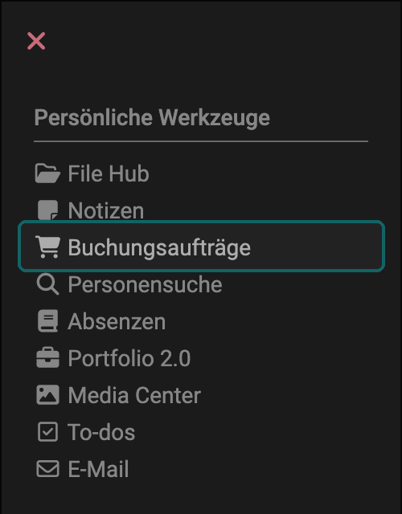
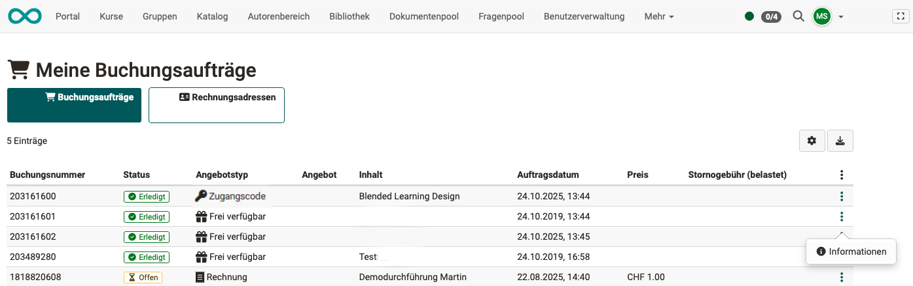

# Persönliche Werkzeuge: Buchungsaufträge {: #bookings}

{ class="aside-right lightbox" }

Unter "Buchungsaufträge" im Bereich "Persönliche Werkzeuge" finden Benutzer:innen eine Übersicht all ihrer gebuchten Kurse und Lernressourcen. Dabei erscheinen nur die Kurse und Lernressourcen, die mit einer [Angebotsart](../learningresources/Access_configuration.de.md) verknüpft sind, z.B. mit einem Zugangscode, und für die ein Buchungsauftrag der Benutzer:innen besteht. Das gilt auch, wenn eine andere Person die Buchung für sie vorgenommen hat. Buchen kann dabei als Synonym für "belegen", "einschreiben" oder "einkaufen" verstanden werden.

Lernressourcen, bei denen die Besitzer:innen die Teilnehmenden manuell eintragen oder bei denen Teilnehmende über eine Gruppe zugeordnet werden, erscheinen hier *nicht*.

{ class="shadow lightbox" title="Buchungsaufträge in den Persönlichen Werkzeugen" }

Wählen Sie über das Zahnrad die Spalten aus, die Sie sehen möchten, z.B. den Angebotstyp ("Zugangscode", "Frei verfügbar", "Rechnung", PayPal), das Angebot und den Inhalt (die gebuchte Lernressource). OpenOlat legt bei jeder Buchung automatisch eine Buchungsnummer an, unter der dieser Buchungsauftrag verwaltet wird. Diese ist ebenfalls hier ersichtlich.

Über das Download-Icon rechts neben dem Zahnrad laden Sie alle Buchungsaufträge als Tabelle herunter. Über "Informationen" im 3-Punkte-Menü einer Buchung öffnen Sie den Dialog "Buchung" mit den Detailinformationen zu diesem Buchungsauftrag. Verwendete das gebuchte Angebot Formulare, zeigt der Dialog auch die ausgefüllten Formulare. [:octicons-tag-16:{ title="ab Release 21.1 (OO-9742)" }](https://track.frentix.com/issue/OO-9742){:target="_blank"}

Stornieren oder einen Kurs verlassen können Sie hier nicht. Eine Buchung stornieren Sie auf der Infoseite der Durchführung, die Sie über den Katalog öffnen: `Katalog > "Ihre Durchführung" > Mehr erfahren > Kasten "Los geht's" > Buchung stornieren`. Wann die Schaltfläche erscheint, beschreibt [Infoseite: Buchung stornieren](../learningresources/General_Functions_Infopage.de.md#cancel_booking). Einen Kurs verlassen Sie im Kasten "Mein Kurs" seiner Infoseite, siehe [Infoseite: Kurs verlassen](../learningresources/General_Functions_Infopage.de.md#leave_course).

Ist die Angebotsart "Rechnung" eingeschaltet, erscheint zusätzlich der Tab "Rechnungsadressen". Dort sehen Sie die Rechnungsadressen, die für Ihre Buchungen hinterlegt sind. Rechnungsadressen von Organisationen pflegen [Administrator:innen](../../manual_admin/administration/Modules_Organisations.de.md).

Die Möglichkeit zur Buchung erscheint ferner im [Katalog](../area_modules/catalog2.0_angebote.de.md#offers_create), sofern das entsprechende Angebot dort veröffentlicht wurde. Den Ablauf der Buchung beschreibt [Katalog 2.0 - Angebote](../area_modules/catalog2.0_angebote.de.md#offer_booking).

## Weiterführende Informationen {: #further_information}

[Zugangskonfiguration / Freigabe >](../learningresources/Access_configuration.de.md) 
[Allgemeine Funktionen: Infoseite >](../learningresources/General_Functions_Infopage.de.md) 
[Modul Organisationen >](../../manual_admin/administration/Modules_Organisations.de.md) 
[Katalog 2.0 - Angebote >](../area_modules/catalog2.0_angebote.de.md) 
[Mitgliederverwaltung >](../learningresources/Members_management.de.md)

[Zum Seitenanfang ^](#bookings)
