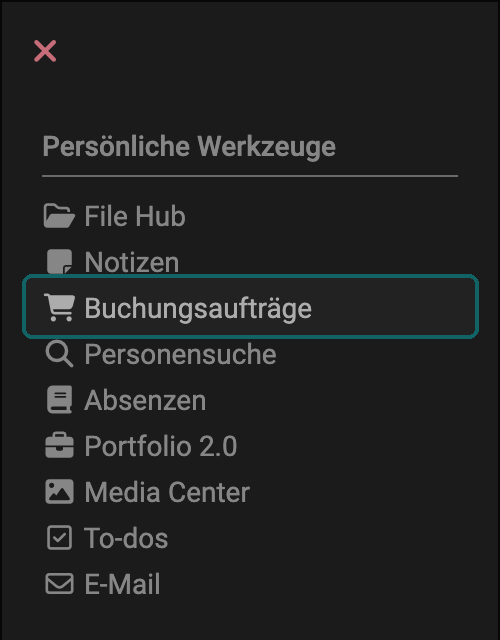
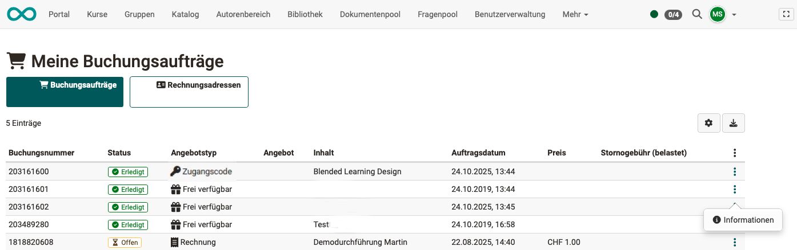

# Persönliche Werkzeuge: Buchungsaufträge {: #bookings}

{ class="aside-right lightbox" }

Wollen Sie nachsehen, was Sie gebucht haben und in welchem Status eine Buchung steht, öffnen Sie die Buchungsaufträge: `Persönliches Menü > Persönliche Werkzeuge > Buchungsaufträge`. Die Übersicht zeigt alle Kurse und Lernressourcen, die mit einer [Angebotsart](../learningresources/Access_configuration.de.md) verknüpft sind, zum Beispiel "Zugangscode", und für die ein Buchungsauftrag für Sie besteht. Das gilt auch, wenn eine andere Person die Buchung für Sie vorgenommen hat. "Buchen" steht dabei für Belegen, Einschreiben und Einkaufen.

Lernressourcen, in die Besitzer:innen Sie direkt eintragen oder in die Sie über eine Gruppe kommen, fehlen in dieser Liste, weil dabei kein Buchungsauftrag entsteht.

{ class="shadow lightbox" title="Buchungsaufträge in den Persönlichen Werkzeugen" }

Über das Zahnrad wählen Sie die Spalten, die Sie sehen möchten, etwa den Angebotstyp ("Zugangscode", "Frei verfügbar", "Rechnung", PayPal), das Angebot und den Inhalt, also die gebuchte Lernressource. Bei jeder Buchung vergibt OpenOlat eine Buchungsnummer, unter der es den Buchungsauftrag führt. Auch diese Nummer zeigt die Tabelle.

Über das Download-Icon rechts neben dem Zahnrad laden Sie alle Buchungsaufträge als Tabelle herunter. Über "Informationen" im 3-Punkte-Menü einer Buchung öffnen Sie den Dialog "Buchung" mit den Detailinformationen zu diesem Buchungsauftrag. Verwendete das gebuchte Angebot Formulare, zeigt der Dialog auch die ausgefüllten Formulare. [:octicons-tag-16:{ title="ab Release 21.1 (OO-9742)" }](https://track.frentix.com/issue/OO-9742){:target="_blank"}

Eine Buchung stornieren und einen Kurs verlassen Sie auf der Infoseite, nicht in den Buchungsaufträgen. Für die Stornierung öffnen Sie die Infoseite der Durchführung im Katalog: 
`Katalog > "Ihre Durchführung" > Mehr erfahren > Kasten "Mein Bildungsprodukt" > Buchung stornieren`

Ist die Durchführung vom Typ Einzelkurs, heisst der Kasten "Mein Kurs". Ob die Schaltfläche erscheint, legt das Angebot fest, siehe [Infoseite: Buchung stornieren](../learningresources/General_Functions_Infopage.de.md#cancel_booking). Einen Kurs verlassen Sie im Kasten "Mein Kurs" seiner Infoseite, siehe [Infoseite: Kurs verlassen](../learningresources/General_Functions_Infopage.de.md#leave_course).

Ist die Angebotsart "Rechnung" eingeschaltet, erscheint zusätzlich der Tab "Rechnungsadressen". Dort sehen Sie die Rechnungsadressen, die für Ihre Buchungen hinterlegt sind. Rechnungsadressen von Organisationen pflegen [Systemadministrator:innen](../../manual_admin/administration/Modules_Organisations.de.md).

Buchen können Sie im [Katalog](../area_modules/catalog2.0_angebote.de.md#offers_create), wenn das Angebot dort veröffentlicht ist. Den Ablauf der Buchung beschreibt [Katalog 2.0 - Angebote](../area_modules/catalog2.0_angebote.de.md#offer_booking).

## Weiterführende Informationen {: #further_information}

[Zugangskonfiguration / Freigabe >](../learningresources/Access_configuration.de.md) 
[Allgemeine Funktionen: Infoseite >](../learningresources/General_Functions_Infopage.de.md) 
[Modul Organisationen >](../../manual_admin/administration/Modules_Organisations.de.md) 
[Katalog 2.0 - Angebote >](../area_modules/catalog2.0_angebote.de.md) 
[Mitgliederverwaltung >](../learningresources/Members_management.de.md)

[Zum Seitenanfang ^](#bookings)
