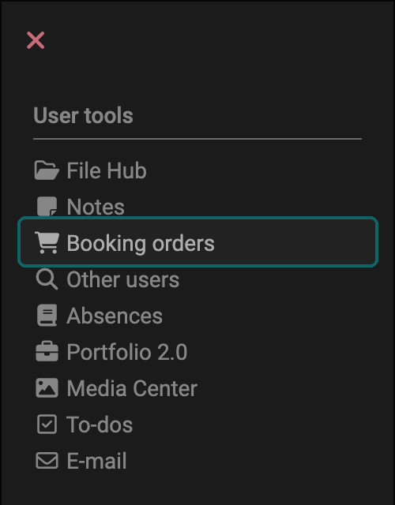
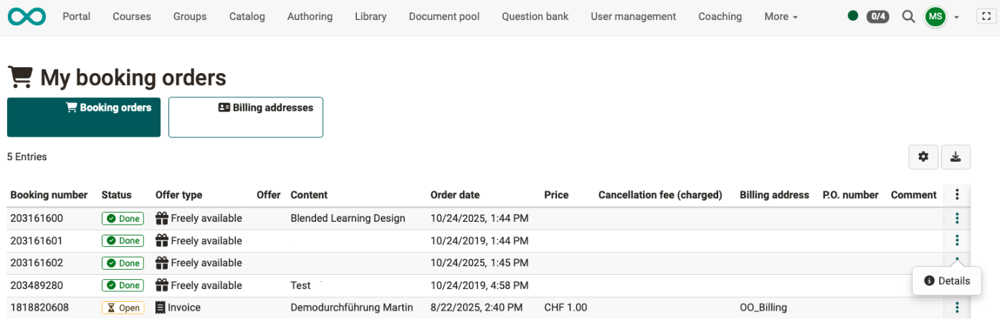

# User tools: Booking orders {: #bookings}

{ class="aside-right lightbox" }

If you want to check what you have booked and which status a booking has, open the booking orders: `Personal menu > User tools > Booking orders`. The overview shows all courses and learning resources that are linked to an [offer type](../learningresources/Access_configuration.md), for example "Access code", and for which a booking order exists for you. This also applies if another person made the booking for you. "Booking" stands for enrolling, registering and purchasing.

Learning resources in which owners enter you directly or which you join via a group are missing from this list, because no booking order is created in that case.

{ class="shadow lightbox" title="Booking orders in the User tools" }

Use the cogwheel to select the columns you want to see, for example the offer type ("Access code", "Freely available", "Invoice", PayPal), the offer and the content, that is the booked learning resource. With every booking, OpenOlat assigns a booking number under which it keeps the booking order. The table shows this number too.

Use the download icon to the right of the cogwheel to download all booking orders as a table. Use "Details" in the 3-dot menu of a booking to open the dialog "Booking" with the detail information on this booking order. If the booked offer used forms, the dialog also shows the completed forms. [:octicons-tag-16:{ title="from Release 21.1 (OO-9742)" }](https://track.frentix.com/issue/OO-9742){:target="_blank"}

You cancel a booking and leave a course on the info page, not in the booking orders. To cancel, open the info page of the implementation in the catalog: 
`Catalog > "Your implementation" > Learn more > Box "My educational product" > Cancel booking`

If the implementation is of type Single course, the box is called "My course". Whether the button appears is set by the offer, see [Info page: Cancel booking](../learningresources/General_Functions_Infopage.md#cancel_booking). You leave a course in the box "My course" of its info page, see [Info page: Leave course](../learningresources/General_Functions_Infopage.md#leave_course).

If the offer type "Invoice" is enabled, the additional tab "Billing addresses" appears. There you see the billing addresses stored for your bookings. [System administrators](../../manual_admin/administration/Modules_Organisations.md) maintain the billing addresses of organisations.

You book in the [catalog](../area_modules/catalog2.0_angebote.md#offers_create) if the offer is published there. The booking process is described in [Catalog 2.0 - Offers](../area_modules/catalog2.0_angebote.md#offer_booking).

## Further information {: #further_information}

[Access configuration >](../learningresources/Access_configuration.md) 
[General Functions: Info Page >](../learningresources/General_Functions_Infopage.md) 
[Module Organisations >](../../manual_admin/administration/Modules_Organisations.md) 
[Catalog 2.0 - Offers >](../area_modules/catalog2.0_angebote.md) 
[Members management >](../learningresources/Members_management.md)

[To the top of the page ^](#bookings)
