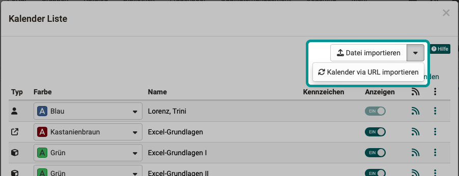

# Persönliche Werkzeuge: Kalender {: #calendar}

{ class="aside-right lightbox" }

:fontawesome-regular-calendar-days:

Die Kalenderfunktion steht Ihnen an verschiedenen Orten zur Verfügung:

* In der [Gruppe](../groups/Using_Group_Tools.de.md):  Zugriff auf den Gruppenkalender, sowie eventuell externe importierte Kalender.

* Im [Kurs](../area_modules/Courses.de.md):  Zugriff auf Kurstermine, sowie Zugriff auf alle Kalender von eingebundenen Gruppen. Kurskalender können sowohl in einem Kursbaustein als auch in der Toolbar eingebunden sein. 

{ class="shadow lightbox" title="Toolbar und Kursmenü eines Kurses" }

 :octicons-device-camera-video-24: **Video-Einführung**: [Kurskalender](<https://www.youtube.com/embed/tfx6UCYw8t8>){:target="_blank"}

* Im [persönlichen Menü](../personal_menu/index.de.md) [(Persönliche Werkzeuge)](../personal_menu/Personal_Tools.de.md):  Im persönlichen Kalender können zusätzlich zu den persönlichen Terminen alle Termine aus Ihren verschiedenen Kursen und Gruppen, in denen Sie Mitglied sind, zusammengeführt werden. Sie erhalten so eine Übersicht. Auch externe Kalender können nach individuellem Bedarf importiert werden.

{ class="shadow lightbox" title="Verschachtelung der Kalender" }

!!! info "Wichtig"

    Wenn Sie in der Liste Ihrer persönlichen Werkzeuge keinen Kalender finden, haben Administrator:innen ihn in der System-Administration ausgeschaltet: 
    `Administration > Core-Konfiguration > Kalender`

[Zum Seitenanfang ^](#calendar)

---

## Termin erstellen / bearbeiten {: #create_entry}

Um einen neuen Termin hinzuzufügen, klicken Sie in das entsprechende Kalenderfeld. Es öffnet sich ein Popup für die Termindetails.

{ class="shadow lightbox" title="Dialog Termindetails" }

1. Wenn Sie Gruppenmitglied sind, wählen Sie zuerst oben im Feld "Kalender", in welchem Kalender Sie den Termin erstellen (persönlicher Kalender oder Gruppenkalender).

2. Zu den "Termindetails" gehört zwingend ein Titel.

3. Auch ein Start- und Enddatum ist eine Pflichtangabe. Mit dem Toggle-Button können die Uhrzeit-Felder ausgeblendet werden und es werden ganztägige Termine erstellt.

4. Für Wiederholungen wählen Sie eine der Optionen des Auswahlfeldes.

5. Im Feld "Ort" halten Sie fest, wo der Termin stattfindet.

6. Mit dem Auswahlfeld "Farbe" geben Sie diesem Termin eine eigene Farbe.

7. Im Feld "Beschreibung" ergänzen Sie weitere Angaben zum Termin.

8. Welche Details zu einem Termin für wen angezeigt werden, ist im Abschnitt [Sichtbarkeit](#visibility) beschrieben.

9. Links können Sie erst hinzufügen, nachdem der Termin erstellt wurde. Speichern Sie einfach den bestehenden Termin und bearbeiten Sie ihn erneut. Dann wird Ihnen unter "Links" ein Button "Link hinzufügen" angezeigt.

Einen Termin bearbeiten oder löschen Sie nachträglich, indem Sie auf den Termin und anschliessend auf die Schaltfläche "Bearbeiten" klicken.

Ein Termin kann auch mit Drag&Drop verschoben werden.

!!! info "Wichtig"

    Verknüpfungen zu Kursbausteinen können nur im Kurskalender erstellt werden. Bei den anderen Kalendern erscheint der Kommentar: _Keine Verknüpfung möglich_.

!!! danger "Achtung"

    Die Schaltfläche "Termin löschen" in den Termindetails löscht den Termin endgültig. Der Termin kann nicht wiederhergestellt werden!

[Zum Seitenanfang ^](#calendar)

---

## Wiederholung (Serientermine) {: #recurring_events}

Für einen Termin, der regelmässig stattfindet, legen Sie eine Serie an, statt jeden Termin einzeln zu erfassen. Wählen Sie dazu in den Termindetails unter "Wiederholung", wie oft sich der Termin wiederholt. Sobald Sie eine Wiederholung wählen, erscheint das Pflichtfeld "endet am" für das Ende der Serie.

{ class="shadow lightbox" title="Dialog Termindetails, Feld Wiederholung" }

Auch Serientermine können Sie bearbeiten. Klicken Sie dazu im Kalender auf einen der Termine. Beim Speichern wählen Sie, ob die Änderung für alle Termine der Serie oder nur für den aufgerufenen Termin gilt. Gilt sie für alle Termine, ändert OpenOlat die Termine der Serie, die Sie zuvor nicht einzeln angepasst haben.

[Zum Seitenanfang ^](#calendar)

---

## Sichtbarkeit {: #visibility}

Mit dem Feld "Sichtbarkeit" in den Termindetails legen Sie fest, wer den Kalendereintrag sehen darf.

{ class="shadow lightbox" title="Dialog Termindetails, Feld Sichtbarkeit" }

Je nach Kalenderart (Persönlicher Kalender, Gruppenkalender, Kurskalender) unterscheiden sich die Auswirkungen der drei Sichtbarkeitsstufen "Privat", "Nur Zeitangabe sichtbar" und "Öffentlich":

|| Persönlicher Kalender| Gruppenkalender| Kurskalender
---|---|---|---
**Privat** | Nur die Person, die den Eintrag erstellt hat, darf den Kalendereintrag sehen, da der Kalender dieser Person zugewiesen wurde.| Nur Mitglieder der Gruppe, der dieser Kalender zugewiesen wurde, dürfen den Kalendereintrag sehen.| Nur Mitglieder des Kurses, dem dieser Kalender zugewiesen wurde, dürfen den Kalendereintrag sehen.
**Nur Zeitangabe sichtbar** | Da nur die Person, die den Eintrag erstellt hat, und niemand anderes den Eintrag sehen kann, haben diese Einstellungen in diesem Kontext keinen Effekt. | Alle Gruppen- bzw. Kursmitglieder sehen den Eintrag mit allen Angaben. Zusätzlich können alle in OpenOlat registrierten Personen oder Gäste mit Zugriff auf die Gruppe/den Kurs die Zeit des Eintrags aber keine weiteren Angaben sehen. | Alle Gruppen- bzw. Kursmitglieder sehen den Eintrag mit allen Angaben. Zusätzlich können alle in OpenOlat registrierten Personen oder Gäste mit Zugriff auf die Gruppe/den Kurs die Zeit des Eintrags aber keine weiteren Angaben sehen.
**Öffentlich** | Da nur die Person, die den Eintrag erstellt hat, und niemand anderes den Eintrag sehen kann, haben diese Einstellungen in diesem Kontext keinen Effekt. | Alle Gruppen- bzw. Kursmitglieder sehen den Eintrag mit allen Angaben. Zusätzlich können alle in OpenOlat registrierten Personen oder Gäste mit Zugriff auf die Gruppe/den Kurs alle Angaben des Eintrags sehen. | Alle Gruppen- bzw. Kursmitglieder sehen den Eintrag mit allen Angaben. Zusätzlich können alle in OpenOlat registrierten Personen oder Gäste mit Zugriff auf die Gruppe/den Kurs alle Angaben des Eintrags sehen.

[Zum Seitenanfang ^](#calendar)

---

## Inhalt {: #content}

Im persönlichen Kalender werden angezeigt:

1. Die selbst in diesem Kalender eingetragenen persönlichen Termine.
2. Andere eigenständige Kalender, die in der Kalenderliste für die gemeinsame Ansicht ausgewählt wurden.  Z.B. ein Gruppen- oder Kurskalender.
3. **Aggregierte Kalender**  Aggregierte Kalender haben ihrerseits Termine wieder aus mehreren verschiedenen Kalendern zusammengezogen. Bei aggregierten Kalendern ist zu beachten, dass OpenOlat nicht auflösen kann, woher die Termine ursprünglich kamen. Ein eingebundener aggregierter Kalender liefert diese Herkunftsinformation für die einzelnen Termine nicht mit, lediglich welche Kalender darin enthalten sind.

!!! info "Aggregierte Kalender"

    Ein aggregierter Kalender ist ein Sammelfeed, der alle Kalender und deren Termine enthält, auf die Sie Zugriff haben. Sie können diesen Feed von anderen Anwendungen aus verwenden, um alle Ihre OpenOlat-Termine dort einzufügen oder anzuzeigen. Dies erspart Ihnen die Arbeit, jeden Kalender einzeln einfügen zu müssen (siehe [OpenOlat-Kalender weitergeben](#share)). Über die 3 Punkte am Ende einer Zeile der Kalenderliste können Sie ferner Dateien und Kalender importieren sowie die Termine eines kompletten Kalenders zurücksetzen.

[Zum Seitenanfang ^](#calendar)

---

## Kalenderliste {: #list}

In der Kalenderliste bestimmen Sie, welche Kalender Sie gemeinsam sehen und in welcher Farbe. Sie öffnen sie mit dem Symbol "Einstellungen" :o_icon_o_icon_customize: in der Kopfzeile des Kalenders.

{ class="shadow lightbox" title="Kopfzeile des Kalenders" }

In der Kalenderliste finden Sie alle Kalender, die im aktuellen Kalender angezeigt werden können (Gruppe, Kurs, extern und persönlich).

{ class="shadow lightbox" title="Kalenderliste" }

Die Spalte "Typ" zeigt mit einem Symbol, um welche Art Kalender es sich handelt: persönlicher Kalender, Gruppenkalender, Kurskalender oder importierter externer Kalender.

Zur besseren Unterscheidung können Sie den Kalendern unterschiedliche Farben geben.

Bei Kurskalendern zeigt die Spalte "Kennzeichen" das Kennzeichen des Kurses. Bei persönlichen und Gruppenkalendern bleibt die Spalte leer.

Zu jedem dieser eigenständigen Kalender kann in der Spalte "Anzeigen" mit einem Toggle-Button eingestellt werden, ob die Termine in Ihrem persönlichen Kalender mit angezeigt werden. Mit den Schaltflächen "Alle anzeigen" und "Alle ausblenden" schalten Sie alle Kalender der Liste gemeinsam ein oder aus. [:octicons-tag-16:{ title="ab Release 18.1 (OO-7314)" }](https://track.frentix.com/issue/OO-7314)

Unter dem Feedsymbol finden Sie die URL, mit der dieser Kalender an anderer Stelle eingebunden werden kann.

Unter dem Icon mit den 3 Punkten am Ende einer Zeile werden Bearbeitungsmöglichkeiten angezeigt, wenn es sich um eigenständige Kalender handelt. (Bei aggregierten Kalendern ist die Bearbeitung beschränkt/nicht möglich.)

[Zum Seitenanfang ^](#calendar)

---

## Kalender zur Kalenderliste hinzufügen  {: #add_to_list}

OpenOlat fügt die Kurs- und Gruppenkalender der Kalenderliste des persönlichen Kalenders standardmässig hinzu. Einen weiteren eigenständigen Kalender fügen Sie mit den Buttons oberhalb der Liste hinzu.

Mit dem Button "Datei importieren" können Kalenderdateien (.ics) eingefügt werden. 
Mit Klick auf den kleinen Pfeil daneben erscheint der Eintrag "Kalender via URL importieren".

{ class="shadow lightbox" title="Kalenderliste, Schaltfläche Datei importieren" }

Ein Kalender, den Sie per URL importieren, muss über das öffentliche Internet erreichbar sein. Ist in der System-Administration der Schutz "SSRF Mitigation" eingeschaltet, weist OpenOlat Adressen aus dem lokalen Netz ab, etwa einen Kalenderserver im Netz Ihrer Organisation. Beim Import als neuer Kalender erscheint dann die Meldung "Die Kalender-Datei konnte nicht geschrieben werden. Bitte versuchen Sie es später nochmals.", beim Import über die 3 Punkte in einen bestehenden Kalender die Meldung "Das Kalender-Dateiformat ist nicht korrekt. Bitte überprüfen Sie die URL." Dieselben Meldungen erscheinen auch bei einer falschen Adresse oder einem Netzwerkfehler. Eine Adresse aus dem lokalen Netz lässt sich nur über eine Ausnahme in der Serverkonfiguration freigeben, siehe [Sicherheit](../../manual_admin/administration/Login_Security.de.md#ssrf). Wenden Sie sich dafür an Ihre Administration. [:octicons-tag-16:{ title="ab Release 21.1 (OO-9310)" }](https://track.frentix.com/issue/OO-9310)

!!! info "Beachten Sie:"

    Mit den Buttons oberhalb der Kalenderliste fügen Sie weitere eigenständige Kalender zur Kalenderliste hinzu.

    * Es erscheint eine weitere Zeile, also ein weiterer eigenständiger Kalender.
    * Sie können in der Kalenderliste bestimmen, ob die Termine dieses Kalenders in Ihren persönlichen Kalender übernommen werden sollen (Toggle-Button einschalten).
    * Sie können den Kalendern unterschiedliche Farben geben.

    Die Optionen zum Hinzufügen oder Löschen unter den 3 Punkten am Ende einer Zeile bearbeiten dagegen nur diesen einzelnen (aggregierten) Kalender.

    * Die hier importierten Kalender erscheinen *nicht* in der Kalenderliste, sind aber in dem nun aggregierten Kalender enthalten.
    * Sie können *keine* farbliche Unterscheidung vornehmen.

    **Empfehlung:**  Importieren Sie Kalender für eine bessere Übersicht als eigenständige Kalender, mit den Buttons in der Kopfzeile der Kalenderliste.

!!! tip "Tipp"

    Wenn Ihr Kalender trotz eingetragener Termine leer erscheint bzw. bestimmte Termine nicht angezeigt werden, ist der gewünschte Kalender möglicherweise in der Kalenderliste nicht ausgewählt. (Toggle-Button nicht eingeschaltet.)

[Zum Seitenanfang ^](#calendar)

---

## Kalender drucken [:octicons-tag-16:{ title="ab Release 9.0 (OO-593)" }](https://track.frentix.com/issue/OO-593) {: #print}

Für die Planung einer Woche oder für einen Aushang brauchen Sie Ihre Termine auf Papier oder als PDF. OpenOlat stellt dafür die Termine eines Zeitraums, den Sie wählen, als Liste zusammen, Tag für Tag.

1. Klicken Sie in der Kopfzeile des Kalenders auf das Symbol "Drucken" :o_icon_o_icon_print:. Es steht links neben dem Symbol "Einstellungen", siehe Bild im Abschnitt [Kalenderliste](#list).
2. Wählen Sie im Fenster "Drucken" den Zeitraum mit "Von" und "Bis". Vorgegeben sind heute und der gleiche Tag im nächsten Monat.
3. Klicken Sie auf "Drucken".

OpenOlat öffnet die Liste in einem neuen Browserfenster und darin den Druckdialog Ihres Browsers. Dort wählen Sie den Drucker oder speichern die Liste als PDF.

Die Liste enthält die Termine aller Kalender, die Sie in der Kalenderliste in der Spalte "Anzeigen" eingeschaltet haben. Bei Terminen, von denen Sie nur die Zeitangabe sehen dürfen, steht statt des Titels "(Kalenderdetails verborgen)".

Das Symbol "Drucken" finden Sie im persönlichen Kalender, im Kurskalender, im Gruppenkalender und im Stundenplan einer [Durchführung](../area_modules/Course_Planner_Implementations.de.md) im Course Planner. Kein Symbol "Drucken" haben die Kalender der [Raumverwaltung](../area_modules/Course_Planner_Rooms.de.md), der [Terminplan eines Projekts](../area_modules/Project_Schedule.de.md) und die Ansicht "Raumbuchungen anzeigen" der Kursbausteine [BigBlueButton](../learningresources/bigbluebutton/index.de.md) und [Microsoft Teams](../learningresources/Course_Element_Microsoft_Teams.de.md). [:octicons-tag-16:{ title="ab Release 21.1.1 (OO-9931)" }](https://track.frentix.com/issue/OO-9931)

[Zum Seitenanfang ^](#calendar)

---

## OpenOlat-Kalender weitergeben {: #share}

Wenn Sie Ihre OpenOlat-Termine in einem anderen Kalenderprogramm sehen möchten, etwa im Google-Kalender, binden Sie die OpenOlat-Kalender über iCal ein, einen Standard für den Austausch von Terminen. Klicken Sie dazu auf das Symbol iCal :o_icon_o_icon_rss: in der Kopfzeile des Kalenders oder in der entsprechenden Zeile der Kalenderliste und kopieren Sie den iCal-Link.

[Zum Seitenanfang ^](#calendar)

---

## Managed Kalender [:octicons-tag-16:{ title="ab Release 10.4 (OO-1644)" }](https://track.frentix.com/issue/OO-1644) {: #managed}

Andere Systeme, zum Beispiel PerformX, können über die REST-Schnittstelle Termine in OpenOlat-Kalender schreiben. Solche Termine heissen managed Termine, sie verwaltet das andere System. Im Kalender tragen sie ein Schloss-Symbol.

!!! info "Wichtig"

    In Kurs- und Gruppenkalendern können die Bearbeitungsmöglichkeiten gegenüber dem persönlichen Kalender abweichen.

[Zum Seitenanfang ^](#calendar)

---

## Weiterführende Informationen {: #further_information}

**Auf dieser Seite erwähnt** 
[Gruppenwerkzeuge nutzen >](../groups/Using_Group_Tools.de.md) 
[Kurse finden >](../area_modules/Courses.de.md) 
[Persönliches Menü >](../personal_menu/index.de.md) 
[Persönliche Werkzeuge >](../personal_menu/Personal_Tools.de.md) 
[Sicherheit >](../../manual_admin/administration/Login_Security.de.md) 
[Course Planner: Durchführungen >](../area_modules/Course_Planner_Implementations.de.md) 
[Course Planner: Raumverwaltung >](../area_modules/Course_Planner_Rooms.de.md) 
[Projekte - Terminplan >](../area_modules/Project_Schedule.de.md) 
[Kursbaustein "BigBlueButton" >](../learningresources/bigbluebutton/index.de.md) 
[Kursbaustein "Microsoft Teams" >](../learningresources/Course_Element_Microsoft_Teams.de.md)

**Weiterführend** 
[Einsatz weiterer Kursfunktionen der Toolbar >](../learningresources/Using_Additional_Course_Features.de.md) 
[Gruppenadministration >](../groups/Group_Administration/index.de.md) 
[Kursbaustein "Kalender" >](../learningresources/Course_Element_Calendar.de.md) 
[Core-Konfiguration: Übersicht >](../../manual_admin/administration/Core_functions.de.md)

**youtube** 
[Kurskalender](<https://www.youtube.com/embed/tfx6UCYw8t8>)

[Zum Seitenanfang ^](#calendar)