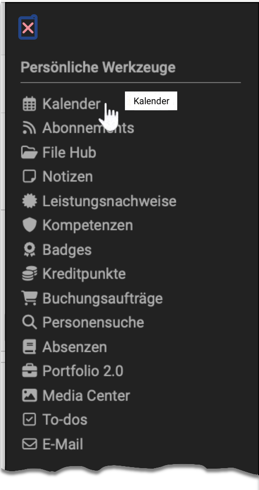
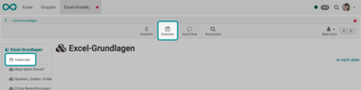
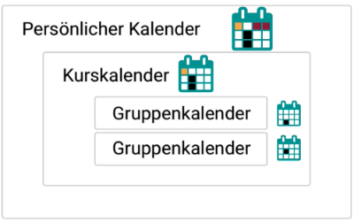
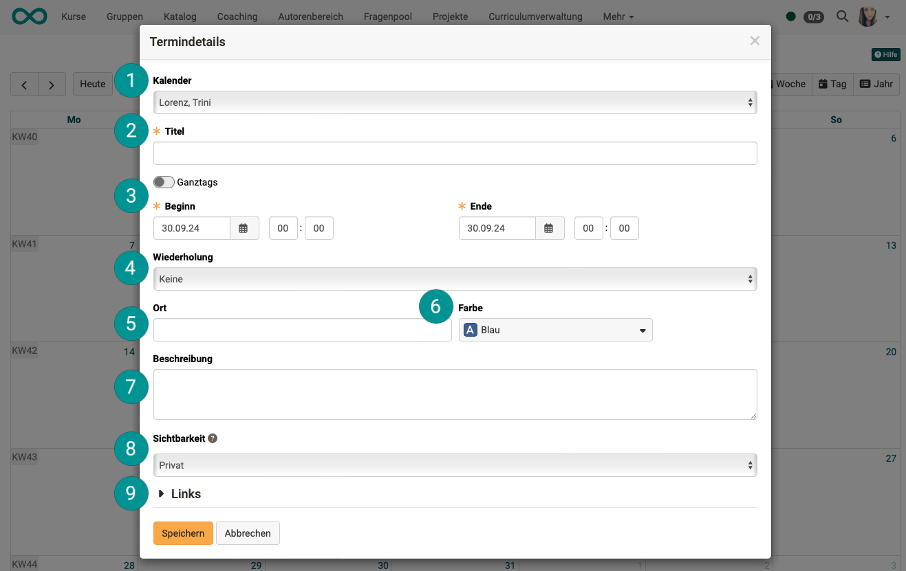
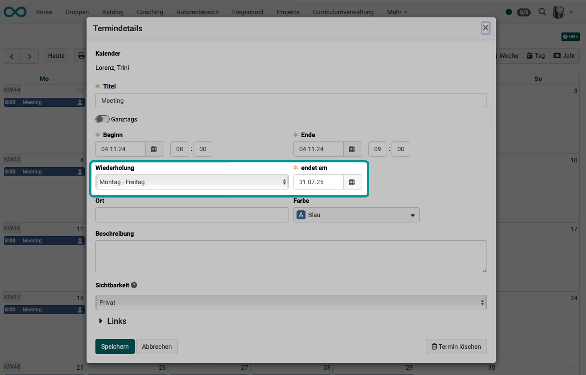
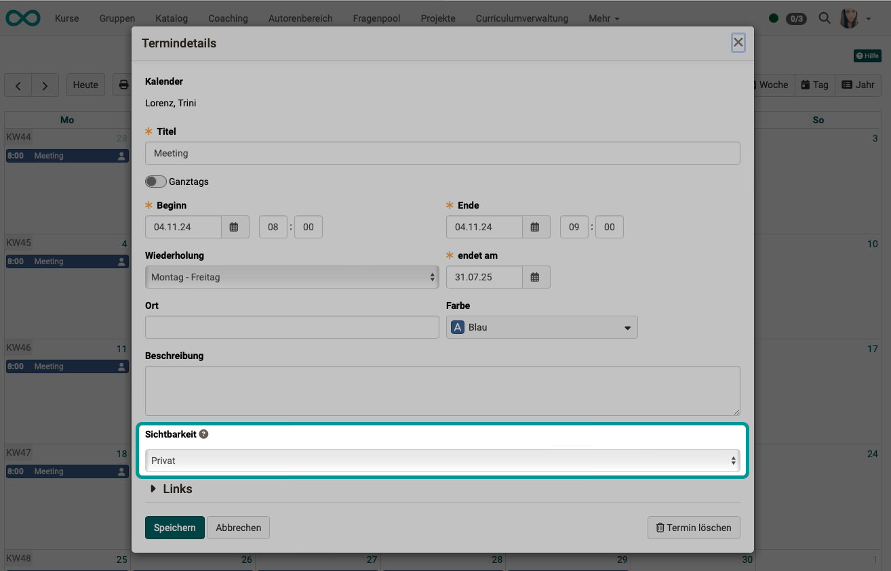
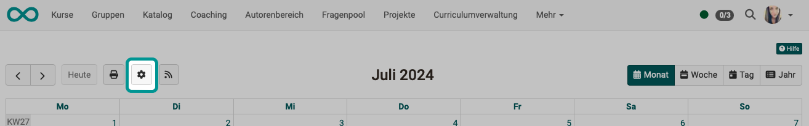
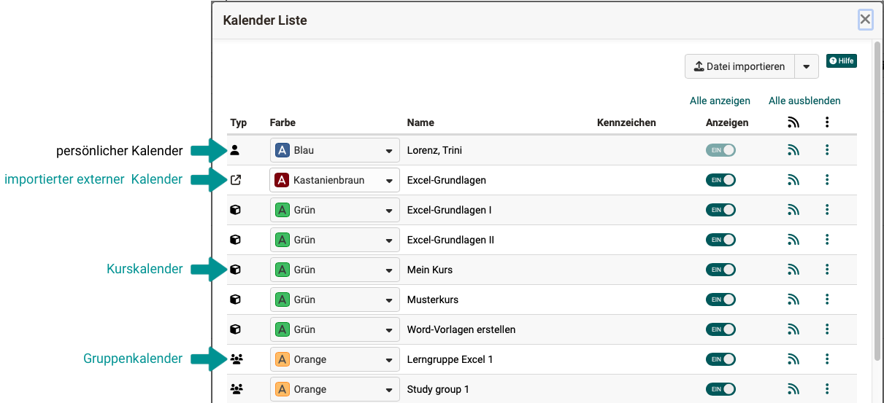
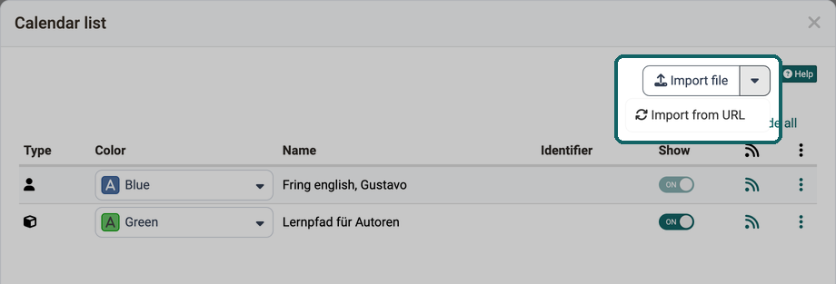

# User tools: Calendar {: #calendar}

{ class="aside-right lightbox" }

:fontawesome-regular-calendar-days:

The calendar function is available in various places:

* In the [group](../groups/Using_Group_Tools.md):  Access to the group calendar and any external imported calendars.

* In the [course](../area_modules/Courses.md):  Access to course dates and access to all calendars of integrated groups. Course calendars can be integrated into a course element as well as into the toolbar. 

{ class="shadow lightbox" title="Toolbar and course menu of a course" }

 :octicons-device-camera-video-24: **Video Introduction (German)**: [Course calendar](<https://www.youtube.com/embed/tfx6UCYw8t8>){:target="_blank"}

* In the [personal menu](../personal_menu/index.md) [(User tools)](../personal_menu/Personal_Tools.md):  In addition to your personal appointments, all appointments from the various courses and groups of which you are a member can be combined in your personal calendar. This gives you an overview. External calendars can also be imported according to individual requirements.

{ class="shadow lightbox" title="Nesting of the calendars" }

!!! info "Important"

    If you cannot find a calendar in the list of your user tools, administrators have switched it off in the system administration: 
    `Administration > Core functions > Calendar`

[To the top of the page ^](#calendar)

---

## Create / Edit entry {: #create_entry}

To add a new appointment, click in the corresponding calendar field. A pop-up opens for the event details.

{ class="shadow lightbox" title="Event details dialog" }

1. If you are a group member, first select in the "Calendar" field at the top in which calendar you create the appointment (personal calendar or group calendar).

2. The "Event details" must include a subject.

3. A start and end date is also mandatory. The toggle button can be used to hide the time fields and create all-day appointments.

4. For recurrences, select one of the options in the selection field.

5. In the "Location" field you record where the appointment takes place.

6. With the "Color" selection field you give this appointment a color of its own.

7. In the "Description" field you add further details about the appointment.

8. Which details of an appointment are displayed for whom is described in the [Visibility](#visibility) section.

9. You can only add links after the appointment has been created. Simply save the existing appointment and edit it again. You will then see an "Add link" button under "Links".

You edit or delete an appointment afterwards by clicking on the appointment and then on the "Edit" button.

An appointment can also be moved using drag & drop.

!!! info "Important"

    Links to course elements can only be created within the course calendar. All other calendars will display the message: _Link not possible_.

!!! danger "Attention"

    The "Delete this entry" button in the event details deletes the appointment permanently. The appointment cannot be restored!

[To the top of the page ^](#calendar)

---

## Recurring events {: #recurring_events}

For an appointment that takes place regularly, you create a series instead of entering each appointment individually. To do this, select under "Recurrence" in the event details how often the appointment repeats. As soon as you select a recurrence, the mandatory field "ends on" appears for the end of the series.

{ class="shadow lightbox" title="Event details dialog, Recurrence field" }

You can also edit recurring appointments. To do this, click on one of the appointments in the calendar. When saving, you select whether the change applies to all appointments in the series or only to the selected appointment. If it applies to all appointments, OpenOlat changes the appointments of the series that you have not adjusted individually before.

[To the top of the page ^](#calendar)

---

## Visibility {: #visibility}

With the "Visibility" field in the event details you specify who can see the calendar entry.

{ class="shadow lightbox" title="Event details dialog, Visibility field" }

Depending on the type of calendar (Personal calendar, group calendar, course calendar) the three visibility levels "Private", "Only time information visible" and "Public" have different effects:

|| Personal calendar| Group calendar| Course calendar
---|---|---|---
**Private** | Only the person who created the entry is allowed to view the calendar entry, as the calendar is assigned to that person.| Only members of the group to which this calendar is assigned are allowed to view the calendar entry.| Only members of the course to which this calendar is assigned are allowed to view the calendar entry.
**Only time information visible** | As only the person who created the entry and nobody else can view the entry, these settings have no effect in this context. | All group and course members see the entry with all details. Additionally, all persons registered in OpenOlat or guests with access to the group/the course can see the time of the entry but no further details. | All group and course members see the entry with all details. Additionally, all persons registered in OpenOlat or guests with access to the group/the course can see the time of the entry but no further details.
**Public** | As only the person who created the entry and nobody else can view the entry, these settings have no effect in this context. | All group and course members see the entry with all details. Additionally, all persons registered in OpenOlat or guests with access to the group/the course can see all details of the entry. | All group and course members see the entry with all details. Additionally, all persons registered in OpenOlat or guests with access to the group/the course can see all details of the entry.

[To the top of the page ^](#calendar)

---

## Content {: #content}

The personal calendar displays:

1. The personal appointments you entered in this calendar yourself.
2. Other standalone calendars that have been selected in the calendar list for the shared view.  E.g. a group or course calendar.
3. **Aggregated calendars**  Aggregated calendars, for their part, have combined appointments from several different calendars. With aggregated calendars, it should be noted that OpenOlat cannot resolve where the events originally came from. An integrated aggregated calendar does not provide this origin information for the individual appointments, only which calendars are included.

!!! info "Aggregated calendar"

    An aggregated calendar is a collective feed that contains all calendars and their appointments that you have access to. You can use this feed from other applications to add or display all your OpenOlat appointments there. This saves you the work of having to insert each calendar individually (see [Share OpenOlat calendar](#share)). You can also use the 3 dots at the end of a line of the calendar list to import files and calendars and reset the appointments of an entire calendar.

[To the top of the page ^](#calendar)

---

## Calendar list {: #list}

In the calendar list you determine which calendars you see together and in which color. You open it with the "Settings" icon :o_icon_o_icon_customize: in the calendar header.

{ class="shadow lightbox" title="Calendar header" }

In the calendar list you will find all calendars that can be displayed in the current calendar (group, course, external and personal).

{ class="shadow lightbox" title="Calendar list" }

The "Type" column shows with an icon which kind of calendar it is: personal calendar, group calendar, course calendar or imported external calendar.

You can give the calendars different colors for better differentiation.

For course calendars, the "Identifier" column shows the identifier of the course. For personal and group calendars the column stays empty.

For each of these independent calendars, a toggle button in the "Show" column can be used to set whether the appointments are also displayed in your personal calendar. With the "Show all" and "Hide all" buttons you switch all calendars of the list on or off together. [:octicons-tag-16:{ title="from Release 18.1 (OO-7314)" }](https://track.frentix.com/issue/OO-7314)

Under the feed symbol you will find the URL with which this calendar can be integrated elsewhere.

Editing options are displayed under the icon with the 3 dots at the end of a line if they are independent calendars. (Editing is limited/not possible for aggregated calendars).

[To the top of the page ^](#calendar)

---

## Add calendars to the calendar list {: #add_to_list}

OpenOlat adds the course and group calendars to the calendar list of the personal calendar by default. You add another independent calendar with the buttons above the list.

Calendar files (.ics) can be added using the "Import file" button. 
Clicking the small arrow next to it reveals the "Import from URL" entry.

{ class="shadow lightbox" title="Calendar list, Import file button · 2026.10.20" }

A calendar that you import from a URL must be reachable via the public internet. If the "SSRF mitigation" protection is switched on in the system administration, OpenOlat rejects addresses from the local network, for example a calendar server in the network of your organisation. When importing as a new calendar, the message "Data could not be written to that calendar file. Please try again later." then appears; when importing via the 3 dots into an existing calendar, the message "Calendar file format incorrect. Please check the URL" appears. The same messages also appear for a wrong address or a network error. An address from the local network can only be allowed through an exception in the server configuration, see [Security](../../manual_admin/administration/Login_Security.md#ssrf). Contact your administration for this. [:octicons-tag-16:{ title="from Release 21.1 (OO-9310)" }](https://track.frentix.com/issue/OO-9310)

!!! info "Please note:"

    Use the buttons above the calendar list to add further independent calendars to the calendar list.

    * Another line appears, that is, another independent calendar.
    * You can specify in the calendar list whether the appointments in this calendar should be transferred to your personal calendar (activate the toggle button).
    * You can give the calendars different colors.

    The options to add or delete under the 3 dots at the end of a line, on the other hand, only edit this single (aggregated) calendar.

    * The calendars imported here do *not* appear in the calendar list, but are included in the now aggregated calendar.
    * You can *not* differentiate by color.

    **Recommendation:**  For a better overview, import calendars as independent calendars, with the buttons in the header of the calendar list.

!!! tip "Tip"

    If your calendar appears empty or certain appointments are not displayed despite having been entered, the desired calendar may not be selected in the calendar list. (Toggle button not switched on.)

[To the top of the page ^](#calendar)

---

## Print calendar [:octicons-tag-16:{ title="from Release 9.0 (OO-593)" }](https://track.frentix.com/issue/OO-593) {: #print}

To plan a week or to put up a notice, you need your appointments on paper or as a PDF. For this, OpenOlat compiles the appointments of a period that you choose as a list, day by day.

1. In the calendar header, click the "Print" icon :o_icon_o_icon_print:. It is located to the left of the "Settings" icon, see the image in the [Calendar list](#list) section.
2. In the "Print" window, choose the period with "From" and "To". The defaults are today and the same day next month.
3. Click "Print".

OpenOlat opens the list in a new browser window and opens your browser's print dialog in it. There you choose the printer or save the list as a PDF.

The list contains the appointments of all calendars that you have switched on in the "Show" column of the calendar list. For appointments of which you may only see the time information, "(Calendar details hidden)" appears instead of the subject.

You find the "Print" icon in the personal calendar, in the course calendar, in the group calendar and in the timetable of an [implementation](../area_modules/Course_Planner_Implementations.md) in the Course Planner. The calendars of the [room management](../area_modules/Course_Planner_Rooms.md), the [schedule of a project](../area_modules/Project_Schedule.md) and the "Show room bookings" view of the [BigBlueButton](../learningresources/bigbluebutton/index.md) and [Microsoft Teams](../learningresources/Course_Element_Microsoft_Teams.md) course elements have no "Print" icon. [:octicons-tag-16:{ title="from Release 21.1.1 (OO-9931)" }](https://track.frentix.com/issue/OO-9931)

[To the top of the page ^](#calendar)

---

## Share OpenOlat calendar {: #share}

If you want to see your OpenOlat appointments in another calendar program, for example in Google Calendar, integrate the OpenOlat calendars via iCal, a standard for exchanging appointments. To do this, click the iCal icon :o_icon_o_icon_rss: in the calendar header or in the corresponding line of the calendar list and copy the iCal link.

[To the top of the page ^](#calendar)

---

## Managed calendar [:octicons-tag-16:{ title="from Release 10.4 (OO-1644)" }](https://track.frentix.com/issue/OO-1644) {: #managed}

Other systems, for example PerformX, can write appointments into OpenOlat calendars via the REST interface. Such appointments are called managed appointments, the other system manages them. In the calendar they carry a lock symbol.

!!! info "Important"

    In course and group calendars, the editing options may differ from the personal calendar.

[To the top of the page ^](#calendar)

---

## Further information {: #further_information}

**Mentioned on this page** 
[Using Group Tools >](../groups/Using_Group_Tools.md) 
[Finding courses >](../area_modules/Courses.md) 
[Personal menu >](../personal_menu/index.md) 
[User tools >](../personal_menu/Personal_Tools.md) 
[Security >](../../manual_admin/administration/Login_Security.md) 
[Course Planner: Implementations >](../area_modules/Course_Planner_Implementations.md) 
[Course Planner: Room management >](../area_modules/Course_Planner_Rooms.md) 
[Projects - Schedule >](../area_modules/Project_Schedule.md) 
[Course Element "BigBlueButton" >](../learningresources/bigbluebutton/index.md) 
[Course Element "Microsoft Teams" >](../learningresources/Course_Element_Microsoft_Teams.md)

**Further reading** 
[Using Additional Course Features >](../learningresources/Using_Additional_Course_Features.md) 
[Group Administration >](../groups/Group_Administration/index.md) 
[Course Element "Calendar" >](../learningresources/Course_Element_Calendar.md) 
[Core functions: Overview >](../../manual_admin/administration/Core_functions.md)

**youtube** 
[Course calendar](<https://www.youtube.com/embed/tfx6UCYw8t8>)

[To the top of the page ^](#calendar)
