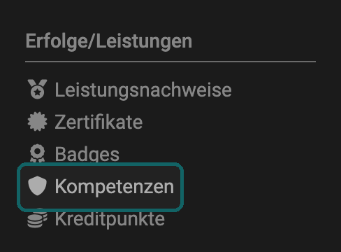

# Persönliche Erfolge/Leistungen: Kompetenzen {: #competences}

{ width="244" class="aside-right lightbox" }

Welche Kompetenzen Ihnen in OpenOlat zugeordnet sind, sehen Sie im persönlichen Menü im Abschnitt "Erfolge/Leistungen" unter "Kompetenzen".

Kompetenzen erhalten Sie zum Beispiel über Ihre ePortfolio-Einträge, oder Benutzerverwalter:innen tragen sie in Ihrem Benutzerprofil ein.

{ class="shadow lightbox" title="Kompetenzen im Abschnitt Erfolge/Leistungen" }

!!! info "Wichtig"

    Kompetenzen gehören immer zu einer Taxonomie. Die Liste zeigt deshalb nur dann Einträge, wenn Systemadministrator:innen das Modul Taxonomie eingeschaltet und Taxonomien aufgebaut haben. Beides richten sie in der System-Administration ein: `Administration > Module > Taxonomie`.

[Zum Seitenanfang ^](#competences)

---

## Wo spielen Kompetenzen eine Rolle? {: #where_used}

Ausser in der Übersicht unter "Erfolge/Leistungen" kommen Kompetenzen an diesen Stellen vor:

- [Kompetenzen verschlagworten >](../area_modules/Competences_tags.de.md) (ePortfolio)
- [Konzept des File Hub >](../basic_concepts/File_Hub_Concept.de.md) (Dokumentenpool)

Im Administrationshandbuch:

- [Fragenpool >](../../manual_admin/administration/eAssessment_Question_bank.de.md)
- [Modul Taxonomie >](../../manual_admin/administration/Modules_Taxonomy.de.md)
- [REST API >](../../manual_admin/administration/REST_API.de.md)
- Benutzerprofil in der [Benutzerverwaltung >](../../manual_admin/usermanagement/Configure_User.de.md)

[Zum Seitenanfang ^](#competences)

---

## Weiterführende Informationen {: #further_information}

**Auf dieser Seite erwähnt** 
[Kompetenzen verschlagworten >](../area_modules/Competences_tags.de.md) 
[Konzept des File Hub >](../basic_concepts/File_Hub_Concept.de.md) 
[e-Assessment Administration: Fragenpool >](../../manual_admin/administration/eAssessment_Question_bank.de.md) 
[Modul Taxonomie >](../../manual_admin/administration/Modules_Taxonomy.de.md) 
[REST API >](../../manual_admin/administration/REST_API.de.md) 
[Kontoeinstellungen verwalten >](../../manual_admin/usermanagement/Configure_User.de.md)

**Weiterführend** 
[Persönliches Menü >](index.de.md) 
[Persönliche Erfolge/Leistungen: Leistungsnachweise >](Evidence_of_Achievements.de.md)

[Zum Seitenanfang ^](#competences)
