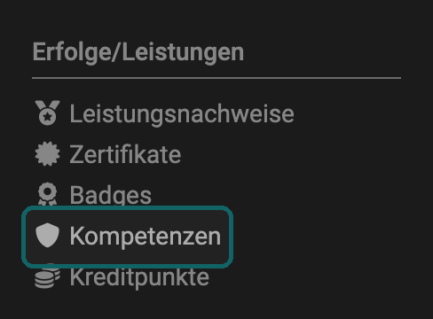
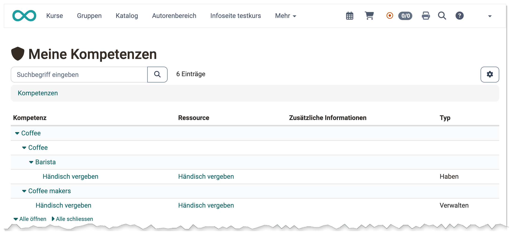

# Persönliche Erfolge/Leistungen: Kompetenzen {: #competences}

{ width="244" class="aside-right lightbox" }

Welche Kompetenzen Ihnen in OpenOlat zugeordnet sind, sehen Sie im [persönlichen Menü](index.de.md) im Abschnitt "Erfolge/Leistungen" unter "Kompetenzen". [:octicons-tag-16:{ title="ab Release 15.5 (OO-5354)" }](https://track.frentix.com/issue/OO-5354)

Kompetenzen erhalten Sie zum Beispiel, wenn Sie in Ihrem ePortfolio einem Eintrag eine Kompetenz zuordnen. Ausserdem tragen Benutzerverwalter:innen Kompetenzen in der Benutzerverwaltung bei Ihrem Konto ein.

{ class="shadow lightbox" title="Kompetenzen im Abschnitt Erfolge/Leistungen · 2026.11.26" }

Die Liste "Meine Kompetenzen" ist nach Taxonomie gegliedert. Eine Taxonomie ist ein Baum von Fachgebieten, mit dem Ihre Organisation Kompetenzen, Lernressourcen und Fragen einordnet; jede Verzweigung ist eine Taxonomieebene. Die Spalte "Ressource" zeigt, woher eine Kompetenz stammt: "Portfolio" aus Ihrem ePortfolio, "Händisch vergeben" von einer Person in OpenOlat, etwa in der Benutzerverwaltung, "Extern vergeben" von einem anderen System über die Schnittstelle von OpenOlat. Ein Klick auf "Portfolio" öffnet den Eintrag in Ihrem ePortfolio. Die Spalte "Typ" sagt, in welcher Beziehung Sie zur Kompetenz stehen, etwa "Haben" oder "Verwalten". Was die einzelnen Kompetenztypen bedeuten, erklärt die Seite [Taxonomie](../basic_concepts/Taxonomy_Concept.de.md#competences).

!!! info "Wichtig"

    Kompetenzen gehören immer zu einer Taxonomie. Die Liste zeigt deshalb nur dann Einträge, wenn Systemadministrator:innen das Modul Taxonomie eingeschaltet und Taxonomien aufgebaut haben. Beides richten sie in der System-Administration ein: `Administration > Module > Taxonomie`.

[Zum Seitenanfang ^](#competences)

---

## Wo spielen Kompetenzen eine Rolle? {: #where_used}

Ausser in der Übersicht unter "Erfolge/Leistungen" kommen Kompetenzen an diesen Stellen vor:

- [Kompetenzen verschlagworten >](../area_modules/Competences_tags.de.md) (ePortfolio)
- [Dokumentenpool >](../basic_concepts/File_Hub_Concept.de.md#document_pool): Den Dokumentenpool sehen Personen mit einer Kompetenz in seiner Taxonomie.

Im Administrationshandbuch:

- [Fragenpool >](../../manual_admin/administration/eAssessment_Question_bank.de.md)
- [Modul Taxonomie >](../../manual_admin/administration/Modules_Taxonomy.de.md)
- [REST API >](../../manual_admin/administration/REST_API.de.md)
- Reiter "Kompetenzen" in den [Kontoeinstellungen >](../../manual_admin/usermanagement/Configure_User.de.md) der Benutzerverwaltung

[Zum Seitenanfang ^](#competences)

---

## Weiterführende Informationen {: #further_information}

**Auf dieser Seite erwähnt** 
[Persönliches Menü >](index.de.md) 
[Taxonomie >](../basic_concepts/Taxonomy_Concept.de.md) 
[Kompetenzen verschlagworten >](../area_modules/Competences_tags.de.md) 
[Konzept des File Hub >](../basic_concepts/File_Hub_Concept.de.md) 
[e-Assessment Administration: Fragenpool >](../../manual_admin/administration/eAssessment_Question_bank.de.md) 
[Modul Taxonomie >](../../manual_admin/administration/Modules_Taxonomy.de.md) 
[REST API >](../../manual_admin/administration/REST_API.de.md) 
[Kontoeinstellungen verwalten >](../../manual_admin/usermanagement/Configure_User.de.md)

**Weiterführend** 
[Persönliche Erfolge/Leistungen: Leistungsnachweise >](Evidence_of_Achievements.de.md) 
[Persönliche Werkzeuge: Portfolio 2.0 >](Portfolio/index.de.md)

[Zum Seitenanfang ^](#competences)
