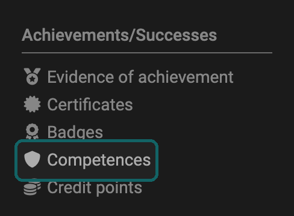
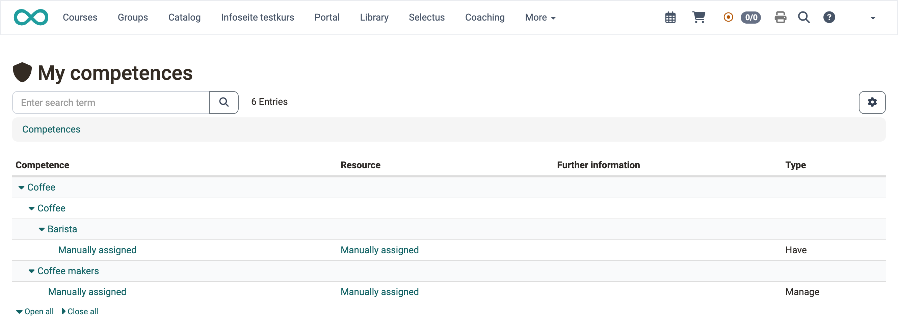

# Personal achievements/successes: Competences {: #competences}

{ width="244" class="aside-right lightbox" }

You see which competences are assigned to you in OpenOlat in the [personal menu](index.md), in the section "Achievements/Successes" under "Competences". [:octicons-tag-16:{ title="from Release 15.5 (OO-5354)" }](https://track.frentix.com/issue/OO-5354)

You receive competences, for example, when you assign a competence to an entry in your ePortfolio. In addition, user managers enter competences for your account in the user management.

{ class="shadow lightbox" title="Competences in the section Achievements/Successes · 2026.11.10" }

The list "My competences" is structured by taxonomy. A taxonomy is a tree of subject areas with which your organisation classifies competences, learning resources and questions; each branch is a taxonomy level. The column "Resource" shows where a competence comes from: "Portfolio" from your ePortfolio, "Manually assigned" by a person in OpenOlat, for example in the user management, "Externally assigned" by another system via the OpenOlat interface. A click on "Portfolio" opens the entry in your ePortfolio. The column "Type" tells you your relation to the competence, for example "Have" or "Manage". What the individual competence types mean is explained on the page [Taxonomy](../basic_concepts/Taxonomy_Concept.md#competences).

!!! info "Important"

    Competences always belong to a taxonomy. The list therefore only shows entries if system administrators have enabled the module Taxonomy and built taxonomies. They set up both in the system administration: `Administration > Modules > Taxonomy`.

[To the top of the page ^](#competences)

---

## Where do competences play a role? {: #where_used}

Apart from the overview under "Achievements/Successes", competences appear in these places:

- [Competences tags >](../area_modules/Competences_tags.md) (ePortfolio)
- [Document pool >](../basic_concepts/File_Hub_Concept.md#document_pool): persons with a competence in its taxonomy see the document pool.

In the admin manual:

- [Question bank >](../../manual_admin/administration/eAssessment_Question_bank.md)
- [Module Taxonomy >](../../manual_admin/administration/Modules_Taxonomy.md)
- [REST API >](../../manual_admin/administration/REST_API.md)
- Tab "Competences" in the [user settings >](../../manual_admin/usermanagement/Configure_User.md) of the user management

[To the top of the page ^](#competences)

---

## Further information {: #further_information}

**Mentioned on this page** 
[Personal menu >](index.md) 
[Taxonomy >](../basic_concepts/Taxonomy_Concept.md) 
[Competences tags >](../area_modules/Competences_tags.md) 
[File Hub Concept >](../basic_concepts/File_Hub_Concept.md) 
[e-Assessment Administration: Question bank >](../../manual_admin/administration/eAssessment_Question_bank.md) 
[Module Taxonomy >](../../manual_admin/administration/Modules_Taxonomy.md) 
[REST API >](../../manual_admin/administration/REST_API.md) 
[Manage user settings >](../../manual_admin/usermanagement/Configure_User.md)

**Further reading** 
[Personal achievements/successes: Evidence of Achievements >](Evidence_of_Achievements.md) 
[User tools: Portfolio 2.0 >](Portfolio/index.md)

[To the top of the page ^](#competences)
