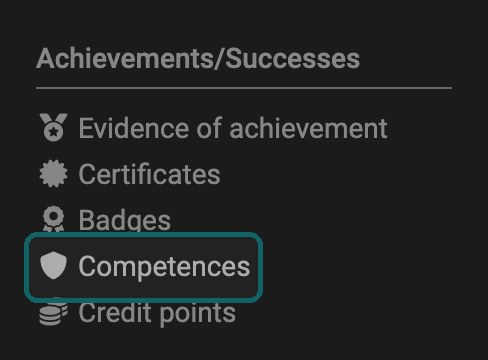
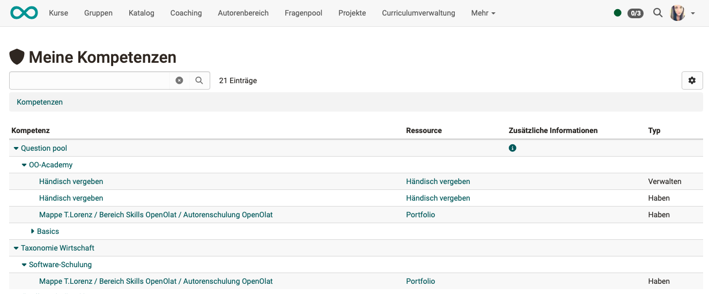

# Personal achievements/successes: Competences {: #competences}

{ width="244" class="aside-right lightbox" }

You see which competences are assigned to you in OpenOlat in the personal menu, in the section "Achievements/Successes" under "Competences".

You receive competences, for example, via your ePortfolio entries, or user managers enter them in your user profile.

{ class="shadow lightbox" title="Competences in the section Achievements/Successes" }

!!! info "Important"

    Competences always belong to a taxonomy. The list therefore only shows entries if system administrators have enabled the module Taxonomy and built taxonomies. They set up both in the system administration: `Administration > Modules > Taxonomy`.

[To the top of the page ^](#competences)

---

## Where do competences play a role? {: #where_used}

Apart from the overview under "Achievements/Successes", competences appear in these places:

- [Competences tags >](../area_modules/Competences_tags.md) (ePortfolio)
- [File Hub Concept >](../basic_concepts/File_Hub_Concept.md) (Document pool)

In the admin manual:

- [Question bank >](../../manual_admin/administration/eAssessment_Question_bank.md)
- [Module Taxonomy >](../../manual_admin/administration/Modules_Taxonomy.md)
- [REST API >](../../manual_admin/administration/REST_API.md)
- User profile in the [User management >](../../manual_admin/usermanagement/Configure_User.md)

[To the top of the page ^](#competences)

---

## Further information {: #further_information}

**Mentioned on this page** 
[Competences tags >](../area_modules/Competences_tags.md) 
[File Hub Concept >](../basic_concepts/File_Hub_Concept.md) 
[e-Assessment Administration: Question bank >](../../manual_admin/administration/eAssessment_Question_bank.md) 
[Module Taxonomy >](../../manual_admin/administration/Modules_Taxonomy.md) 
[REST API >](../../manual_admin/administration/REST_API.md) 
[Manage user settings >](../../manual_admin/usermanagement/Configure_User.md)

**Further reading** 
[Personal menu >](index.md) 
[Personal achievements/successes: Evidence of Achievements >](Evidence_of_Achievements.md)

[To the top of the page ^](#competences)
