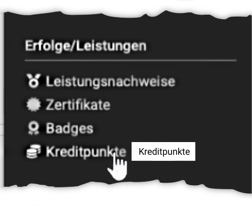
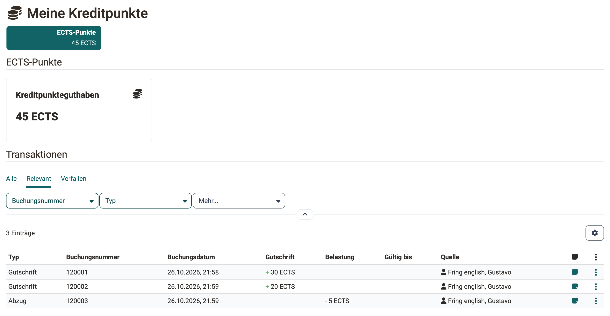

# Persönliche Erfolge/Leistungen: Kreditpunkte {: #credit_points}

{ class="aside-right lightbox"}

Wenn in Kursen Kreditpunkte vergeben werden, werden Ihnen nach erfolgreichem Absolvieren eines Kurses Kreditpunkte gutgeschrieben.

Die Kreditpunkte können Ihnen in verschiedenen "Währungen" gutgeschrieben werden. Welche "Währungen" (Kreditpunktesysteme) grundsätzlich im System verfügbar sind, legen Administrator:innen fest.

Im persönlichen Menü unter "Kreditpunkte" finden Sie Ihr aktuelles Kreditpunkteguthaben.

Die Seite "Meine Kreditpunkte" zeigt je Kreditpunktesystem die Kachel "Kreditpunkteguthaben" und, wenn das Kreditpunktesystem eine Gültigkeitsdauer hat, die Kachel "Nächster Kreditpunkteverfall". Darunter listet die Tabelle "Transaktionen" alle Gutschriften, Belastungen, Stornos, Abzüge und Verfälle auf. Mit den Tabs "Alle", "Relevant" und "Verfallen" sowie den Filtern "Buchungsnummer" und "Typ" grenzen Sie die Liste ein. [:octicons-tag-16:{ title="ab Release 20.1.1 (OO-8558)" }](https://track.frentix.com/issue/OO-8558)

Ein Kreditpunktesystem erscheint erst, wenn Sie darin Transaktionen haben oder Mitglied eines Zertifikatsprogramms sind, das dieses Kreditpunktesystem verwendet. [:octicons-tag-16:{ title="ab Release 20.2.0 (OO-9070)" }](https://track.frentix.com/issue/OO-9070)

Im zweiten Fall ist die Tabelle "Transaktionen" leer und zeigt "Noch keine Transaktionen". Das ist kein Fehler: In diesem Kreditpunktesystem wurden Ihnen noch keine Kreditpunkte gutgeschrieben oder belastet. Finden ein Filter oder ein Tab keine Transaktion, zeigt die Tabelle "Keine Transaktionen gefunden". [:octicons-tag-16:{ title="ab Release 21.1 (OO-9490)" }](https://track.frentix.com/issue/OO-9490){:target="_blank"}

{ class="shadow lightbox" title="Seite Meine Kreditpunkte · 2026.10.26" }

[Zum Seitenanfang ^](#credit_points)

---

## Wer sieht Ihre Kreditpunkte? [:octicons-tag-16:{ title="ab Release 21.1 (OO-9490)" }](https://track.frentix.com/issue/OO-9490){:target="_blank"} {: #who_sees}

Ausser Ihnen sehen Ihre Kreditpunkte nur Personen, denen OpenOlat dafür eine Rolle oder ein Recht gibt:

* **In der Benutzerverwaltung** sehen Administrator:innen, Principals, Benutzerverwalter:innen und Rollenverwalter:innen Ihrer Organisation Ihre Kreditpunkte. Gutschreiben, abziehen und stornieren können dort nur Administrator:innen.
* **Im Coaching Tool** sehen Linienvorgesetzte und Ausbildungsverantwortliche Ihrer Organisation sowie Personen, die über eine eigene Rolle für Sie zuständig sind, Ihre Kreditpunkte im Tab [Kreditpunkte](../area_modules/Coaching_People.de.md#tab_credit_points). Das gilt nur, wenn Administrator:innen ihrer Rolle das Recht "Kreditpunkte anzeigen" erteilt haben; ab Werk ist es aus. Diese Personen sehen nur, sie ändern nichts.

Ist ein Kreditpunktesystem auf Organisationen beschränkt, sieht eine andere Person es nur, wenn sie selbst einer dieser Organisationen angehört.

[Zum Seitenanfang ^](#credit_points)

---

## Kreditpunkte als Voraussetzung für eine Kursteilnahme {: #prerequisite}

Im Rahmen von Zertifikatsprogrammen kann eingerichtet werden, dass vor der Zulassung zu einem Kurs eine bestimmte Anzahl Kreditpunkte auf Ihrem Konto vorhanden sein muss.

Beachten Sie dabei, dass es Kreditpunkte in verschiedenen "Währungen" (Kreditpunktesystemen) geben kann.

**Beispiel** 
Es kann z.B. eingerichtet werden, dass Sie "Sicherheitspunkte" (= Währung der OpenOlat-Kreditpunkte) in verschiedenen Sicherheitsschulungen Level 1 erwerben können. Für die Zulassung zu einer Sicherheitsschulung Level 2 kann als Voraussetzung ein Guthaben von 50 "Sicherheitspunkten" verlangt werden. Andere Kreditpunkte werden für diese Schulung nicht anerkannt.

[Zum Seitenanfang ^](#credit_points)

---

## Weiterführende Informationen {: #further_information}

[Kurseinstellungen - Tab Bewertung >](../learningresources/Course_Settings_Assessment.de.md) 
[e-Assessment Administration: Kreditpunkte >](../../manual_admin/administration/e-Assessment_Credit_Points.de.md) 
[Coaching - Personen >](../area_modules/Coaching_People.de.md) 
[Wie mache ich Erfolge und Leistungen sichtbar? >](../../manual_how-to/achievements/achievements.de.md)

[Zum Seitenanfang ^](#credit_points)
