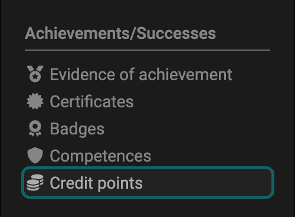
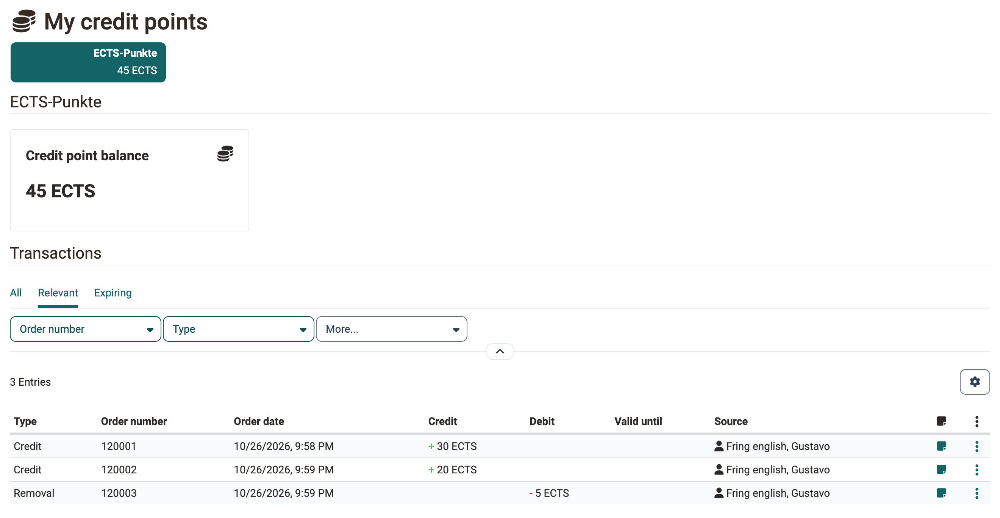

# Personal achievements/successes: Credit points {: #credit_points}

{ class="aside-right lightbox"}

If credit points are awarded in courses, you are credited with credit points after successfully completing a course.

The credit points can be credited to you in different "currencies". Administrators define which "currencies" (credit point systems) are available in the system.

In the personal menu under "Credit points" you find your current credit point balance.

The page "My credit points" shows for each credit point system the tile "Credit point balance" and, if the credit point system has a validity period, the tile "Next credit point expiry". Below them, the table "Transactions" lists all credits, debits, reversals, removals and expiries. Use the tabs "All", "Relevant" and "Expiring" and the filters "Order number" and "Type" to narrow down the list. [:octicons-tag-16:{ title="from Release 20.1.1 (OO-8558)" }](https://track.frentix.com/issue/OO-8558)

A credit point system only appears once you have transactions in it or are a member of a certification program that uses this credit point system. [:octicons-tag-16:{ title="from Release 20.2.0 (OO-9070)" }](https://track.frentix.com/issue/OO-9070)

In the second case, the table "Transactions" is empty and shows "No transactions available". This is not an error: no credit points have been credited or debited to you in this credit point system yet. If a filter or a tab finds no transaction, the table shows "No transactions found". [:octicons-tag-16:{ title="from Release 21.1 (OO-9490)" }](https://track.frentix.com/issue/OO-9490){:target="_blank"}

{ class="shadow lightbox" title="Page My credit points · 2026.10.26" }

[To the top of the page ^](#credit_points)

---

## Who can see your credit points? [:octicons-tag-16:{ title="from Release 21.1 (OO-9490)" }](https://track.frentix.com/issue/OO-9490){:target="_blank"} {: #who_sees}

Apart from you, only people to whom OpenOlat gives a role or a right for this can see your credit points:

* **In the user management**, administrators, principals, user managers and roles managers of your organisation see your credit points. Only administrators can credit, remove and cancel credit points there.
* **In the Coaching Tool**, line managers and education managers of your organisation as well as people who are responsible for you via an own role see your credit points in the tab [Credit points](../area_modules/Coaching_People.md#tab_credit_points). This only applies if administrators have granted their role the right "View credit points"; by default, it is off. These people only view, they do not change anything.

If a credit point system is restricted to organisations, another person only sees it if they belong to one of these organisations themselves.

[To the top of the page ^](#credit_points)

---

## Credit points as a prerequisite for course participation {: #prerequisite}

Certification programs can be set up so that a certain number of credit points must be in your account before you are admitted to a course.

Please note that credit points can exist in different "currencies" (credit point systems).

**Example** 
For example, it can be set up so that you earn "safety points" (= currency of the OpenOlat credit points) in various Level 1 safety training courses. A balance of 50 "safety points" can be required for admission to a Level 2 safety training course. Other credit points are not recognised for this training course.

[To the top of the page ^](#credit_points)

---

## Further information {: #further_information}

[Course Settings - Tab Assessment >](../learningresources/Course_Settings_Assessment.md) 
[e-Assessment Administration: Credit points >](../../manual_admin/administration/e-Assessment_Credit_Points.md) 
[Coaching - People >](../area_modules/Coaching_People.md) 
[How do I make successes and achievements visible? >](../../manual_how-to/achievements/achievements.md)

[To the top of the page ^](#credit_points)
