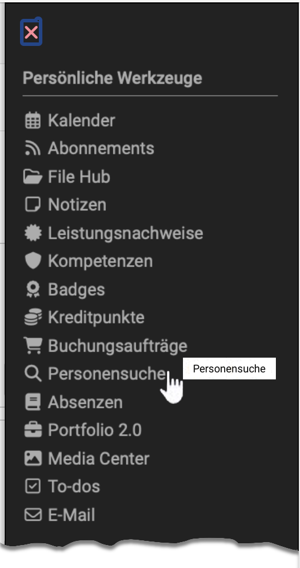
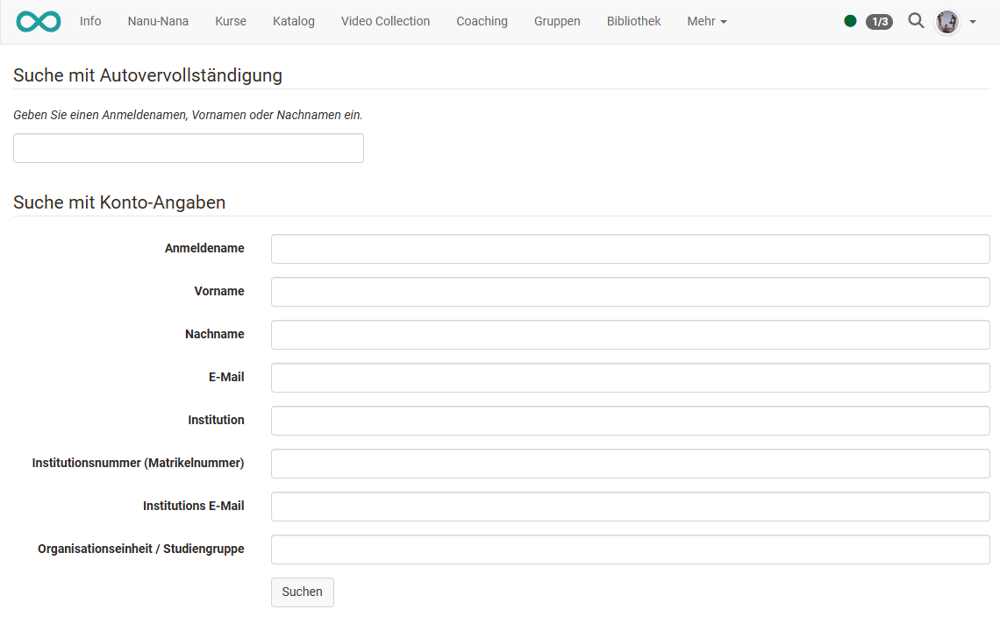

# Persönliche Werkzeuge: Personensuche {: #other_users}

{ class="aside-right lightbox"}

Im Unterschied zur allgemeinen Volltextsuche, die Sie über das Lupensymbol in der Hauptnavigation aufrufen, ist die Suchfunktion im persönlichen Menü eine **Personensuche**. Das Suchformular enthält die Felder, mit denen Sie die Suche eingrenzen.

Die zur Verfügung stehenden Suchfelder können je nach Rolle variieren. Geben Sie mindestens einen Suchbegriff mit mindestens vier Zeichen ein.

{ class="shadow lightbox" title="Personensuche im persönlichen Menü" }

Wählen Sie eine Person aus, öffnet OpenOlat ihre Seite mit diesen Menüpunkten:

* "Visitenkarte": die Angaben, die die Person auf ihrer Visitenkarte zeigt.
* "Kalender": den persönlichen Kalender der Person, nur zum Ansehen. Den Menüpunkt zeigt OpenOlat, wenn persönliche Kalender eingeschaltet sind.
* "Ordner": den Ordner "public" der [persönlichen Dateien](File_Hub.de.md#personal_files) der Person, nur zum Lesen.
* "Kontakt": ein Formular, mit dem Sie der Person eine E-Mail schicken.

## Weiterführende Informationen {: #further_information}

[Personensuche >](../basic_concepts/Search_Person.de.md) 
[Allgemeines zur Suche >](../basic_concepts/Search_General/index.de.md) 
[Globale Suche >](../basic_concepts/Search_Global.de.md) 
[Lokale Suche >](../basic_concepts/Search_Local.de.md) 
[Suche in einem Kurs >](../basic_concepts/Search_in_Course.de.md) 
[Suche im File Hub >](../basic_concepts/Search_in_FileHub.de.md) 
[Persönliche Werkzeuge: File Hub >](File_Hub.de.md)

[Zum Seitenanfang ^](#other_users)
