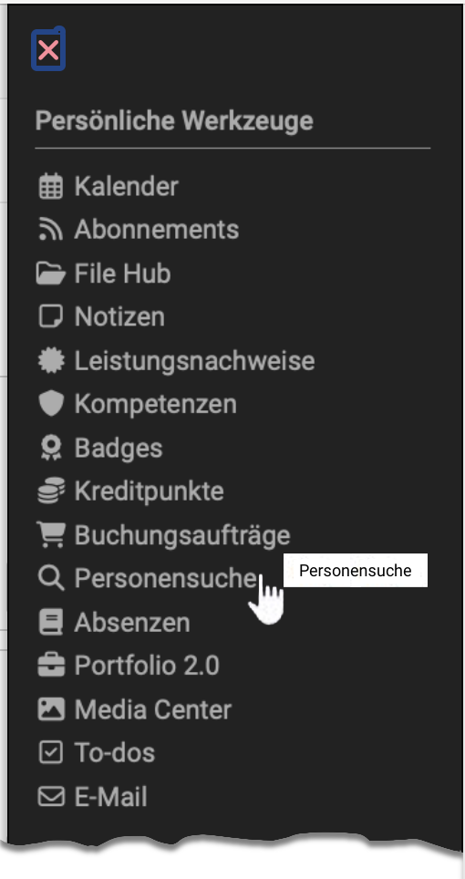
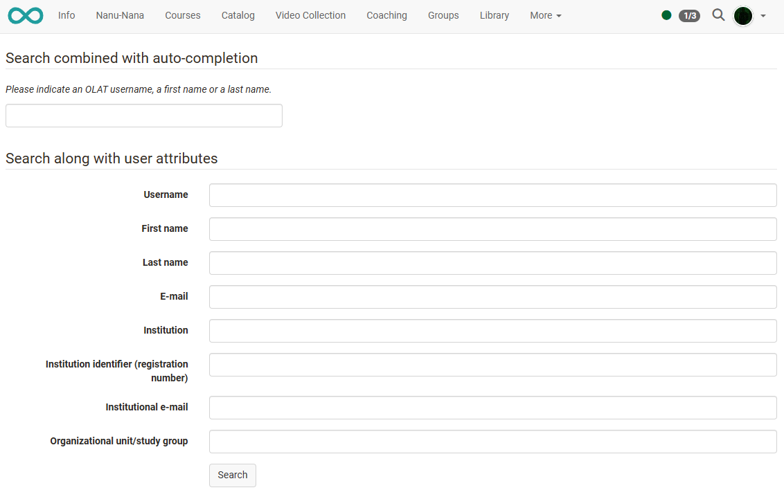

# User tools: Other users {: #other_users}

{ class="aside-right lightbox"}

In contrast to the general full-text search, which you open via the magnifying glass symbol in the main navigation, the search function in the personal menu is a **search for other users**. The search form contains the fields with which you narrow down the search.

The available search fields may vary depending on the role. Enter at least one search term with at least four characters.

{ class="shadow lightbox" title="Other users in the personal menu" }

If you select a person, OpenOlat opens their page with these menu items:

* "Visiting card": the details the person shows on their visiting card.
* "Calendar": the personal calendar of the person, for viewing only. OpenOlat shows the menu item when personal calendars are enabled.
* "Folder": the folder "public" of the person's [personal files](File_Hub.md#personal_files), read-only.
* "Contact": a form with which you send the person an e-mail.

## Further information {: #further_information}

[Search other Users >](../basic_concepts/Search_Person.md) 
[General information on the search >](../basic_concepts/Search_General/index.md) 
[Global search >](../basic_concepts/Search_Global.md) 
[Local search >](../basic_concepts/Search_Local.md) 
[Search in a course >](../basic_concepts/Search_in_Course.md) 
[Search in the File Hub >](../basic_concepts/Search_in_FileHub.md) 
[User tools: File Hub >](File_Hub.md)

[To the top of the page ^](#other_users)
