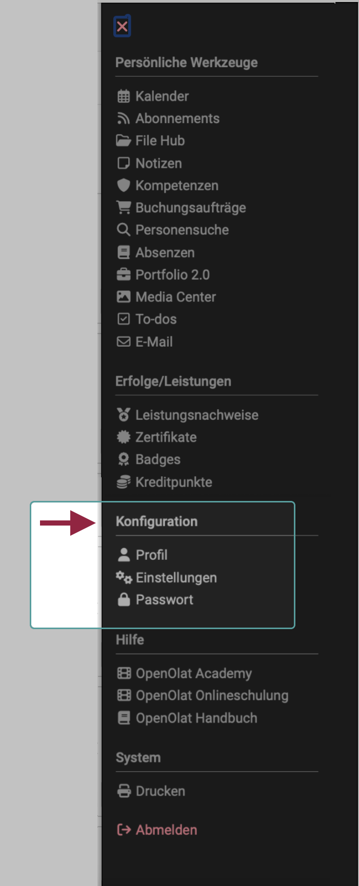

# Persönliche Konfiguration {: #personal_configuration}

{ class="aside-right shadow lightbox"}

Die persönlichen Konfigurationen finden Sie als Abschnitt "Konfiguration" im [persönlichen Menü](../index.de.md), unterhalb der Abschnitte "Persönliche Werkzeuge" und "Erfolge/Leistungen".

Welche Konfigurationswerkzeuge Ihnen hier angeboten werden, bestimmt zum einen die Aktivierung in der System-Administration: `Administration > Core-Konfiguration > Persönliche Werkzeuge`. Zum anderen entscheiden Sie selbst, ob die Werkzeuge im [persönlichen Menü](../index.de.md) oder als Symbol in der Hauptnavigation erscheinen sollen.

 
 

## Menüpunkte {: #menu_items}

Suchen Sie eine Einstellung zu Ihrer Person oder zu Ihrem Konto, sagt Ihnen die Übersicht, unter welchem Menüpunkt sie liegt, und führt Sie mit dem Link zu seiner Beschreibung. Die Tabelle folgt der Reihenfolge im persönlichen Menü.

| Menüpunkt | Wozu |
|---|---|
| [Profil](../Profile/index.de.md) | Die Angaben zu Ihrer Person ändern und Ihre Visitenkarte einrichten. Haben Systemadministrator:innen das COVID-Zertifikat eingeschaltet, finden Sie im Profil auch den Tab ["COVID-Zertifikat"](../COVID_certificate.de.md). |
| [Einstellungen](../Settings.de.md) | OpenOlat an Ihre Bedürfnisse anpassen, etwa die Sprache der Oberfläche wählen oder Werkzeuge in der Hauptnavigation anzeigen. |
| [Passwort](../Password.de.md) | Ihr OpenOlat-Passwort ändern. |

[Zum Seitenanfang ^](#personal_configuration)

## Weiterführende Informationen {: #further_information}

[Persönliche Werkzeuge >](../Personal_Tools/index.de.md) 
[Persönliche Erfolge/Leistungen >](../Achievements/index.de.md) 
[Core-Konfiguration: Übersicht >](../../../manual_admin/administration/Core_functions/index.de.md)

[Zum Seitenanfang ^](#personal_configuration)
