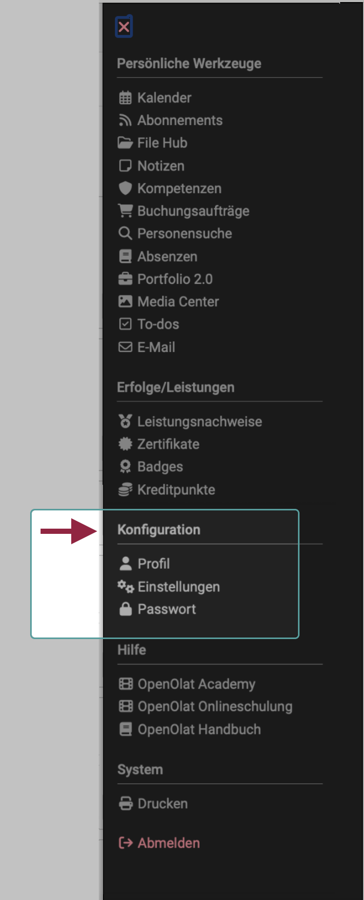

# Personal Configuration {: #personal_configuration}

{ class="aside-right shadow lightbox"}

You find the personal configurations as the section "Configuration" in the [personal menu](../index.md), below the sections "User tools" and "Achievements/Successes".

Which configuration tools are offered to you here is determined on the one hand by the activation in the system administration: `Administration > Core functions > User tools`. On the other hand, you decide yourself whether the tools appear in the [personal menu](../index.md) or as an icon in the main navigation.

 
 

## Menu items {: #menu_items}

If you are looking for a setting for your person or your account, the overview tells you under which menu item it is located and takes you to its description with the link. The table follows the order in the personal menu.

| Menu item | Purpose |
|---|---|
| [Profile](../Profile/index.md) | Change your personal details and set up your visiting card. If system administrators have enabled the COVID certificate, you also find the tab ["COVID certificate"](../COVID_certificate.md) in the profile. |
| [Settings](../Settings.md) | Adapt OpenOlat to your needs, for example choose the language of the user interface or display tools in the main navigation. |
| [Password](../Password.md) | Change your OpenOlat password. |

[To the top of the page ^](#personal_configuration)

## Further information {: #further_information}

[User tools >](../Personal_Tools/index.md) 
[Core functions: Overview >](../../../manual_admin/administration/Core_functions/index.md)

[To the top of the page ^](#personal_configuration)
