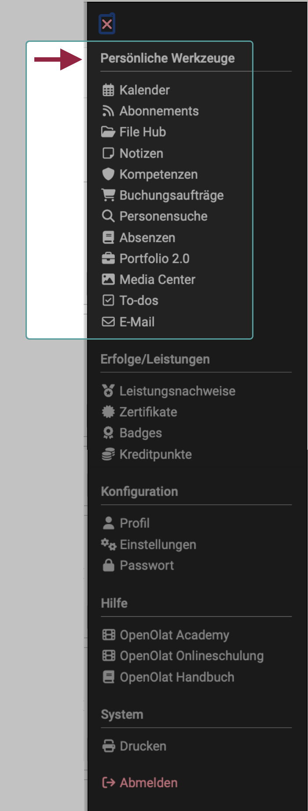

# Persönliche Werkzeuge {: #personal_tools}

{ class="aside-right shadow lightbox"}

Die persönlichen Werkzeuge finden Sie als einen Abschnitt im [persönlichen Menü](../index.de.md).

Welche Werkzeuge Ihnen hier angeboten werden, bestimmt zum einen die Aktivierung in der System-Administration. Zum anderen entscheiden Sie selbst, ob die Werkzeuge im [persönlichen Menü](../index.de.md) oder als Symbol in der Hauptnavigation erscheinen sollen.

 
 

## Menüpunkte {: #menu_items}

Suchen Sie ein Werkzeug, sagt Ihnen die Übersicht in einem Satz, wozu es dient, und führt Sie mit dem Link zu seiner Beschreibung. Die Tabelle folgt der Reihenfolge im persönlichen Menü.

| Menüpunkt | Wozu |
|---|---|
| [Kalender](../Calendar.de.md) | Private Termine erstellen und die Termine aus Ihren Kursen und Gruppen in einem Kalender zusammen sehen. |
| [Abonnements](../Subscriptions.de.md) | Die Neuigkeiten aus allem, was Sie abonniert haben, gesammelt sehen und Ihre Abonnements verwalten, etwa für Foren, Ordner oder Projekte. |
| [File Hub](../File_Hub.de.md) | Alle Ordner öffnen, auf die Sie Zugriff haben, etwa Kursordner, Gruppenordner und Ihre persönlichen Dateien. |
| [Notizen](../Notes.de.md) | Die Notizen, die Sie in Ihren Kursen geschrieben haben, gesammelt ansehen, bearbeiten, ausdrucken und löschen. |
| [Buchungsaufträge](../Bookings.de.md) | Nachsehen, welche Kurse und Lernressourcen Sie gebucht haben und in welchem Status eine Buchung steht. |
| [Personensuche](../Other_users.de.md) | Andere Personen in OpenOlat suchen, ihre Visitenkarte und ihren Ordner "public" ansehen und sie kontaktieren. |
| [Absenzen](../Absences.de.md) | Ihre Termine und Absenzen in den Kursen mit Absenzenmanagement ansehen. Den Menüpunkt zeigt OpenOlat, wenn das Modul Termine und Absenzen eingeschaltet ist. |
| [Portfolio 2.0](../Portfolio/index.de.md) | Lernprodukte in Portfoliomappen sammeln, über den eigenen Lernprozess reflektieren und Mappen mit anderen Personen teilen. |
| [Media Center](../Media_Center.de.md) | Ihre Medien erstellen, hochladen und verwalten, um sie etwa in Kursen oder im Portfolio zu verwenden, und die Medien sehen, die andere für Sie freigegeben haben. |
| [To-dos](../To-Dos.de.md) | Alle To-dos sehen, bei denen Sie zugewiesen oder delegiert sind, etwa aus Kursen und Projekten, und persönliche To-dos erstellen. |
| [E-Mail](../E-Mail.de.md) | Die E-Mails sehen, die Sie in OpenOlat erhalten oder versendet haben. Den Menüpunkt zeigt OpenOlat, wenn das OpenOlat Postfach eingeschaltet ist. |

Leistungsnachweise, Zertifikate, Badges, Kompetenzen und Kreditpunkte stehen im persönlichen Menü im Abschnitt "Erfolge/Leistungen". Die Links auf diese Seiten finden Sie in den Quick Links auf der Seite [Persönliches Menü](../index.de.md#sections).

!!! tip "Tipp"

    Wenn Sie Ihre Werkzeuge statt im persönlichen Menü lieber in der Hauptnavigation angezeigt haben möchten, können Sie die Menüoption vom persönlichen Menü dorthin verschieben. Die Einstellung dazu nehmen Sie vor unter 
    `Persönliches Menü > Konfiguration > Einstellungen > Tab "System" > Persönliche Werkzeuge` 
    Alle Werkzeuge, die Sie hier markieren, werden statt im persönlichen Menü in der Hauptnavigation rechts oben angezeigt und sind so schneller erreichbar.

[Zum Seitenanfang ^](#personal_tools)

## Weiterführende Informationen {: #further_information}

[Persönliche Konfiguration: Einstellungen >](../Settings.de.md) 
[Persönliche Erfolge/Leistungen >](../Achievements/index.de.md) 
[Persönliche Konfiguration >](../Personal_Configuration/index.de.md)

[Zum Seitenanfang ^](#personal_tools)
