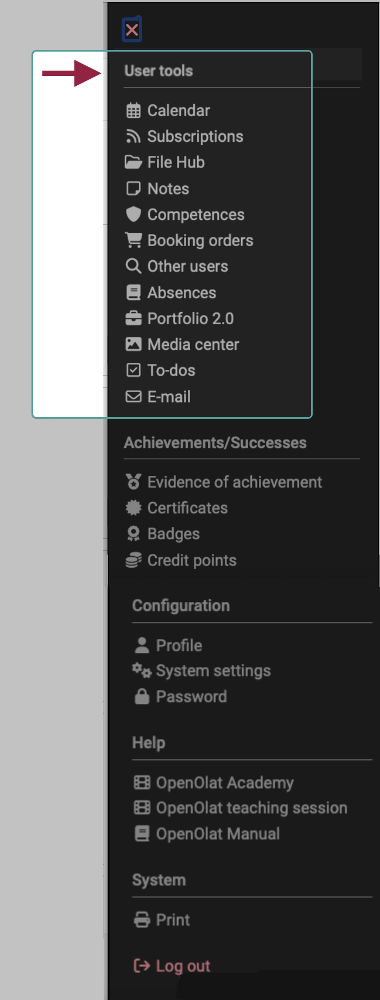

# User tools {: #personal_tools}

{ class="aside-right shadow lightbox"}

You can find the user tools as a section in the [personal menu](../index.md).

Which tools are offered to you here is determined on the one hand by the activation in the system administration. On the other hand, you decide yourself whether the tools appear in the [personal menu](../index.md) or as an icon in the main navigation.

 
 

## Menu items {: #menu_items}

If you are looking for a tool, the overview tells you in one sentence what it is for and takes you to its description with the link. The table follows the order in the personal menu.

| Menu item | Purpose |
|---|---|
| [Calendar](../Calendar.md) | Create private appointments and see the appointments from your courses and groups together in one calendar. |
| [Subscriptions](../Subscriptions.md) | See the news from everything you have subscribed to in one place and manage your subscriptions, for example for forums, folders or projects. |
| [File Hub](../File_Hub.md) | Open all folders you have access to, for example course folders, group folders and your personal files. |
| [Notes](../Notes.md) | View, edit, print and delete the notes you have written in your courses in one place. |
| [Booking orders](../Bookings.md) | Check which courses and learning resources you have booked and which status a booking has. |
| [Other users](../Other_users.md) | Search for other persons in OpenOlat, view their visiting card and their folder "public", and contact them. |
| [Absences](../Absences.md) | View your events and absences in the courses with absence management. OpenOlat shows the menu item when the module Events and Absences is enabled. |
| [Portfolio 2.0](../Portfolio/index.md) | Collect learning products in portfolio binders, reflect on your own learning process and share binders with other persons. |
| [Media Center](../Media_Center.md) | Create, upload and manage your media to use them, for example, in courses or in the portfolio, and see the media that others have shared with you. |
| [To-dos](../To-Dos.md) | See all to-dos to which you are assigned or delegated, for example from courses and projects, and create personal to-dos. |
| [E-mail](../E-Mail.md) | See the e-mails you have received or sent in OpenOlat. OpenOlat shows the menu item when the OpenOlat inbox is enabled. |

Evidence of achievement, certificates, badges, competences and credit points are in the personal menu in the section "Achievements/Successes". You find the links to these pages in the quick links on the page [Personal menu](../index.md#sections).

!!! tip "Tip"

    If you prefer to have your tools displayed in the main navigation instead of the personal menu, you can move the menu option from the personal menu there. You make the setting for this under 
    `Personal menu > Configuration > Settings > Tab "System" > User tools` 
    All tools that you mark here are displayed in the main navigation at the top right instead of in the personal menu and can thus be accessed more quickly.

[To the top of the page ^](#personal_tools)

## Further information {: #further_information}

[Personal Configuration: Settings >](../Settings.md) 
[Personal achievements/successes >](../Achievements/index.md) 
[Personal Configuration >](../Personal_Configuration/index.md)

[To the top of the page ^](#personal_tools)
