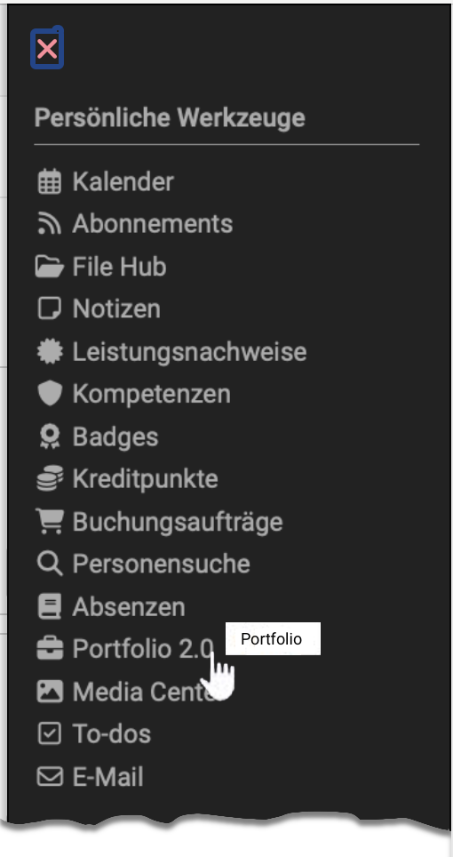
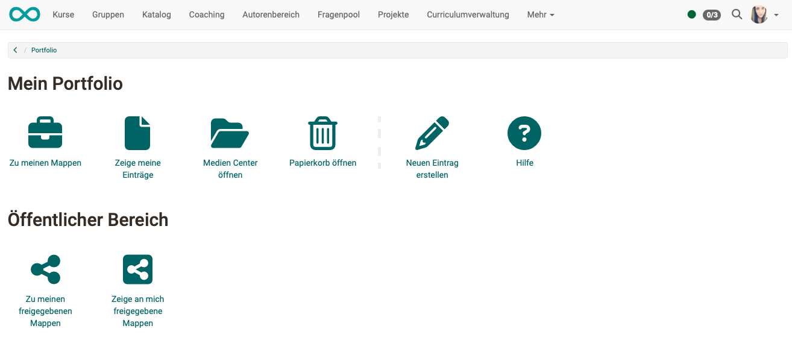

# Persönliche Werkzeuge: Portfolio 2.0 {: #portfolio}

{ class="aside-right lightbox"}

Ein Portfolio dient der Sammlung und Dokumentation von (Lern-)Artefakten,
Lernergebnissen und Lernprozessen sowie zur Förderung der [Reflexion](../../area_modules/Portfolio_General_Information.de.md#was-ist-eine-reflexion) über den
eigenen Entwicklungsprozess. 

Lernprodukte können hier gesammelt und bei Bedarf
bestimmten Personen zugänglich gemacht werden. Unter dem Menüeintrag "Portfolio 2.0" können Sie Portfoliomappen erstellen, diese bestimmten
Personen (OpenOlat-Benutzer:innen sowie Externen) [zugänglich machen](../../area_modules/Shared_by_me.de.md), die Mappen anderer Benutzer:innen [betrachten](../../area_modules/Shared_with_me.de.md) und auch
[Portfolioaufgaben](../../learningresources/Course_Element_Portfolio_Task.de.md), die Lehrende im Rahmen eines OpenOlat-Kurses bereitgestellt haben, bearbeiten.

Jede OpenOlat-Benutzer:in kann selbst eine Portfoliomappe erstellen, sofern die Administrator:innen dies freigegeben haben. Wie Sie eine eigene, kursunabhängige Mappe anlegen, zeigt die Anleitung [Drei Schritte zu Ihrer Mappe](../../portfolio/Three_steps_to_your_portfolio_binder.de.md).

{ class="shadow lightbox" title="Startseite Mein Portfolio" }

---

## Steckbrief

Name | Portfolio 2.0
---------|----------
Verfügbar seit | Release 11.0 (OO-2057)

## Bewertungsportfolio {: #assessment_portfolio}

Ein zentrales Element des OpenOlat Portfolios ist das Bewertungsportfolio. Dazu erstellen Autor:innen Portfoliovorlagen mit Aufgaben und Portfolio-Strukturen und stellen sie in OpenOlat-Kursen als Portfolioaufgabe zur Verfügung. Dort holen die Teilnehmenden die Portfolioaufgabe ab und bearbeiten die daraus entstandene Mappe unter "Portfolio 2.0" weiter.

Die Vorlage erstellen Autor:innen im Autorenbereich als Lernressource "Portfolio 2.0 Vorlage". Diese Seiten beschreiben die Sicht der Autor:innen:

* [Portfoliovorlage: Erstellung](../../learningresources/Portfolio_template_Creation.de.md)
* [Kursbaustein "Portfolioaufgabe"](../../learningresources/Course_Element_Portfolio_Task.de.md)
* [Prozess eines Bewertungsportfolios](../../portfolio/Process_of_an_assessment_portfolio.de.md)

## Die Kapitel zum Portfolio 2.0 {: #chapters}

In den folgenden Kapiteln erfahren Sie Generelles zum Thema ePortfolio, wie das OpenOlat Portfolio aufgebaut ist und welche Elemente dazu gehören, wie Sie selbst eine Portfoliomappe erstellen und organisieren und wie ein Bewertungsportfolio abläuft.

* [Allgemeines zum Portfolio](../../area_modules/Portfolio_General_Information.de.md)
* [Bestandteile des Portfolios](../../area_modules/Components_of_the_portfolio/index.de.md)
* [Drei Schritte zu Ihrer Mappe](../../portfolio/Three_steps_to_your_portfolio_binder.de.md)
* [Der Portfolio Editor](../../area_modules/The_portfolio_editor_17_1.de.md)
* [Mehrfachverwendung von Einträgen](../../area_modules/Multiple_use_of_entries.de.md)
* [Kompetenzen verschlagworten](../../area_modules/Competences_tags.de.md)
* [Prozess eines Bewertungsportfolios](../../portfolio/Process_of_an_assessment_portfolio.de.md)

## Weiterführende Informationen {: #further_information}

[Meine Mappen >](../../area_modules/My_portfolio_binders.de.md) 
[Persönliche Werkzeuge: Das Media Center >](../Media_Center.de.md) 
[Persönliche Erfolge/Leistungen: Leistungsnachweise >](../Evidence_of_Achievements.de.md) 
[Persönliches Menü >](../index.de.md)

[Zum Seitenanfang ^](#portfolio)
