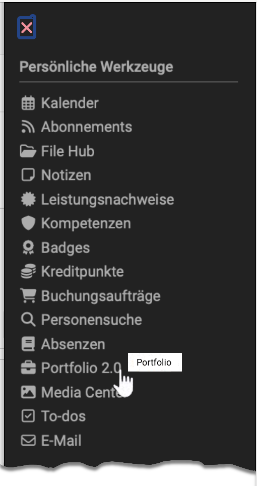
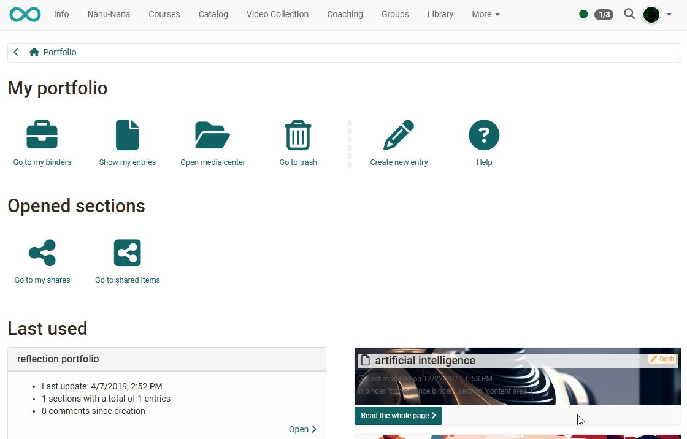

# User tools: Portfolio 2.0 {: #portfolio}

{ class="aside-right lightbox"}

A portfolio serves to collect and document (learning) artifacts, learning outcomes and learning processes as well as to promote [reflection](../../area_modules/Portfolio_General_Information.md#what-is-a-reflection) on one's own development process. 

Learning products can be collected here and, if required, be made accessible to specific persons. Under the menu item "Portfolio 2.0", you can create portfolio binders, make them [accessible](../../area_modules/Shared_by_me.md) to specific persons (OpenOlat users as well as external persons), [view](../../area_modules/Shared_with_me.md) the binders of other users, and edit [portfolio tasks](../../learningresources/Course_Element_Portfolio_Task.md) that teachers have provided as part of an OpenOlat course.

Every OpenOlat user can create a portfolio binder themselves, if the administrators have enabled this. The guide [Three steps to your portfolio binder](../../portfolio/Three_steps_to_your_portfolio_binder.md) shows how you create your own, course-independent binder.

{ class="shadow lightbox" title="Start page My portfolio" }

---

## Assessment portfolio {: #assessment_portfolio}

A central element of the OpenOlat portfolio is the assessment portfolio. For this purpose, authors create portfolio templates with tasks and portfolio structures and make them available in OpenOlat courses as a portfolio task. There, participants collect the portfolio task and continue working on the resulting binder under "Portfolio 2.0".

Authors create the template in the authoring area as the learning resource "Portfolio 2.0 template". These pages describe the authors' view:

* [Portfolio template: Creation](../../learningresources/Portfolio_template_Creation.md)
* [Course element "Portfolio task"](../../learningresources/Course_Element_Portfolio_Task.md)
* [Process of an assessment portfolio](../../portfolio/Process_of_an_assessment_portfolio.md)

## The chapters on Portfolio 2.0 {: #chapters}

In the following chapters, you will learn general information about ePortfolios, how the OpenOlat portfolio is structured and which elements are included, how you can create and organize a portfolio binder yourself and how an assessment portfolio works.

* [Portfolio - General Information](../../area_modules/Portfolio_General_Information.md)
* [Components of the portfolio](../../area_modules/Components_of_the_portfolio/index.md)
* [Three steps to your portfolio binder](../../portfolio/Three_steps_to_your_portfolio_binder.md)
* [The Portfolio Editor](../../area_modules/The_portfolio_editor_17_1.md)
* [Multiple use of entries](../../area_modules/Multiple_use_of_entries.md)
* [Competences tags](../../area_modules/Competences_tags.md)
* [Process of an assessment portfolio](../../portfolio/Process_of_an_assessment_portfolio.md)

## Further information {: #further_information}

[My binders >](../../area_modules/My_portfolio_binders.md) 
[User tools: Media Center >](../Media_Center.md) 
[Personal achievements/successes: Evidence of Achievements >](../Evidence_of_Achievements.md) 
[Personal menu >](../index.md)

[To the top of the page ^](#portfolio)
