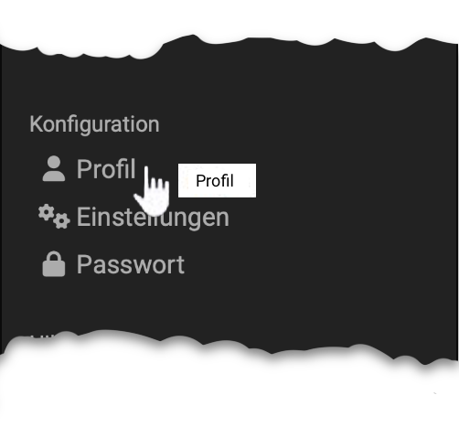
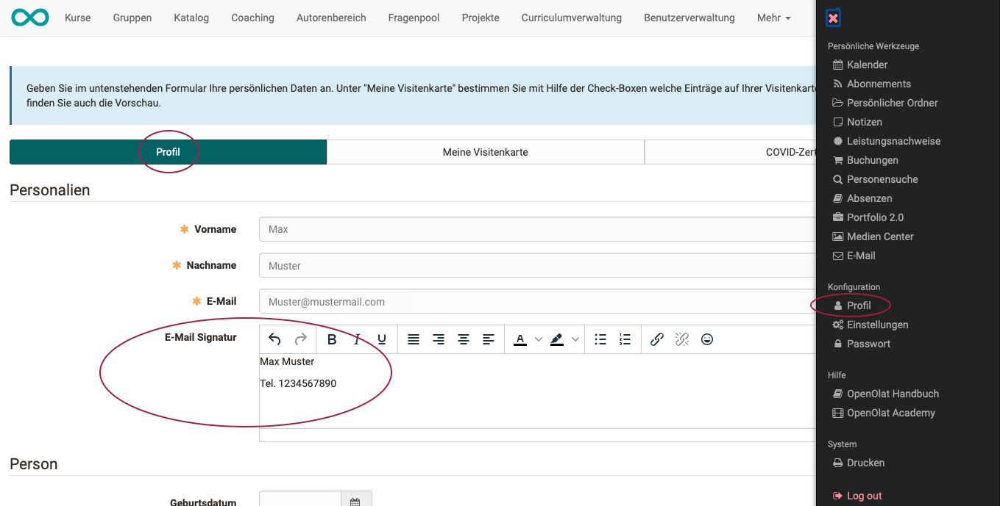

# :o_icon_o_icon_user: Persönliche Konfiguration: Profil {: #personal_configuration_profile}

{ class="aside-right lightbox"}

Im Profil halten Sie Ihre persönlichen Daten aktuell und bestimmen, was andere auf Ihrer Visitenkarte sehen. Sie öffnen es im persönlichen Menü im Abschnitt "Konfiguration" mit "Profil".

!!! tip "Ihre Organisation legt fest, welche Felder Sie selbst ändern"

    Ein gesperrtes Feld zeigt seinen Wert, nimmt aber keine Eingabe an. Standardmässig sind diese Felder gesperrt:

    * Anmeldename
    * Vorname
    * Nachname
    * Institution
    * Institutionsnummer (Matrikelnummer)
    * Institutions E-Mail
    * Organisationseinheit / Studiengruppe
    * Studienfach

    Der Anmeldename ist im Profil immer gesperrt. Welche weiteren Felder Sie selbst bearbeiten, bestimmt Ihre Organisation. Soll ein gesperrtes Feld geändert werden, z.B. Ihr Studienfach, wenden Sie sich an Ihre Administrator:in.

Ihre E-Mail-Adresse ändern Sie über den Button "Bearbeiten" beim Feld "E-Mail". OpenOlat sendet einen Validierungscode an die neue Adresse. Erst wenn Sie diesen Code eingegeben haben, ist die neue E-Mail-Adresse aktiv; bis dahin verwendet OpenOlat die bisherige Adresse. Nach der Änderung erhalten sowohl die alte als auch die neue Adresse eine Benachrichtigung. Bei Problemen wenden Sie sich an Ihre Administrator:in. [:octicons-tag-16:{ title="ab Release 20.0 (OO-8190)" }](https://track.frentix.com/issue/OO-8190)

    
E-Mail-Signatur

    Das Feld "E-Mail Signatur" erscheint, wenn Ihre Systemadministrator:innen es für das Profil vorgesehen haben.
    

Mit einer Telefonnummer in den Kontaktdaten setzen Sie Ihr Passwort per SMS zurück, wenn Ihre OpenOlat-Instanz einen SMS-Service nutzt. Tragen Sie die Nummer im internationalen Format ein, zum Beispiel +41 12 345 67 89. Am besten eignet sich eine Mobiltelefonnummer. Bei einer Festnetznummer erhalten Sie zur Überprüfung einen Anruf, der Ihnen den Code ansagt.

Im Bereich "Über mich" tragen Sie bei Bedarf Informationen über sich als Freitext ein.

Mit einem Foto im Profil erkennen andere Sie beim Online-Lernen wieder. Das Foto erscheint in OpenOlat an mehreren Stellen, z.B. auf Ihrer Visitenkarte, bei Forenbeiträgen oder in der Liste der Teilnehmer:innen. OpenOlat schneidet das Bild auf eine Breite von 100 Pixel zu.

Ihr Foto laden Sie im Abschnitt "Publiziertes Bild" über "Datei wählen" hoch, als JPG-, PNG- oder GIF-Datei bis 10 MB. Mit "Ersetzen" tauschen Sie das Foto aus, mit "Löschen" entfernen Sie es. Klicken Sie danach auf "Speichern". Ist der Abschnitt gesperrt, gibt Ihre Organisation das Foto vor.

### Tab "Meine Visitenkarte"

Mit den Checkboxen bestimmen Sie, welche Einträge auf Ihrer Visitenkarte erscheinen und damit für andere OpenOlat-Benutzer:innen sichtbar sind. Checkboxen, die Sie nicht ändern können, sind systemweit vorgegeben.

Unter "Vorschau" zeigt der Tab Ihre Visitenkarte. Dort steht im Abschnitt "Externer Link zur Visitenkarte" der Link auf Ihre Visitenkarte. Sie kopieren ihn oder geben ihn als QR-Code weiter, etwa in einer E-Mail-Signatur oder auf einer Folie, siehe [Links kopieren und als QR-Code weitergeben](../../basic_concepts/Navigation.de.md#url_field). [:octicons-tag-16:{ title="ab Release 10.1 (OO-1348)" }](https://track.frentix.com/issue/OO-1348)

!!! tip "Tipp"

    Um sich die Visitenkarten anderer OpenOlat-Benutzer:innen anzuschauen, wählen Sie im persönlichen Menü das Werkzeug "[Personensuche](../Other_users.de.md)" und suchen die gewünschte Person über die Suchmaske.

## Weiterführende Informationen {: #further_information}

**Auf dieser Seite erwähnt** 
[Navigation >](../../basic_concepts/Navigation.de.md) 
[Persönliche Werkzeuge: Personensuche >](../Other_users.de.md)

**Weiterführend** 
[Persönliche Werkzeuge: E-Mail >](../E-Mail.de.md) 
[Persönliche Konfiguration: Einstellungen >](../Settings.de.md) 
[Persönliche Konfiguration: Passwort >](../Password.de.md) 
[Persönliches Menü >](../index.de.md)

[Zum Seitenanfang ^](#personal_configuration_profile)
