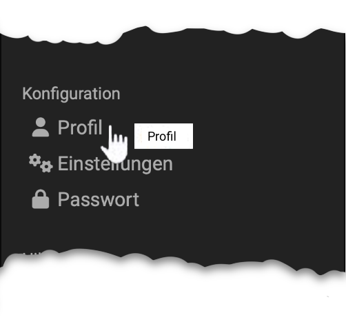
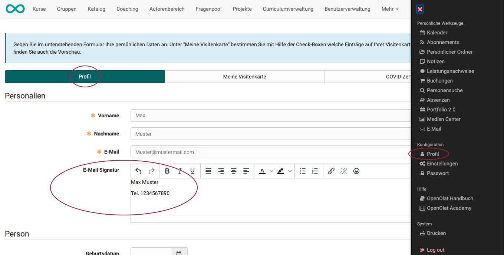

# :o_icon_o_icon_user: Personal Configuration: Profile {: #personal_configuration_profile}

{ class="aside-right lightbox"}

In the profile you keep your personal data up to date and determine what others see on your visiting card. You open it in the personal menu in the section "Configuration" with "Profile".

!!! tip "Your organisation determines which fields you change yourself"

    A locked field shows its value but does not accept any input. By default, these fields are locked:

    * Username
    * First name
    * Last name
    * Institution
    * Institution identifier (registration number)
    * Institutional e-mail
    * Organizational unit/study group
    * Field of studies

    The username is always locked in the profile. Your organisation determines which other fields you edit yourself. If a locked field needs to be changed, e.g. your field of studies, contact your administrator.

You change your e-mail address with the button "Edit" next to the field "E-mail". OpenOlat sends a validation code to the new address. The new e-mail address only becomes active once you have entered this code; until then OpenOlat uses the previous address. After the change, both the old and the new address receive a notification. If you have problems, contact your administrator. [:octicons-tag-16:{ title="from Release 20.0 (OO-8190)" }](https://track.frentix.com/issue/OO-8190)

    
E-mail signature

    The field "E-Mail signature" appears if your system administrators have provided it for the profile.
    

With a phone number in the contact data, you reset your password via SMS if your OpenOlat instance uses an SMS service. Enter the number in the international format, for example +41 12 345 67 89. A mobile phone number works best. For a landline number, you receive a call for verification that reads out the code to you.

In the section "About me", you enter information about yourself as free text if required.

With a photo in your profile, others recognise you during online learning. The photo appears in OpenOlat in several places, e.g. on your visiting card, in forum posts or in the participant list. OpenOlat crops the picture to a width of 100 pixels.

You upload your photo in the section "Published image" with "Select file", as a JPG, PNG or GIF file of up to 10 MB. With "Replace" you exchange the photo, with "Delete" you remove it. Then click "Save". If the section is locked, your organisation provides the photo.

### Tab "My visiting card"

With the checkboxes you determine which entries appear on your visiting card and are thus visible to other OpenOlat users. Checkboxes you cannot change are predefined system-wide.

Under "Preview", the tab shows your visiting card. There, the section "External link to visiting card" shows the link to your visiting card. You copy it or pass it on as a QR code, for example in an e-mail signature or on a slide, see [Copy links and pass them on as a QR code](../../basic_concepts/Navigation.md#url_field). [:octicons-tag-16:{ title="from Release 10.1 (OO-1348)" }](https://track.frentix.com/issue/OO-1348)

!!! tip "Tip"

    To view the visiting cards of other OpenOlat users, select the tool "[Other users](../Other_users.md)" in the personal menu and search for the desired person using the search mask.

## Further information {: #further_information}

**Mentioned on this page** 
[Navigation >](../../basic_concepts/Navigation.md) 
[User tools: Other users >](../Other_users.md)

**Further reading** 
[User tools: E-Mail >](../E-Mail.md) 
[Personal Configuration: Settings >](../Settings.md) 
[Personal Configuration: Password >](../Password.md) 
[Personal menu and general components >](../index.md)

[To the top of the page ^](#personal_configuration_profile)
