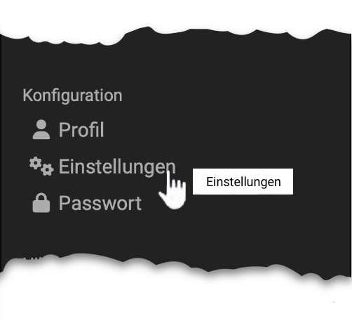
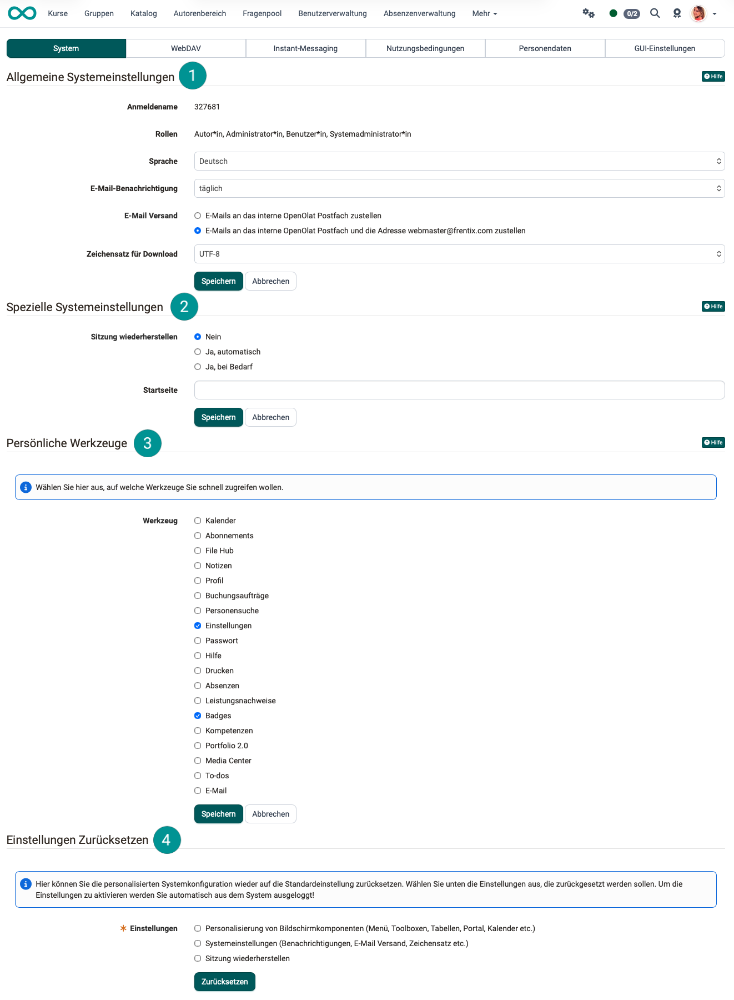
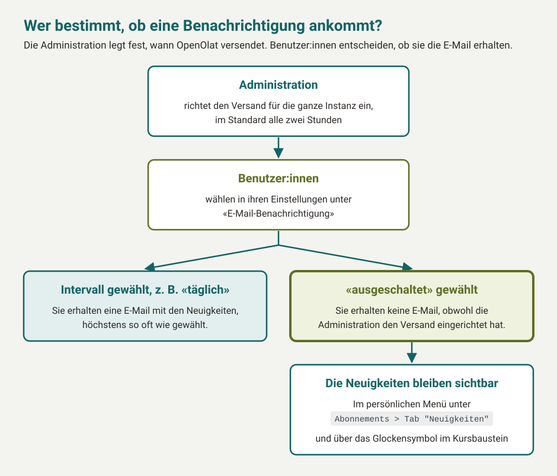
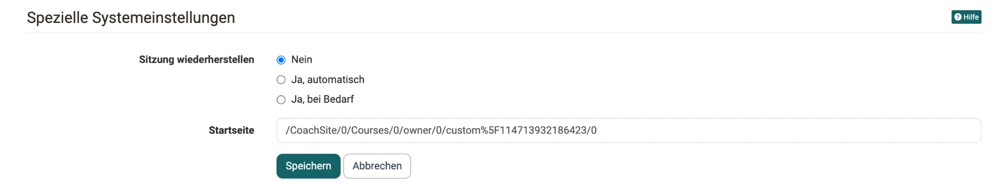
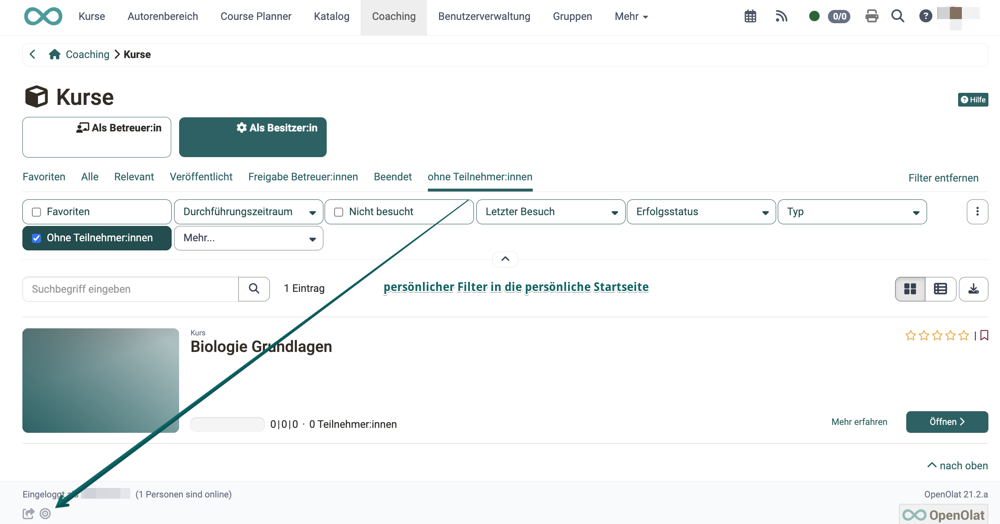
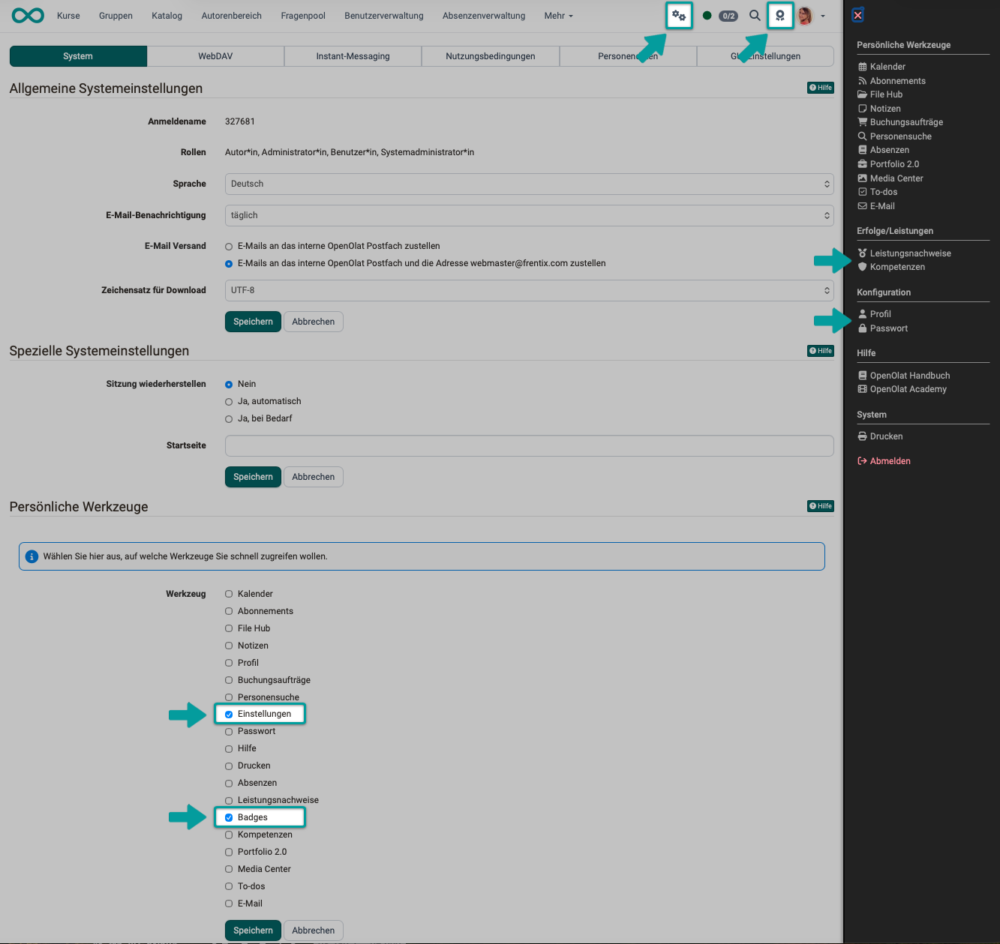
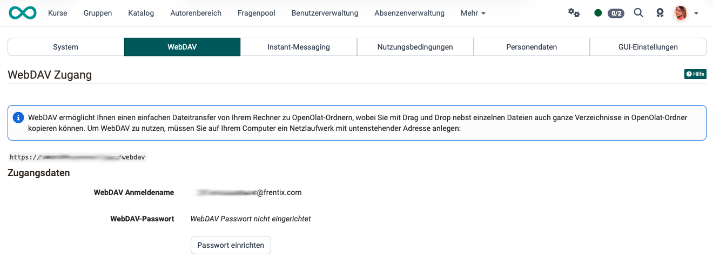
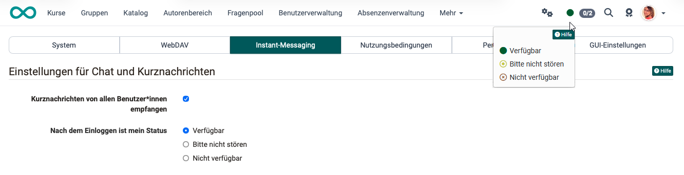
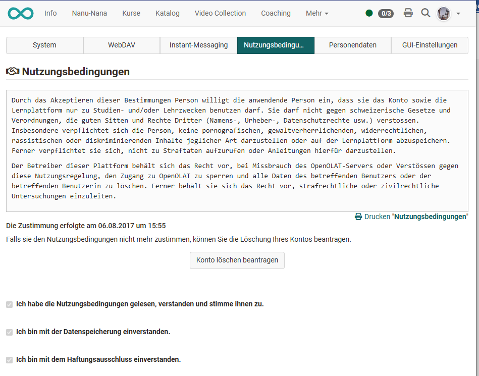
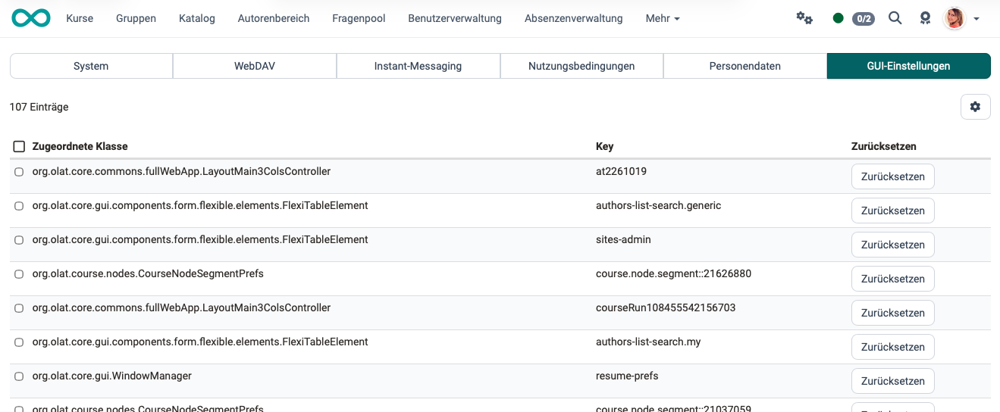

# :o_icon_o_icon_settings: Persönliche Konfiguration: Einstellungen {: #personal_configuration_settings}

{ class="aside-right lightbox"}

:octicons-device-camera-video-24: **Video-Einführung**: [Benutzereinstellungen](<https://www.youtube.com/embed/7osBJ99FIN8>){:target="_blank"}

Mit Hilfe der Einstellungen können Sie OpenOlat nach Ihren Bedürfnissen anpassen. Sie finden die Einstellungen im persönlichen Menü unter: 
`Persönliches Menü > Einstellungen`

## Tab System {: #tab_system}

Sie finden den Tab "System" im persönlichen Menü unter: 
`Persönliches Menü > Einstellungen > Tab "System"`

{ class="shadow lightbox" title="Tab System der persönlichen Einstellungen" }

###  Allgemeine Systemeinstellungen {: #general}

In den allgemeinen Systemeinstellungen sehen Sie Ihre Kontodaten. Sie legen hier ausserdem die Sprache, die Benachrichtigungen und die Zustellung Ihrer E-Mails fest.

#### Anmeldename und Rollen {: #username_roles}

Hier sehen Sie Ihren Anmeldenamen und Ihre OpenOlat-Rollen. Beide Angaben sind nur zur Ansicht und lassen sich hier nicht ändern.

#### Sprache {: #language}

Unter "Sprache" wählen Sie Ihre individuelle Systemsprache. OpenOlat ist in zahlreiche Sprachen übersetzt worden. Die Änderung der Sprache wird erst nach dem nächsten Login aktiv.

!!! info "Wichtig"

    Die Sprache von Kursinhalten wird von der Sprachwahl hier nicht beeinflusst.

#### E-Mail-Benachrichtigung {: #notification_interval}

Unter "E-Mail-Benachrichtigung" legen Sie fest, wie oft Sie höchstens eine E-Mail mit den Neuigkeiten aus Ihren Abonnements erhalten. Zur Auswahl stehen: "ausgeschaltet", "alle zwei Stunden", "alle vier Stunden", "alle zwölf Stunden", "täglich", "wöchentlich" und "monatlich". Treffen Sie keine Wahl, gilt "täglich". Je nach Konfiguration Ihrer OpenOlat-Instanz stehen weniger Intervalle zur Auswahl, oder das Feld erscheint gar nicht.

Die gewählte Häufigkeit ist eine Obergrenze: OpenOlat schickt Ihnen nur dann eine E-Mail, wenn es in Ihren Abonnements etwas Neues gibt. Mit "ausgeschaltet" erhalten Sie keine Benachrichtigungen per E-Mail mehr. Das gilt unabhängig vom Zeitplan der Instanz. Die Neuigkeiten gehen dabei nicht verloren: Ihre Abonnements bleiben bestehen, und Sie sehen die Neuigkeiten jederzeit selbst unter `Persönliches Menü > Abonnements > Tab "Neuigkeiten"` oder über das Glockensymbol im jeweiligen Kursbaustein. Mehr dazu: [Abonnements](Subscriptions.de.md#view_notifications)

Die E-Mail kommt nicht im selben Moment, in dem Ihr Intervall abläuft, sondern beim nächsten Lauf des systemweiten Versands. Diesen Zeitplan legt die Administration fest, im Standard läuft der Versand alle zwei Stunden. Ist bei einem Lauf Ihr Intervall abgelaufen und gibt es Neuigkeiten, erhalten Sie die E-Mail. Mehr dazu: [Core-Konfiguration: Benachrichtigungen](../../manual_admin/administration/Core_functions.de.md#notifications)

{ class="shadow lightbox" title="Wer bestimmt, ob eine Benachrichtigung ankommt?" }

#### E-Mail Versand {: #mail_delivery}

Unter "E-Mail Versand" legen Sie fest, wohin OpenOlat Ihre E-Mails zustellt. Das Feld erscheint nur, wenn die Administration das OpenOlat Postfach eingeschaltet hat.

  * "E-Mails an das interne OpenOlat Postfach zustellen": Die Nachrichten bleiben in OpenOlat. Sie lesen sie unter `Persönliche Werkzeuge > E-Mail`. In der Benachrichtigungsmail finden Sie zusätzlich einen Hinweis auf neue E-Mails im OpenOlat-Postfach.
  * "E-Mails an das interne OpenOlat Postfach und die Adresse ... zustellen": OpenOlat legt jede Nachricht ins Postfach und leitet sie zusätzlich an die angezeigte Adresse weiter. Angezeigt wird die Adresse aus Ihrem Profil. Das ist die dauerhafte Weiterleitung.

Ihre Wahl überschreibt die systemweite Standardeinstellung. Treffen Sie keine Wahl, gilt die Vorgabe der Administration: [E-Mail Einstellungen](../../manual_admin/administration/E-Mail_Settings.de.md#e-mail-inbox-and-outbox).

Eine einzelne Nachricht leiten Sie auch ohne diese Einstellung weiter: [Persönliche Werkzeuge: E-Mail](E-Mail.de.md#forward).

#### Zeichensatz für Download {: #charset}

Über den "Zeichensatz für Download" bestimmen Sie, in welchem Zeichensatz Dateien abgespeichert werden sollen, die Sie über die Datenarchivierung herunterladen. Dies betrifft den Download der Test- und Fragebogenresultate sowie der Kursresultate. Im Standard ist der Zeichensatz UTF-8 voreingestellt. Enthalten Ihre Tests oder Fragebogen z.B. arabische Zeichen, muss hier UTF-8 gewählt sein.

#### Dokumenteneditor {: #document_editor}

Unter "Dokumenteneditor" wählen Sie, mit welchem Editor OpenOlat Ihre Dokumente öffnet. Das Feld erscheint nur, wenn Ihnen mindestens zwei externe Editoren zur Verfügung stehen.

###  Spezielle Systemeinstellungen {: #special}

Damit Sie nach dem Login sofort dort weiterarbeiten, wo Ihre Arbeit liegt, legen Sie hier fest, welche Seite OpenOlat nach dem Login öffnet: den zuletzt besuchten Ort oder eine Startseite.

{ class="shadow lightbox" title="Abschnitt Spezielle Systemeinstellungen im Tab System · 2026.10.19" }

#### Sitzung wiederherstellen {: #resume_session}

In der Auswahl "Sitzung wiederherstellen" legen Sie fest, was direkt nach dem Login passiert. Ihre Startseite ist die Seite, die Sie unten im Feld "Startseite" festlegen. Haben Sie dort keine festgelegt, ist es die Startseite, die Ihre Organisation für Ihre Rolle eingerichtet hat.

  * "Nein": OpenOlat öffnet nach jedem Login Ihre Startseite.
  * "Ja, automatisch": OpenOlat öffnet den Ort, den Sie zuletzt besucht haben.
  * "Ja, bei Bedarf": OpenOlat fragt nach dem Login "Wollen Sie Ihre letzte Sitzung wiederherstellen?". Mit "Ja" gelangen Sie an den zuletzt besuchten Ort, mit "Startseite" auf Ihre Startseite. Gibt es weder Ihre eigene noch eine Startseite Ihrer Organisation, heisst der zweite Button "Nein".

Setzen Sie in dieser Rückfrage das Häkchen "Nicht mehr nachfragen", speichert OpenOlat Ihre Antwort als Einstellung: "Ja" stellt "Sitzung wiederherstellen" auf "Ja, automatisch", "Startseite" oder "Nein" stellt sie auf "Nein".

Gibt es noch keinen zuletzt besuchten Ort, etwa beim ersten Login, öffnet OpenOlat in jedem Fall Ihre Startseite.

#### :o_icon_o_icon_landingpage: Startseite [:octicons-tag-16:{ title="ab Release 10.0 (OO-986)" }](https://track.frentix.com/issue/OO-986) {: #landing_page}

Ihre Organisation kann für jede Rolle eine Startseite einrichten. Haben Sie mehrere Rollen, legt Ihre Organisation fest, welche davon Ihre Startseite bestimmt. Im Feld "Startseite" können Sie eine eigene Startseite festlegen. Sie hat Vorrang vor der Startseite Ihrer Organisation. Damit OpenOlat sie nach jedem Login öffnet, wählen Sie bei "Sitzung wiederherstellen" "Nein". Mehr dazu: [Startseiten nach Rolle](../../manual_admin/administration/Landing_pages.de.md#role_based) und [Was Vorrang vor der Startseite Ihrer Organisation hat](../../manual_admin/administration/Landing_pages.de.md#precedence)

!!! info "Wichtig"

    Eine persönliche Startseite steht nicht in den Regeln, mit denen Ihre Organisation die Startseiten einrichtet. Öffnet OpenOlat nach dem Login eine unerwartete Seite, muss bei einer Anfrage deshalb zuerst geklärt werden, ob eine Regel Ihrer Organisation oder Ihre persönliche Startseite gilt. Diese Abklärung verkürzen Sie, wenn Sie gleich angeben, ob Sie eine persönliche Startseite festgelegt haben.

Bei "Ja, automatisch" blendet OpenOlat das Feld "Startseite" aus.

Am einfachsten öffnen Sie die gewünschte Seite und klicken links unten in der Fusszeile auf das Startseiten-Icon :o_icon_o_icon_landingpage: "Aktuelle Seite im Profil als persönliche Startseite festlegen". Jede OpenOlat-Seite, auf die Sie Zugriff haben, kann so Ihre persönliche Startseite werden. Den Link auf eine bestimmte Seite erhalten Sie auch über die Aktion "Teilen" links unten in der Fusszeile. Wählen Sie dort "Link kopieren" und fügen Sie den Link ins Feld "Startseite" ein [:octicons-tag-16:{ title="ab Release 21.1 (OO-9693)" }](https://track.frentix.com/issue/OO-9693){:target="_blank"}.

Auch einen eigenen Filter-Tab einer Liste können Sie als persönliche Startseite festlegen, zum Beispiel einen gespeicherten Filter der Kursliste im Coaching. Öffnen Sie den Tab und klicken Sie auf das Startseiten-Icon :o_icon_o_icon_landingpage: in der Fusszeile. Wie Sie einen Filter als eigenen Tab speichern, beschreibt die Seite [Mit Tabellen arbeiten](../basic_concepts/Table_Concept.de.md).

{ class="shadow lightbox" title="Seite Kurse im Coaching · 2026.10.19" }

Leeren Sie das Feld "Startseite" und klicken Sie auf "Speichern", gilt wieder die Startseite Ihrer Organisation.

###  Persönliche Werkzeuge {: #personal_tools}

Hier wählen Sie aus, welche persönlichen Werkzeuge direkt oben in der Hauptnavigation (links neben Ihrem Profilbild) erscheinen sollen, sodass Sie schnell auf diese Werkzeuge zugreifen können. 
Werkzeuge, die als Symbol in der Hauptnavigation angezeigt werden, sind nicht mehr im persönlichen Menü aufgeführt.

**Beispiel: "Einstellungen" und "Badges" sind aus dem persönlichen Menü in die Hauptnavigation verschoben**
{ class="shadow lightbox" title="Abschnitt Persönliche Werkzeuge im Tab System" }

!!! tip "Tipp"

    Versuchen Sie nicht, alle Werkzeuge zu aktivieren, sondern wählen Sie gezielt die Werkzeuge aus, die Sie häufig benutzen. So bleibt die Hauptnavigation übersichtlich.

###  Einstellungen zurücksetzen {: #reset}

Unter "Einstellungen Zurücksetzen" im Tab "System" haben Sie die Möglichkeit, Ihre vorgenommenen systembezogenen Änderungen wieder **auf die Standardeinstellungen zurückzusetzen**. Zurückgesetzt werden können

* die personalisierten Einstellungen der Bildschirmkomponenten (Menü, Toolboxen, Tabellen, Portal, Kalender, usw.),
* Systemeinstellungen (Benachrichtigungen, E-Mail-Versand, Zeichensatz, usw.)
* sowie die Einstellungen zur Wiederherstellung der letzten Sitzung.

Nach dem Zurücksetzen werden Sie automatisch aus OpenOlat abgemeldet.

[Zum Seitenanfang ^](#personal_configuration_settings)

---

## Tab WebDAV {: #tab_webdav}

Im Tab "WebDAV" finden Sie den [WebDAV-Link zu Ihrer OpenOlat-Instanz](../basic_concepts/Using_WebDAV.de.md), über den Sie Dateien bequem verwalten können. Über WebDAV greifen Sie als OpenOlat-Benutzer:in auf Ihren persönlichen Ordner zu. OpenOlat-Autor:innen können über WebDAV ihre gesamten Kursdateien organisieren.

Unter "Zugangsdaten" sehen Sie Ihren WebDAV-Anmeldenamen. Mit "Passwort einrichten" legen Sie ein eigenes WebDAV-Passwort fest.

{ class="shadow lightbox" title="Tab WebDAV der persönlichen Einstellungen" }

[Zum Seitenanfang ^](#personal_configuration_settings)

---

## Tab Instant-Messaging {: #tab_instant-messaging}

Im Tab "Instant-Messaging" legen Sie die Einstellungen für die [Chat-Funktion](../../manual_admin/administration/Instant_Messaging.de.md) und Ihren Kommunikations-Status nach dem Login fest. Mit der Option "Kurznachrichten von allen Benutzer:innen empfangen" legen Sie fest, ob alle Benutzer:innen Ihnen Kurznachrichten senden dürfen. Unter "Nach dem Einloggen ist mein Status" wählen Sie zwischen "Verfügbar", "Bitte nicht stören" und "Nicht verfügbar".

{ class="shadow lightbox" title="Tab Instant-Messaging der persönlichen Einstellungen" }

[Zum Seitenanfang ^](#personal_configuration_settings)

---

## Tab Nutzungsbedingungen {: #tab_terms_of_use}

Hier können Sie die Nutzungsbedingungen nachlesen, welche Sie beim ersten Login bestätigt haben. Die genauen Nutzungsbedingungen werden von den OpenOlat-Administrator:innen festgelegt.

Ferner kann hier auch die Löschung des kompletten OpenOlat-Kontos beantragt werden. Der Antrag geht als E-Mail an eine von der System-Administration hinterlegte Adresse; die Löschung selbst führt die Benutzerverwaltung aus. Mehr dazu: [Datenschutz](../../manual_admin/usermanagement/Data_protection.de.md#request_account_deletion)

{ class="shadow lightbox" title="Tab Nutzungsbedingungen der persönlichen Einstellungen" }

[Zum Seitenanfang ^](#personal_configuration_settings)

---

## Tab Personendaten {: #tab_user_data}

In diesem Bereich können Sie eine Übersicht über Ihre in OpenOlat gespeicherten Daten nach Artikel 15 DSGVO beim Betreiber anfordern. Es ist der entsprechende Support-Link hier hinterlegt.

Sobald der Export durchgeführt wurde, können Sie die über Sie gespeicherten Benutzerdaten hier über die Schaltfläche **Dateien herunterladen** beziehen. Die Datei bleibt einen Monat zum Herunterladen bereit, danach ist ein neuer Export nötig.

Wie der Export ausgelöst wird und wer das darf, beschreibt die Seite [Datenschutz](../../manual_admin/usermanagement/Data_protection.de.md#export_user_data) im Administrationshandbuch.

[Zum Seitenanfang ^](#personal_configuration_settings)

---

## Tab GUI-Einstellungen {: #tab_GUI}

Die Einstellungen des GUI (Graphical User Interface) werden in Variablen gespeichert. Expert:innen können hier gezielt einzelne Variablenwerte zurücksetzen.

{ class="shadow lightbox" title="Tab GUI-Einstellungen der persönlichen Einstellungen" }

[Zum Seitenanfang ^](#personal_configuration_settings)

---

## Weiterführende Informationen {: #further_information}

**Auf dieser Seite erwähnt** 
[Persönliche Werkzeuge: Abonnements >](Subscriptions.de.md) 
[Core-Konfiguration: Übersicht >](../../manual_admin/administration/Core_functions.de.md) 
[E-Mail Einstellungen >](../../manual_admin/administration/E-Mail_Settings.de.md) 
[Persönliche Werkzeuge: E-Mail >](E-Mail.de.md) 
[Startseite >](../../manual_admin/administration/Landing_pages.de.md) 
[Mit Tabellen arbeiten >](../basic_concepts/Table_Concept.de.md) 
[Einsatz von WebDAV >](../basic_concepts/Using_WebDAV.de.md) 
[Modul Instant Messaging >](../../manual_admin/administration/Instant_Messaging.de.md) 
[Datenschutz >](../../manual_admin/usermanagement/Data_protection.de.md)

**Weiterführend** 
[Persönliche Konfiguration: Profil >](Profile.de.md) 
[Persönliche Konfiguration: Passwort >](Password.de.md) 
[Persönliche Werkzeuge >](Personal_Tools.de.md) 
[Chat >](../basic_concepts/Chat.de.md)

**youtube** 
[Benutzereinstellungen](<https://www.youtube.com/embed/7osBJ99FIN8>){:target="_blank"}

[Zum Seitenanfang ^](#personal_configuration_settings)
