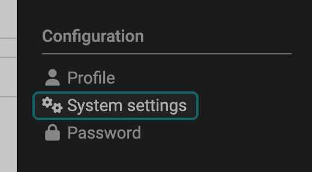
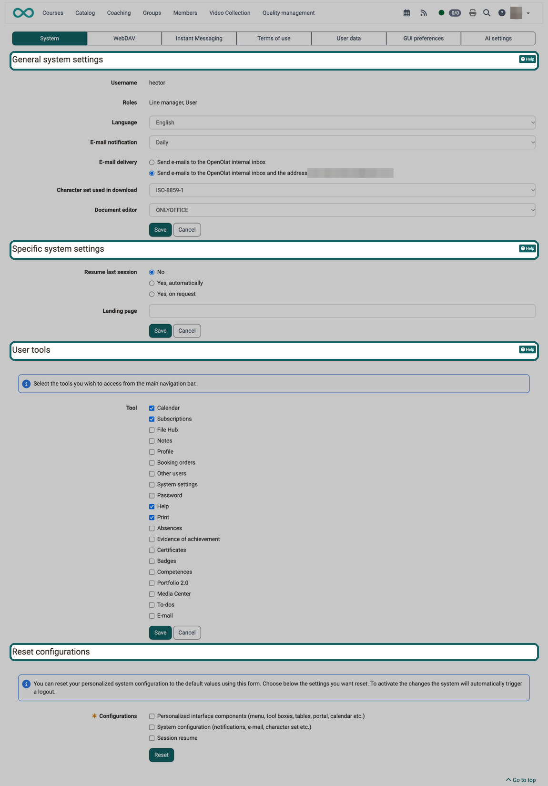
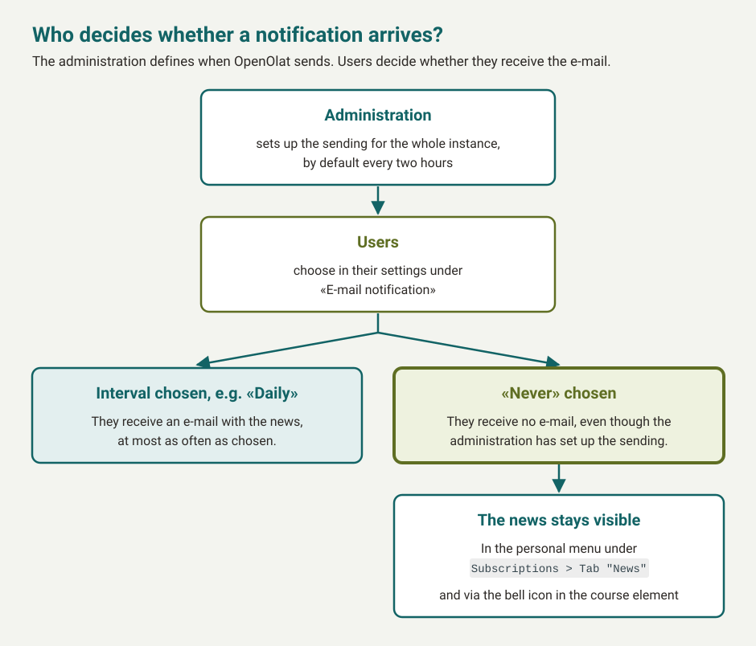
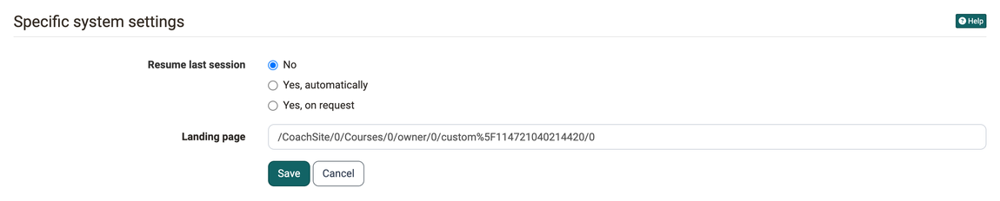
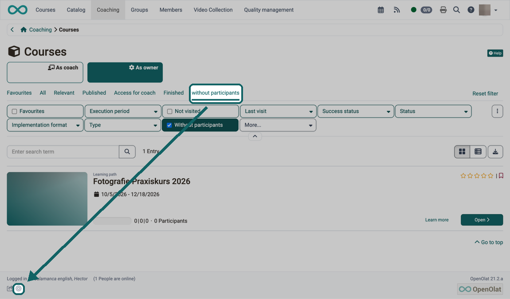
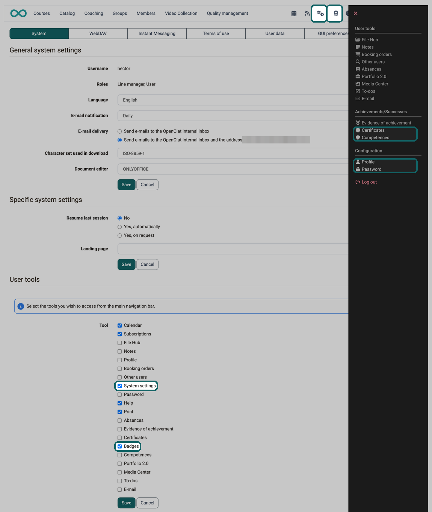
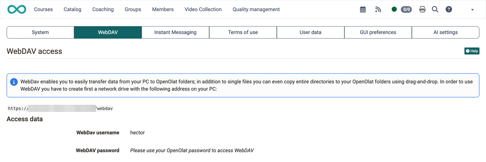
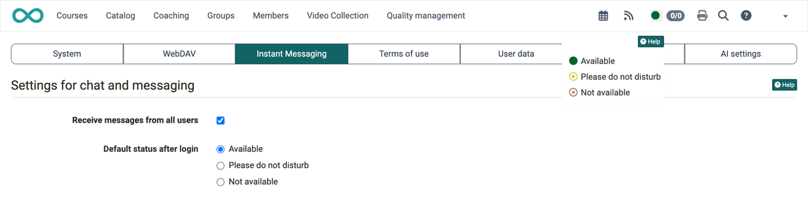
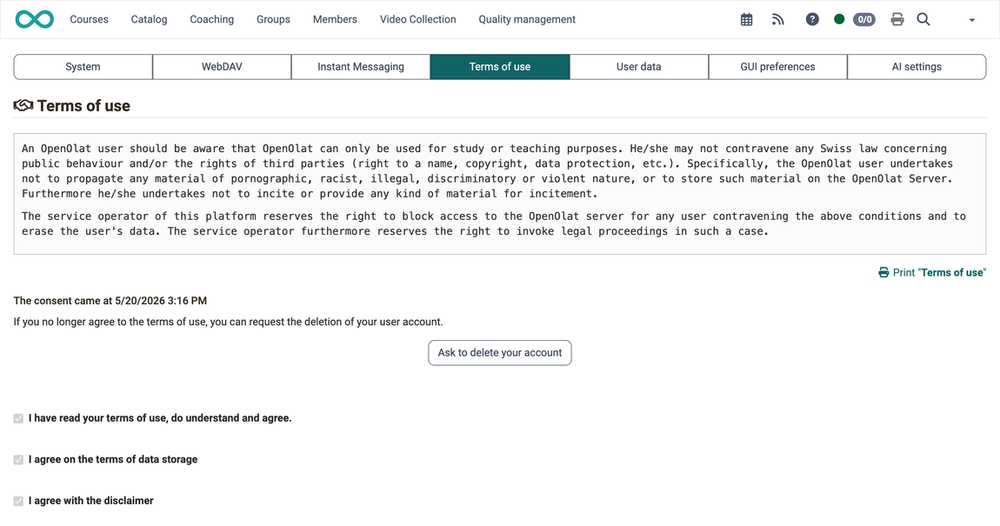
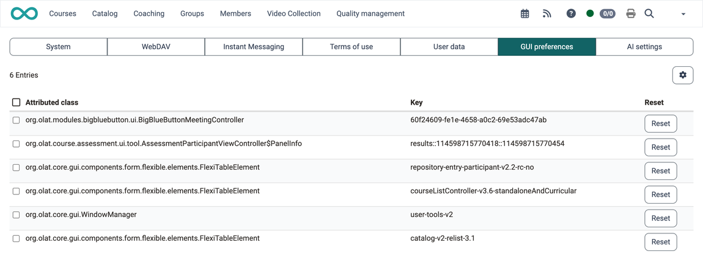

# :o_icon_o_icon_settings: Personal Configuration: Settings {: #personal_configuration_settings}

{ class="aside-right lightbox" title="Personal menu · 2026.10.20" }

:octicons-device-camera-video-24: **Video Introduction (German)**: [User settings](<https://www.youtube.com/embed/7osBJ99FIN8>){:target="_blank"}

The settings allow you to adapt OpenOlat according to your needs. You find the settings in the personal menu under: 
`Personal menu > System settings`

## Tab System {: #tab_system}

You find the tab "System" in the personal menu under: 
`Personal menu > System settings > Tab "System"`

{ class="shadow lightbox" title="System tab of the personal settings · 2026.10.20" }

### General system settings {: #general}

In the general system settings you see your account data. You also set the language, the notifications and the delivery of your e-mails here.

#### Username and roles {: #username_roles}

Here you see your username and your OpenOlat roles. Both entries are for viewing only and cannot be changed here.

#### Language {: #language}

Under "Language" you select your individual system language. OpenOlat has been translated into numerous languages. Changing the language only becomes active after the next login.

!!! info "Important"

    The language of course content is not affected by the language selection here.

#### E-mail notification {: #notification_interval}

Under "E-mail notification" you set how often at most you receive an e-mail with the news from your subscriptions. You can choose between: "Never", "Every two hours", "Every four hours", "Every twelve hours", "Daily", "Weekly" and "Monthly". If you make no choice, "Daily" applies. Depending on the configuration of your OpenOlat instance, fewer intervals are available, or the field does not appear at all.

The chosen frequency is an upper limit: OpenOlat only sends you an e-mail if there is something new in your subscriptions. With "Never" you no longer receive notifications by e-mail. This applies regardless of the schedule of the instance. The news is not lost: your subscriptions remain, and you can see the news yourself at any time under `Personal menu > Subscriptions > Tab "News"` or via the bell icon in the respective course element. More about this: [Subscriptions](Subscriptions.md#view_notifications)

The e-mail does not arrive at the moment your interval expires, but at the next run of the system-wide sending. The administration defines this schedule, by default the sending runs every two hours. If your interval has expired at a run and there is news, you receive the e-mail. More about this: [Core functions: Notifications](../../manual_admin/administration/Core_functions.md#notifications)

{ class="shadow lightbox" title="Who decides whether a notification arrives?" }

#### E-mail delivery {: #mail_delivery}

Under "E-mail delivery" you set where OpenOlat delivers your e-mails. The field only appears when the administration has switched on the OpenOlat inbox.

  * "Send e-mails to the OpenOlat internal inbox": The messages stay in OpenOlat. You read them under `User tools > E-Mail`. In the notification mail you also find a note about new e-mails in the OpenOlat inbox.
  * "Send e-mails to the OpenOlat internal inbox and the address ...": OpenOlat puts every message into the inbox and forwards it to the address shown as well. The address shown is the one from your profile. This is the permanent forwarding.

Your choice overrides the system-wide default setting. If you make no choice, the default of the administration applies: [Email Settings](../../manual_admin/administration/E-Mail_Settings.md#e-mail-inbox-and-outbox).

You can also forward a single message without this setting: [User tools: E-Mail](E-Mail.md#forward).

#### Character set used in download {: #charset}

Via the "Character set used in download" you determine in which character set files that you download via data archiving are stored. This concerns the download of test and questionnaire results as well as course results. By default, the character set UTF-8 is preset. If your tests or questionnaires contain e.g. Arabic characters, UTF-8 must be selected here.

#### Document editor {: #document_editor}

Under "Document editor" you select which editor OpenOlat uses to open your documents. The field only appears when at least two external editors are available to you.

### Specific system settings {: #special}

So that you can continue working right where your work lies after login, you define here which page OpenOlat opens after login: the location last visited or a landing page.

{ class="shadow lightbox" title="Section Specific system settings in the System tab · 2026.10.20" }

#### Resume last session {: #resume_session}

In the selection "Resume last session" you specify what happens immediately after login. Your landing page is the page you set below in the field "Landing page". If you have not set one there, it is the landing page your organisation has set up for your role.

  * "No": OpenOlat opens your landing page after each login.
  * "Yes, automatically": OpenOlat opens the location you visited last.
  * "Yes, on request": OpenOlat asks after login "Do you want to resume your last session?". With "Yes" you go to the location last visited, with "Landing page" to your landing page. If there is neither your own landing page nor one of your organisation, the second button is called "No".

If you tick the check box "Do not ask again" in this prompt, OpenOlat saves your answer as a setting: "Yes" sets "Resume last session" to "Yes, automatically", "Landing page" or "No" sets it to "No".

If there is no location last visited yet, for example at the first login, OpenOlat opens your landing page in any case.

#### :o_icon_o_icon_landingpage: Landing page [:octicons-tag-16:{ title="from Release 10.0 (OO-986)" }](https://track.frentix.com/issue/OO-986) {: #landing_page}

Your organisation can set up a landing page for each role. If you have several roles, your organisation determines which of them defines your landing page. In the field "Landing page" you can set your own landing page. It takes precedence over the landing page of your organisation. So that OpenOlat opens it after each login, select "No" for "Resume last session". More about this: [Landing pages by role](../../manual_admin/administration/Landing_pages.md#role_based) and [What takes precedence over the landing page of your organisation](../../manual_admin/administration/Landing_pages.md#precedence)

!!! info "Important"

    A personal landing page does not appear in the rules your organisation uses to set up the landing pages. If OpenOlat opens an unexpected page after login, any request about it therefore first has to clarify whether a rule of your organisation or your personal landing page applies. You shorten this clarification if you state right away whether you have set a personal landing page.

With "Yes, automatically", OpenOlat hides the field "Landing page".

The easiest way is to open the desired page and click the landing page icon :o_icon_o_icon_landingpage: "Set current page as personal start page in profile" at the bottom left of the footer. Any OpenOlat page you have access to can become your personal landing page this way. You also get the link to a specific page via the action ["Share"](../basic_concepts/Navigation.md#share) at the bottom left of the footer. Select "Copy link" there and paste the link into the field "Landing page" [:octicons-tag-16:{ title="from Release 21.1 (OO-9693)" }](https://track.frentix.com/issue/OO-9693){:target="_blank"}.

You can also set a custom filter tab of a list as your personal landing page, for example a saved filter of the course list in Coaching. Open the tab and click the landing page icon :o_icon_o_icon_landingpage: in the footer. The page [Working with tables](../basic_concepts/Table_Concept.md) describes how to save a filter as a custom tab.

{ class="shadow lightbox" title="Page Courses in Coaching · 2026.10.20" }

If you clear the field "Landing page" and click "Save", the landing page of your organisation applies again.

### User tools {: #personal_tools}

Here you select which user tools appear directly at the top in the main navigation (to the left of your profile picture) so that you can access these tools quickly. 
Tools that are displayed as an icon in the main navigation are no longer listed in the personal menu.

**Example: "System settings" and "Badges" have been moved from the personal menu to the main navigation**
{ class="shadow lightbox" title="Section User tools in the System tab · 2026.10.20" }

!!! tip "Tip"

    Do not try to enable all the tools; instead, select only the ones you use frequently. This keeps the main navigation uncluttered.

### Reset configurations {: #reset}

If you want to undo your personal adjustments, reset them to the default setting under "Reset configurations" in the tab "System". You select what is reset:

* "Personalized interface components (menu, tool boxes, tables, portal, calendar etc.)"
* "System configuration (notifications, e-mail, character set etc.)"
* "Session resume"

After a click on "Reset", OpenOlat logs you out automatically so that the default setting takes effect.

[To the top of the page ^](#personal_configuration_settings)

---

## Tab WebDAV {: #tab_webdav}

In the tab "WebDAV" you find the [WebDAV link to your OpenOlat instance](../basic_concepts/Using_WebDAV.md), which you can use to manage files. Via WebDAV you access your personal folder as an OpenOlat user. OpenOlat authors can organize their entire course files via WebDAV.

Under "Access data" you see your WebDAV username. If you have an OpenOlat password, you also use it for WebDAV. If you have no OpenOlat password, you define a separate WebDAV password with "Set password".

{ class="shadow lightbox" title="WebDAV tab of the personal settings · 2026.10.20" }

[To the top of the page ^](#personal_configuration_settings)

---

## Tab Instant Messaging {: #tab_instant-messaging}

In the tab "Instant Messaging" you define the settings for the [chat function](../../manual_admin/administration/Instant_Messaging.md) and your communication status after login. With the option "Receive messages from all users" you specify whether all users may send you messages. Under "Default status after login" you choose between "Available", "Please do not disturb" and "Not available".

{ class="shadow lightbox" title="Instant Messaging tab of the personal settings · 2026.10.20" }

[To the top of the page ^](#personal_configuration_settings)

---

## Tab Terms of use {: #tab_terms_of_use}

Here you read the terms of use you agreed to the first time you logged in. The administrators of your OpenOlat instance define their content.

If you no longer agree to the terms of use, you request the deletion of your OpenOlat account here with "Ask to delete your account". The request is sent as an email to an address configured by the system administration; the deletion itself is carried out by the user management. More about this: [Data protection](../../manual_admin/usermanagement/Data_protection.md#request_account_deletion)

{ class="shadow lightbox" title="Terms of use tab of the personal settings · 2026.10.20" }

[To the top of the page ^](#personal_configuration_settings)

---

## Tab User data {: #tab_user_data}

If you want to know which data OpenOlat has stored about you, request an overview in accordance with Article 15 of the GDPR from the operator here. The link "Support" opens an e-mail to the support for this.

As soon as the export is ready, you download the user data stored about you here with the button "Download the data". The file stays available for one month, after that a new export is required.

How the export is triggered and who is allowed to do so is described on the page [Data protection](../../manual_admin/usermanagement/Data_protection.md#export_user_data) in the administration manual.

[To the top of the page ^](#personal_configuration_settings)

---

## Tab GUI preferences {: #tab_GUI}

If you want to reset only a single saved adjustment instead of all of them, you find it here. OpenOlat stores the settings of the GUI (Graphical User Interface) in variables. With "Reset" in the row of a variable you reset this one variable, with "Bulk reset" the selected ones. The tab is intended for experts.

{ class="shadow lightbox" title="GUI preferences tab of the personal settings · 2026.10.20" }

[To the top of the page ^](#personal_configuration_settings)

---

## Further information {: #further_information}

**Mentioned on this page** 
[User tools: Subscriptions >](Subscriptions.md) 
[Core functions: Overview >](../../manual_admin/administration/Core_functions.md) 
[Email Settings >](../../manual_admin/administration/E-Mail_Settings.md) 
[User tools: E-Mail >](E-Mail.md) 
[Landing pages >](../../manual_admin/administration/Landing_pages.md) 
[Navigation >](../basic_concepts/Navigation.md) 
[Working with tables >](../basic_concepts/Table_Concept.md) 
[Using WebDAV >](../basic_concepts/Using_WebDAV.md) 
[Module Instant Messaging >](../../manual_admin/administration/Instant_Messaging.md) 
[Data protection >](../../manual_admin/usermanagement/Data_protection.md)

**Further reading** 
[Personal Configuration: Profile >](Profile.md) 
[Personal Configuration: Password >](Password.md) 
[User tools >](Personal_Tools.md) 
[Chat >](../basic_concepts/Chat.md)

**youtube** 
[User settings (German)](<https://www.youtube.com/embed/7osBJ99FIN8>){:target="_blank"}

[To the top of the page ^](#personal_configuration_settings)
