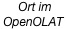
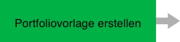
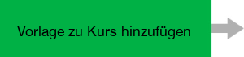
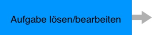
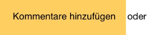
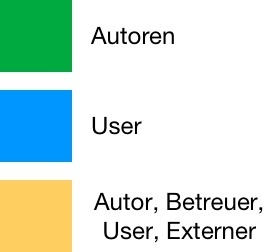

# Prozess eines Bewertungsportfolios {: #process_of_an_assessment_portfolio}

Ein E-Portfolio lässt sich auf verschiedene Arten nutzen. Diese Seite zeigt als Beispiel den Ablauf eines Lernportfolios mit Aufgaben, Kommentaren und Bewertung. Beteiligt sind Lehrende, die Aufgaben stellen und bewerten, und Lernende, die sie bearbeiten.

Mit dem Kursbaustein "Portfolioaufgabe" stellen Lehrende den Lernenden in einem Kurs eine vorbereitete Mappe bereit. Darin dokumentieren die Lernenden ihren Lernprozess und bearbeiten die bereitgestellten Aufgaben. Die Lernenden holen die Mappe im Kurs ab, bearbeiten sie und geben sie später für Feedback und Bewertung an die Lehrenden frei.

Ein Klick auf einen Prozessschritt öffnet die Seite, die ihn beschreibt.

Autorenbereich  | Autorenbereich | Autorenbereich { class=size16 } { class=size16 }
---------|----------|---------
  |  | 
 { class=size16 } { class=size16 } :o_icon_o_ep_icon: | :o_icon_o_ep_icon: | :o_icon_o_ep_icon:
  |  | 
 :o_icon_o_ep_icon: | :o_icon_o_ep_icon: |
  |  | 

!!! info "Wichtig"

    Eine Portfoliovorlage lässt sich auch ohne Kurs nutzen: Sie stellen sie den Lernenden als eigenständige Lernressource bereit.

!!! tip "Tipp"

    Besprechen Sie die Bewertungskriterien mit den Lernenden, bevor diese mit der Bearbeitung beginnen.

## Weiterführende Informationen {: #further_information}

**Auf dieser Seite erwähnt** 
[Portfoliovorlage: Erstellung >](../learningresources/Portfolio_template_Creation.de.md) 
[Portfoliovorlage: Administration und Bearbeitung >](../learningresources/Portfolio_template_Administration_and_editing.de.md) 
[Portfolioaufgabe erstellen >](../learningresources/Creating_Portfolio_Tasks.de.md) 
[Portfolioaufgabe: abholen und bearbeiten >](../learningresources/Portfolio_task_and_assignment_Collecting_and_editing.de.md) 
[Portfolioaufgabe: kommentieren und bewerten >](../learningresources/Portfolio_assignment_Grading.de.md)

**Weiterführend** 
[Kursbaustein "Portfolioaufgabe" >](../learningresources/Course_Element_Portfolio_Task.de.md) 
[Drei Schritte zu Ihrer Mappe >](Three_steps_to_your_portfolio_binder.de.md)

[Zum Seitenanfang ^](#process_of_an_assessment_portfolio)
