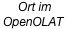
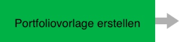
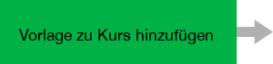
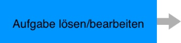
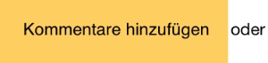
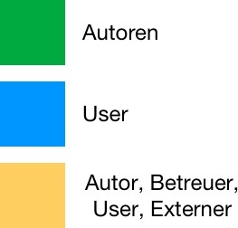

# Prozess eines Bewertungsportfolios {: #process_of_an_assessment_portfolio}

Das ePortfolio lässt sich auf verschiedene Arten nutzen. Diese Seite zeigt als Beispiel den Ablauf eines Bewertungsportfolios, also eines Portfolios mit Aufgaben, Kommentaren und Bewertung. Beteiligt sind Lehrende, die Aufgaben stellen und bewerten, und Lernende, die sie bearbeiten.

Die Lehrenden erstellen im [Autorenbereich](../area_modules/Authoring/index.de.md) eine Portfoliovorlage mit Bereichen und Aufgaben. Mit dem Kursbaustein "Portfolioaufgabe" stellen sie die Vorlage in einem Kurs bereit. Jede lernende Person holt sich dort mit dem Button "Portfolioaufgabe abholen" eine eigene Mappe als Kopie der Vorlage. Darin dokumentiert sie ihren Lernprozess, bearbeitet die Aufgaben und gibt die Mappe später für Feedback und Bewertung an die Lehrenden frei.

Ein Klick auf einen Prozessschritt öffnet die Seite, die ihn beschreibt. Über jeder Zeile steht, wo die Schritte stattfinden: Die Vorlage entsteht im Autorenbereich und kommt von dort in den Kurs; abgeholt wird sie im Kurs, alle weiteren Schritte finden im ePortfolio statt. Die Farbe eines Schritts zeigt, wer ihn ausführt: grün die Lehrenden (in der Legende "Autoren"), blau die Lernenden ("User"). Kommentieren (gelb) können die Lernenden selbst und alle, denen sie die Mappe als Betreuer:in oder Gutachter:in freigegeben haben, auch eingeladene externe Personen.

Autorenbereich  | Autorenbereich | Autorenbereich { class=size16 } { class=size16 }
---------|----------|---------
  |  | 
 { class=size16 } { class=size16 } :o_icon_o_ep_icon: | :o_icon_o_ep_icon: | :o_icon_o_ep_icon:
  |  | 
 :o_icon_o_ep_icon: | :o_icon_o_ep_icon: |
  |  | 

!!! note "Hinweis"

    Eine Portfoliovorlage lässt sich auch ohne Kurs nutzen: Sie geben die Vorlage als Lernressource für die Lernenden frei. Die Lernenden erstellen daraus in ihrem ePortfolio mit "Mappe basierend auf Vorlage erstellen" eine eigene Mappe.

!!! tip "Tipp"

    Besprechen Sie die Bewertungskriterien mit den Lernenden, bevor diese mit der Bearbeitung beginnen.

## Weiterführende Informationen {: #further_information}

**Auf dieser Seite erwähnt** 
[Autorenbereich - Übersicht >](../area_modules/Authoring/index.de.md) 
[Portfoliovorlage: Erstellung >](../learningresources/Portfolio_template_Creation.de.md) 
[Portfoliovorlage: Administration und Bearbeitung >](../learningresources/Portfolio_template_Administration_and_editing.de.md) 
[Portfolioaufgabe erstellen >](../learningresources/Creating_Portfolio_Tasks.de.md) 
[Kursbaustein "Portfolioaufgabe" >](../learningresources/Course_Element_Portfolio_Task.de.md) 
[Portfolioaufgabe: kommentieren und bewerten >](../learningresources/Portfolio_assignment_Grading.de.md)

**Weiterführend** 
[Drei Schritte zu Ihrer Mappe >](Three_steps_to_your_portfolio_binder.de.md)

[Zum Seitenanfang ^](#process_of_an_assessment_portfolio)
