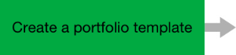
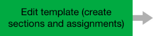
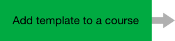
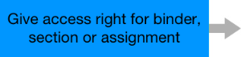
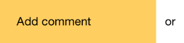

# Process of an assessment portfolio {: #process_of_an_assessment_portfolio}

The ePortfolio can be used in different ways. As an example, this page shows the process of an assessment portfolio, that is, a portfolio with assignments, comments and assessment. Involved are lecturers, who set and assess the assignments, and learners, who work on them.

The lecturers create a portfolio template with sections and assignments in [Authoring](../area_modules/Authoring/index.md). With the course element "Portfolio task", they provide the template in a course. There, each learner collects their own binder as a copy of the template with the button "Collect portfolio task". In it, they document their learning process, work on the assignments and later share the binder with the lecturers for feedback and assessment.

A click on a process step opens the page that describes it. Above each row it says where the steps take place: the template is created in Authoring and from there goes into the course; it is collected in the course, and all further steps take place in the ePortfolio. The colour of a step shows who carries it out: green the lecturers (in the legend "Author"), blue the learners ("User"). Comments (yellow) can be written by the learners themselves and by everyone they have shared the binder with as coach or reviewer, including invited external persons.

Authoring  | Authoring | Authoring { class=size16 } { class=size16 }
---------|----------|---------
  |  | 
 { class=size16 } { class=size16 } :o_icon_o_ep_icon: | :o_icon_o_ep_icon: | :o_icon_o_ep_icon:
  |  | 
 :o_icon_o_ep_icon: | :o_icon_o_ep_icon: |
  |  | 

!!! note "Note"

    A portfolio template can also be used without a course: you share the template as a learning resource with the learners. The learners create their own binder from it in their ePortfolio with "New binder from template".

!!! tip "Tip"

    Discuss the assessment criteria with the learners before they start working.

## Further information {: #further_information}

**Mentioned on this page** 
[Authoring - Overview >](../area_modules/Authoring/index.md) 
[Portfolio template: Creation >](../learningresources/Portfolio_template_Creation.md) 
[Portfolio template: Administration and editing >](../learningresources/Portfolio_template_Administration_and_editing.md) 
[Creating Portfolio Tasks >](../learningresources/Creating_Portfolio_Tasks.md) 
[Course Element "Portfolio task" >](../learningresources/Course_Element_Portfolio_Task.md) 
[Portfolio assignment: Grading >](../learningresources/Portfolio_assignment_Grading.md)

**Further reading** 
[Three steps to your portfolio binder >](Three_steps_to_your_portfolio_binder.md)

[To the top of the page ^](#process_of_an_assessment_portfolio)

