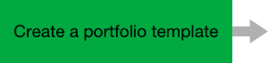
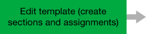
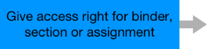
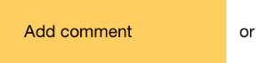

# Process of an assessment portfolio {: #process_of_an_assessment_portfolio}

An e-portfolio can be used in different ways. As an example, this page shows the process of a learning portfolio with assignments, comments and assessment. Involved are lecturers, who set and assess the assignments, and learners, who work on them.

With the course element "Portfolio task", lecturers provide learners in a course with a prepared binder. In it, the learners document their learning process and work on the provided assignments. The learners collect the binder in the course, edit it and later share it with the lecturers for feedback and assessment.

A click on a process step opens the page that describes it.

Authoring  | Authoring | Authoring { class=size16 } { class=size16 }
---------|----------|---------
  |  | 
 { class=size16 } { class=size16 } :o_icon_o_ep_icon: | :o_icon_o_ep_icon: | :o_icon_o_ep_icon:
  |  | 
 :o_icon_o_ep_icon: | :o_icon_o_ep_icon: |
  |  | 

!!! info "Important"

    A portfolio template can also be used without a course: you provide it to the learners as a standalone learning resource.

!!! tip "Tip"

    Discuss the assessment criteria with the learners before they start working.

## Further information {: #further_information}

**Mentioned on this page** 
[Portfolio template: Creation >](../learningresources/Portfolio_template_Creation.md) 
[Portfolio template: Administration and editing >](../learningresources/Portfolio_template_Administration_and_editing.md) 
[Creating Portfolio Tasks >](../learningresources/Creating_Portfolio_Tasks.md) 
[Course Element "Portfolio Task" >](../learningresources/Course_Element_Portfolio_Task.md) 
[Portfolio assignment: Grading >](../learningresources/Portfolio_assignment_Grading.md)

**Further reading** 
[Three steps to your portfolio binder >](Three_steps_to_your_portfolio_binder.md)

[To the top of the page ^](#process_of_an_assessment_portfolio)

