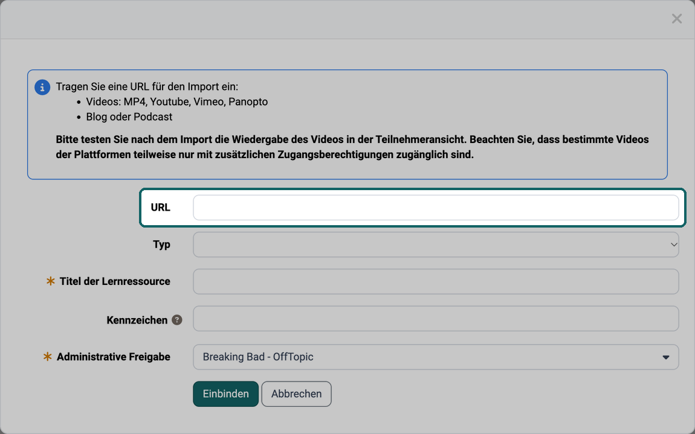

# Vier Schritte zu Ihrem Blog

Mit dieser Anleitung fügen Sie Ihrem Kurs in kurzer Zeit einen Blog hinzu, legen fest, wer darin schreiben darf, und erstellen den ersten Eintrag.

## Schritt 1: Kurseditor öffnen und Kursbaustein Blog einfügen

a) Öffnen Sie den gewünschten Kurs und wählen Sie im Menü "Administration" den Eintrag "Kurseditor".

b) Wählen Sie im Kursmenü den Kursbaustein, unter dem der Blog stehen soll. OpenOlat fügt neue Kursbausteine immer unterhalb des ausgewählten Kursbausteins ein.

c) Klicken Sie auf "Kursbausteine einfügen" oder nutzen Sie die Quick-Add-Funktion und wählen Sie "Blog".

Schon ist der Kursbaustein dem Kurs hinzugefügt.

d) Vergeben Sie im Tab "Titel und Beschreibung" einen passenden Titel und speichern Sie den Kursbaustein.

## Schritt 2: Blog erstellen [:octicons-tag-16:{ title="ab Release 19.0 (OO-7531)" }](https://track.frentix.com/issue/OO-7531)

a) Wechseln Sie in den Tab "Blog-Lerninhalt". Solange kein Blog gewählt ist, bietet der Tab drei Wege an:

{ class="shadow lightbox" title="Tab Blog-Lerninhalt im Kurseditor · 2026.10.20" }

* **Auswählen**: Sie verbinden den Kursbaustein mit einem Blog, der bereits als Lernressource besteht.
* **Erstellen**: Sie legen einen neuen OpenOlat-Blog an, in dem Sie und die berechtigten Personen Einträge schreiben.
* **Per URL einbinden**: Sie binden einen externen Blog über seinen RSS-Feed ein, siehe [Externen Blog einbinden](#external_blog).

Einen Blog, der Ihnen als Datei vorliegt, zum Beispiel aus einem Export, laden Sie über den Pfeil neben "Per URL einbinden" mit "Import" hoch. Ob ein Blog ein OpenOlat-Blog oder ein externer Blog ist, steht damit beim Anlegen fest und lässt sich später nicht mehr ändern.

Im Folgenden erstellen Sie einen neuen OpenOlat-Blog:

b) Klicken Sie auf "Erstellen".

c) Geben Sie im Dialog "Blog erstellen" einen Titel ein und bestätigen Sie mit "Erstellen".

Damit ist eine neue Blog-Lernressource angelegt und mit dem Kursbaustein verbunden. Der Tab zeigt den Blog nun mit der Zahl seiner Einträge und den Einstellungen "Beiträge bewerten" und "Beiträge kommentieren". Mit "Lernressource bearbeiten" öffnen Sie den Blog selbst.

## Schritt 3: Benutzerberechtigungen definieren [:octicons-tag-16:{ title="ab Release 15.0 (OO-4417)" }](https://track.frentix.com/issue/OO-4417)

Im Tab "Blog-Lerninhalt" legen Sie unter "Berechtigungen" fest, wer Blogbeiträge erstellen und wer den Blog moderieren darf. Für "Beiträge erstellen" und "Moderator" wählen Sie je die Rollen, zum Beispiel Teilnehmer:innen oder Betreuer:innen. In der erweiterten Konfiguration vergeben Sie ein Recht zusätzlich an einzelne Benutzer:innen oder Gruppen, auch mit Beginn und Ende. Die Berechtigung "Beiträge erstellen" erscheint nur bei einem OpenOlat-Blog, bei einem externen Blog schreibt niemand in OpenOlat.

Abschliessend publizieren Sie den Kurs und schliessen den Kurseditor, damit die Änderungen sichtbar werden.

## Schritt 4: Blog Beiträge hinzufügen

Nach dem Publizieren steht der Blog im Kurs. Solange er keine Einträge hat, zeigt er die Meldung "Es wurden keine Einträge gefunden, die angezeigt werden können."

{ class="shadow lightbox" title="Kursbaustein Blog im Kurs · 2026.10.20" }

* Klicken Sie auf "Eintrag hinzufügen". Sie finden den Button in der leeren Liste und oben rechts.

* Vergeben Sie einen Titel und schreiben Sie den Beitrag im Feld "Inhalt". Ergänzend können Sie eine Zusammenfassung schreiben und eine Audio- oder Videodatei hochladen.

* Klicken Sie auf "Veröffentlichen". Mit "Entwurf speichern" sichern Sie den Beitrag, ohne ihn zu veröffentlichen.

Weitere Einträge fügen Sie jederzeit mit "Eintrag hinzufügen" hinzu. Personen mit der Berechtigung "Beiträge erstellen" schreiben ihre Beiträge auf dieselbe Weise im Kurs, sobald der Kurs publiziert ist.

!!! info "Wichtig"

    Beiträge erstellen können Besitzer:innen, Betreuer:innen und Teilnehmende nur in einem OpenOlat-Blog. Einen externen Blog können sie je nach den Einstellungen "Beiträge bewerten" und "Beiträge kommentieren" bewerten und kommentieren.

    Teilnehmende und Betreuer:innen erstellen ihre Beiträge im Kurs. Besitzer:innen des Blogs fügen Einträge zusätzlich direkt in der Lernressource hinzu, die sich im Kurseditor im Tab "Blog-Lerninhalt" über "Lernressource bearbeiten" öffnet.

### Externen Blog einbinden {: #external_blog}

Einen Blog, der ausserhalb von OpenOlat im Internet erscheint, zeigen Sie über seinen RSS-Feed direkt im Kurs an. Sie brauchen dafür die Adresse des RSS-Feeds.

Klicken Sie im Tab "Blog-Lerninhalt" auf "Per URL einbinden". Tragen Sie im Dialog im Feld "URL" die Adresse des RSS-Feeds ein. Erkennt OpenOlat den Blog, sind danach die Felder "Typ" und "Titel der Lernressource" ausgefüllt. Klicken Sie auf "Einbinden". Denselben Dialog öffnen Sie im Autorenbereich über den Pfeil neben "Datei importieren" mit "Per URL einbinden".

{ class="shadow lightbox" title="Dialog Per URL einbinden · 2026.10.20" }

Der Feed muss über das öffentliche Internet erreichbar sein, denn OpenOlat ruft ihn vom Server aus ab. Ist in der System-Administration der Schutz "SSRF Mitigation" eingeschaltet, ruft OpenOlat keinen Feed aus dem lokalen Netz ab, etwa von einem Server im Netz Ihrer Organisation, siehe [Sicherheit](../../manual_admin/administration/Login_Security.de.md#ssrf). [:octicons-tag-16:{ title="ab Release 21.1 (OO-9310)" }](https://track.frentix.com/issue/OO-9310)

Anschliessend zeigt der Kurs die Einträge des externen Blogs. Je nach Einstellung lassen sie sich mit Sternen bewerten und kommentieren. Die Kommentare sind nur im Kurs sichtbar, nicht im externen Blog. Neue Einträge entstehen nur im externen Blog. Die Adresse des Feeds ändern Sie in der Lernressource mit "URL ersetzen".

!!! tip "Tipp"

    Alternativ erstellen Sie einen OpenOlat-Blog wie jede andere Lernressource im Autorenbereich mit "Erstellen" und verbinden ihn danach im Kurseditor im Tab "Blog-Lerninhalt" über "Auswählen" mit dem Kurs.

    So wird sichtbar, dass Lernressourcen kursübergreifend sind: Derselbe Blog lässt sich in mehreren OpenOlat-Kursen einbinden und auch ohne Kurs verwenden.

## Weiterführende Informationen {: #further_information}

**Auf dieser Seite erwähnt** 
[Sicherheit >](../../manual_admin/administration/Login_Security.de.md)

**Weiterführend** 
[Kursbaustein "Blog" >](../learningresources/Course_Element_Blog.de.md) 
[Vier Schritte zu Ihrem Podcast >](../resource_podcast/Four_Steps_to_Your_Podcast.de.md)

[Zum Seitenanfang ^](#vier-schritte-zu-ihrem-blog)

