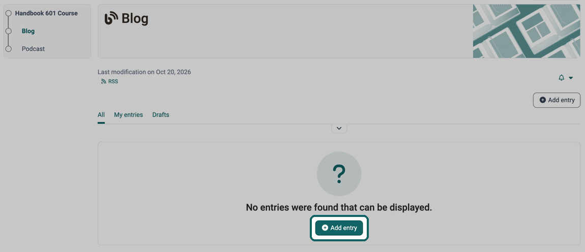
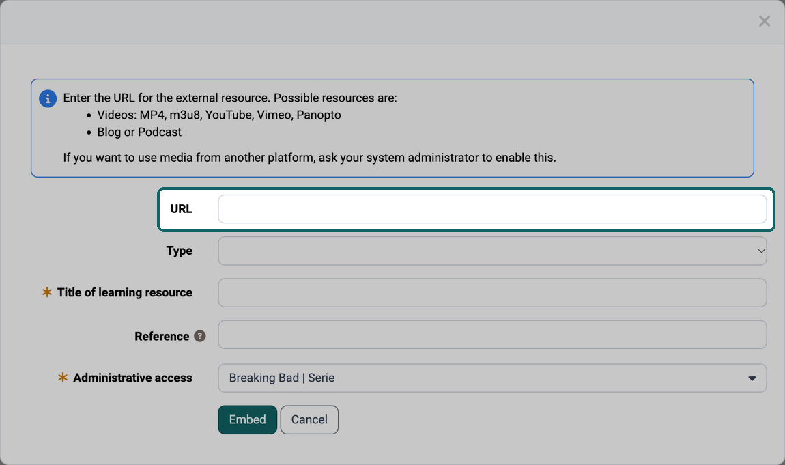

# Four Steps to Your Blog

With this guide, you add a blog to your course in a short time, define who may write in it, and create the first entry.

## Step 1: Open course editor and insert Blog course element

a) Open the desired course and select the "Course editor" entry in the "Administration" menu.

b) In the course menu, select the course element below which the blog should appear. OpenOlat always inserts new course elements below the selected course element.

c) Click "Insert course elements" or use the Quick-Add function and select "Blog".

The course element has now been added to the course.

d) Assign a suitable title in the tab "Title and description" and save the course element.

## Step 2: Create Blog [:octicons-tag-16:{ title="from Release 19.0 (OO-7531)" }](https://track.frentix.com/issue/OO-7531)

a) Switch to the tab "Blog learning content". As long as no blog is selected, the tab offers three options:

{ class="shadow lightbox" title="Tab Blog learning content in the course editor · 2026.10.20" }

* **Select**: You connect the course element with a blog that already exists as a learning resource.
* **Create**: You create a new OpenOlat blog in which you and the authorised people write entries.
* **Embed via URL**: You embed an external blog via its RSS feed, see [Embed an external blog](#external_blog).

A blog that you have as a file, for example from an export, you upload with "Import" via the arrow next to "Embed via URL". Whether a blog is an OpenOlat blog or an external blog is thus fixed when it is created and cannot be changed later.

In the following, you create a new OpenOlat blog:

b) Click "Create".

c) In the "Create blog" dialog, enter a title and confirm with "Create".

A new blog learning resource is now created and connected with the course element. The tab now shows the blog with the number of its posts and the settings "Posts are rateable" and "Posts are commentable". With "Edit learning resource" you open the blog itself.

## Step 3: Define user permissions [:octicons-tag-16:{ title="from Release 15.0 (OO-4417)" }](https://track.frentix.com/issue/OO-4417)

In the tab "Blog learning content", you define under "User rights" who may create blog entries and who may moderate the blog. For "Create items" and "Moderator" you select the roles, for example participants or coaches. In the advanced configuration, you additionally grant a right to individual users or groups, also with a start and an end. The "Create items" right only appears for an OpenOlat blog; in an external blog nobody writes in OpenOlat.

Finally, publish the course and close the course editor so that the changes become visible.

## Step 4: Add blog entries

After publishing, the blog is in the course. As long as it has no entries, it shows the message "No entries were found that can be displayed."

{ class="shadow lightbox" title="Blog course element in the course · 2026.10.20" }

* Click "Add entry". You find the button in the empty list and at the top right.

* Give the entry a title and write it in the "Content" field. In addition, you can write a summary and upload an audio or video file.

* Click "Publish". With "Save draft" you keep the entry without publishing it.

You add further entries at any time with "Add entry". People with the "Create items" right write their entries the same way in the course, as soon as the course is published.

!!! info "Important"

    Owners, coaches and participants can create entries only in an OpenOlat blog. Depending on the settings "Posts are rateable" and "Posts are commentable", they can rate and comment on an external blog.

    Participants and coaches create their entries in the course. Owners of the blog can additionally add entries directly in the learning resource, which opens in the course editor in the tab "Blog learning content" via "Edit learning resource".

### Embed an external blog {: #external_blog}

You show a blog that appears outside OpenOlat on the internet directly in the course via its RSS feed. For this you need the address of the RSS feed.

In the tab "Blog learning content", click "Embed via URL". In the dialog, enter the address of the RSS feed in the "URL" field. If OpenOlat recognises the blog, the fields "Type" and "Title of learning resource" are filled in afterwards. Click "Embed". You open the same dialog in Authoring via the arrow next to "Import file" with "Embed via URL".

{ class="shadow lightbox" title="Embed via URL dialog · 2026.10.20" }

The feed must be reachable via the public internet, because OpenOlat retrieves it from the server. If the "SSRF mitigation" protection is switched on in the system administration, OpenOlat does not retrieve a feed from the local network, for example from a server in the network of your organisation, see [Security](../../manual_admin/administration/Login_Security.md#ssrf). [:octicons-tag-16:{ title="from Release 21.1 (OO-9310)" }](https://track.frentix.com/issue/OO-9310)

The course then shows the entries of the external blog. Depending on the settings, they can be rated with stars and commented on. The comments are only visible in the course, not in the external blog. New entries are only created in the external blog. You change the address of the feed in the learning resource with "Replace URL".

!!! tip "Tip"

    Alternatively, you create an OpenOlat blog like any other learning resource in Authoring with "Create" and then connect it with the course in the course editor in the tab "Blog learning content" via "Select".

    This shows that learning resources are cross-course: the same blog can be embedded in several OpenOlat courses and can also be used without a course.

## Further information {: #further_information}

**Mentioned on this page** 
[Security >](../../manual_admin/administration/Login_Security.md)

**Further reading** 
[Course Element "Blog" >](../learningresources/Course_Element_Blog.md) 
[Four Steps to Your Podcast >](../resource_podcast/Four_Steps_to_Your_Podcast.md)

[To the top of the page ^](#four-steps-to-your-blog)

