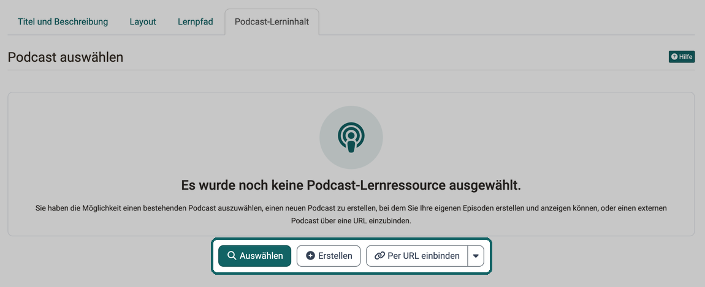
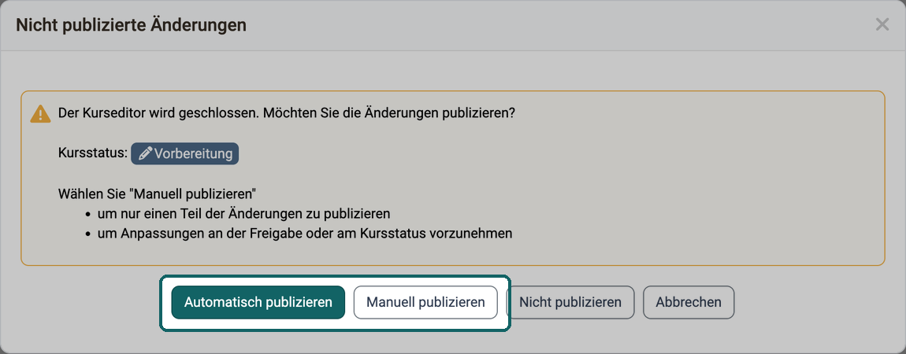

# Vier Schritte zu Ihrem Podcast

Mit dieser Anleitung fügen Sie Ihrem Kurs in kurzer Zeit einen Podcast hinzu und erstellen die erste Episode.

## Voraussetzungen

Produzieren Sie die Audio- oder Videodatei für Ihre Podcast-Episode mit einer
dafür vorgesehenen Aufnahmesoftware (z.B.
[GarageBand](http://www.apple.com/ilife/garageband/ "GarageBand")) und
speichern Sie sie in einem der angegebenen Formate: MP3, MP4, M4V, M4A oder
AAC und achten Sie auf die angegebene Maximalgrösse.

Wenn Sie noch keinen Kurs erstellt haben, steht im Kapitel ["Kurs erstellen"](../learningresources/Creating_Course.de.md), wie Sie vorgehen, bevor Sie mit Hilfe
der folgenden Anleitung Ihren Podcast erstellen.

## Podcast erstellen

In vier Schritten fügen Sie den Kursbaustein ein, erstellen den Podcast, füllen ihn mit der ersten Episode und publizieren den Kurs.

### Schritt 1: Kurseditor öffnen und Podcast-Kursbaustein einfügen

1. Öffnen Sie im Autorenbereich den Kurs, zum Beispiel über den Tab "Meine Kurse" oder "Favoriten".

    { class="shadow lightbox" title="Tab Meine Kurse im Autorenbereich · 2026.10.20" }

2. Wählen Sie im Menü "Administration" den Eintrag "Kurseditor".
3. Wählen Sie im Kursmenü den Kursbaustein, unter dem der Podcast stehen soll.
4. Klicken Sie auf "Kursbausteine einfügen" und wählen Sie "Podcast".
5. Geben Sie im Tab "Titel und Beschreibung" einen kurzen Titel für den Kursbaustein ein und speichern Sie.

### Schritt 2: Podcast erstellen [:octicons-tag-16:{ title="ab Release 19.0 (OO-7531)" }](https://track.frentix.com/issue/OO-7531)

1. Wechseln Sie in den Tab "Podcast-Lerninhalt". Solange kein Podcast gewählt ist, bietet der Tab drei Wege an: "Auswählen" verbindet den Kursbaustein mit einem bestehenden Podcast, "Erstellen" legt einen neuen OpenOlat-Podcast an und "Per URL einbinden" bindet einen externen Podcast über seinen Feed ein.

    { class="shadow lightbox" title="Tab Podcast-Lerninhalt im Kurseditor · 2026.10.20" }

2. Klicken Sie auf "Erstellen".
3. Geben Sie im Dialog "Podcast erstellen" den Titel des Podcasts ein. Er erscheint später im Kopf des Podcasts. Klicken Sie auf "Erstellen".

Ob ein Podcast ein OpenOlat-Podcast oder ein externer Podcast ist, steht beim Anlegen fest und lässt sich später nicht mehr ändern.

Einen bestehenden externen Podcast binden Sie im Tab "Podcast-Lerninhalt" mit "Per URL einbinden" ein. Tragen Sie im Dialog im Feld "URL" die Adresse des Feeds ein und klicken Sie auf "Einbinden". Der Feed muss über das öffentliche Internet erreichbar sein, denn OpenOlat ruft ihn vom Server aus ab. Ist in der System-Administration der Schutz "SSRF Mitigation" eingeschaltet, ruft OpenOlat keinen Feed aus dem lokalen Netz ab, etwa von einem Server im Netz Ihrer Organisation, siehe [Sicherheit](../../manual_admin/administration/Login_Security.de.md#ssrf). [:octicons-tag-16:{ title="ab Release 21.1 (OO-9310)" }](https://track.frentix.com/issue/OO-9310)

### Schritt 3: Podcast mit Inhalt füllen

1. Klicken Sie im Kurseditor im Tab "Podcast-Lerninhalt" auf "Lernressource bearbeiten".

    { class="shadow lightbox" title="Tab Podcast-Lerninhalt mit gewähltem Podcast · 2026.10.20" }

2. Klicken Sie auf "Episode hinzufügen". Sie finden den Button in der leeren Liste und oben rechts.

    { class="shadow lightbox" title="Lernressource Podcast · 2026.10.20" }

3. Geben Sie einen Titel ein, wählen Sie im Feld "Audio- oder Videodatei" eine Datei von Ihrem Rechner und klicken Sie auf "Veröffentlichen". Bei Bedarf ergänzen Sie eine Zusammenfassung.

Weitere Episoden fügen Sie später auf dieselbe Weise oder direkt im Kurs hinzu. Wer im Kurs ebenfalls Episoden hinzufügen darf, legen Sie im Tab "Podcast-Lerninhalt" unter "Berechtigungen" mit "Beiträge erstellen" fest. Diese Personen fügen ihre Episoden im Kurs hinzu, sobald der Kurs publiziert ist.

### Schritt 4: Kurs publizieren und freischalten

1. Schliessen Sie den Kurseditor. Hat der Kurs nicht publizierte Änderungen, erscheint der Dialog "Nicht publizierte Änderungen".

    Wählen Sie "Automatisch publizieren", wenn alle Änderungen publiziert werden sollen. Wählen Sie "Manuell publizieren", wenn Sie nur einen Teil der Änderungen publizieren oder die Freigabe oder den Kursstatus anpassen wollen.

    { class="shadow lightbox" title="Dialog Nicht publizierte Änderungen · 2026.10.20" }

!!! tip "Tipp"

    Den ausführlichen Ablauf zum Publizieren öffnen Sie im Kurseditor über "Publizieren" in der Toolbar.

Der Podcast ist nun eingebunden und Teilnehmende können die erste Episode abspielen.

Wie jede Lernressource können Sie einen Podcast auch zuerst im Autorenbereich erstellen und danach im Tab "Podcast-Lerninhalt" mit "Auswählen" in den Kurs einbinden.

## Weiterführende Informationen {: #further_information}

**Auf dieser Seite erwähnt** 
[Kurs erstellen >](../learningresources/Creating_Course.de.md) 
[Sicherheit >](../../manual_admin/administration/Login_Security.de.md)

**Weiterführend** 
[Kursbaustein "Podcast" >](../learningresources/Course_Element_Podcast.de.md) 
[Vier Schritte zu Ihrem Blog >](../resource_blog/Four_Steps_to_Your_Blog.de.md)

[Zum Seitenanfang ^](#vier-schritte-zu-ihrem-podcast)

