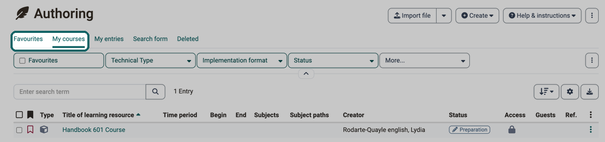
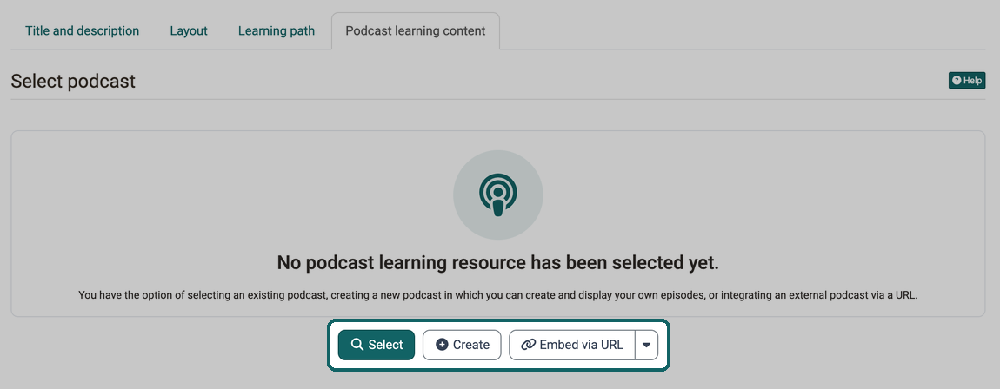
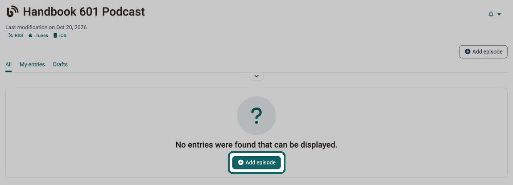
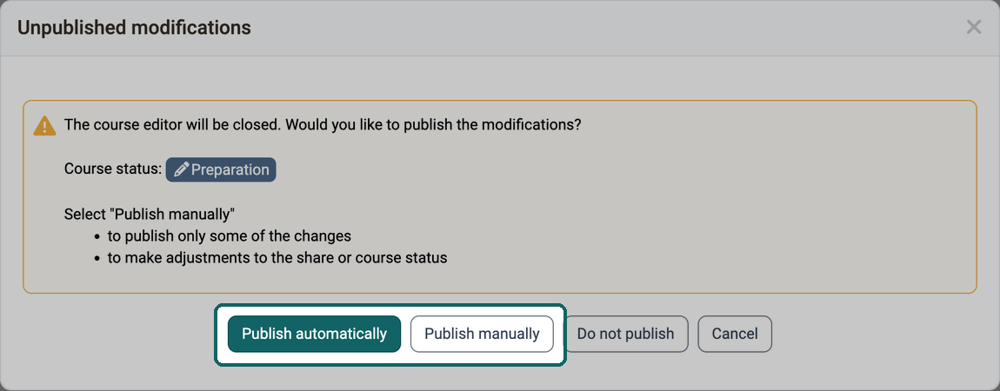

# Four Steps to Your Podcast

With this guide, you add a podcast to your course in a short time and create the first episode.

## Requirements

Produce an audio or video file for your podcast episode by means of
appropriate recording software (e.g.
[GarageBand](http://www.apple.com/ilife/garageband/ "GarageBand")) before
saving it in one of the indicated formats: MP3, MP4, M4V, M4A or AAC, and observe the indicated maximum size.

In case you have not created a course yet, the chapter ["Creating Courses"](../learningresources/Creating_Course.md) describes how to proceed
before you create your podcast with the following instruction.

## Create Podcast

In four steps you insert the course element, create the podcast, fill it with the first episode and publish the course.

### Step 1: Open course editor and insert podcast course element

1. Open the course in Authoring, for example via the tab "My courses" or "Favourites".

    { class="shadow lightbox" title="Tab My courses in Authoring · 2026.10.20" }

2. Select the "Course editor" entry in the "Administration" menu.
3. In the course menu, select the course element below which the podcast should appear.
4. Click "Insert course elements" and select "Podcast".
5. Enter a short title for the course element in the tab "Title and description" and save.

### Step 2: Create a Podcast [:octicons-tag-16:{ title="from Release 19.0 (OO-7531)" }](https://track.frentix.com/issue/OO-7531)

1. Switch to the tab "Podcast learning content". As long as no podcast is selected, the tab offers three options: "Select" connects the course element with an existing podcast, "Create" creates a new OpenOlat podcast and "Embed via URL" embeds an external podcast via its feed.

    { class="shadow lightbox" title="Tab Podcast learning content in the course editor · 2026.10.20" }

2. Click "Create".
3. In the "Create Podcast" dialog, enter the title of the podcast. It later appears in the header of the podcast. Click "Create".

Whether a podcast is an OpenOlat podcast or an external podcast is fixed when it is created and cannot be changed later.

You embed an existing external podcast in the tab "Podcast learning content" with "Embed via URL". In the dialog, enter the address of the feed in the "URL" field and click "Embed". The feed must be reachable via the public internet, because OpenOlat retrieves it from the server. If the "SSRF mitigation" protection is switched on in the system administration, OpenOlat does not retrieve a feed from the local network, for example from a server in the network of your organisation, see [Security](../../manual_admin/administration/Login_Security.md#ssrf). [:octicons-tag-16:{ title="from Release 21.1 (OO-9310)" }](https://track.frentix.com/issue/OO-9310)

### Step 3: Fill podcast with content

1. In the course editor, click "Edit learning resource" in the tab "Podcast learning content".

    { class="shadow lightbox" title="Tab Podcast learning content with a selected podcast · 2026.10.20" }

2. Click "Add episode". You find the button in the empty list and at the top right.

    { class="shadow lightbox" title="Podcast learning resource · 2026.10.20" }

3. Enter a title, select a file from your computer in the "Audio or video file" field and click "Publish". If required, add a summary.

You add further episodes later the same way or directly in the course. Who else may add episodes in the course, you define in the tab "Podcast learning content" under "User rights" with "Create items". These people add their episodes in the course as soon as the course is published.

### Step 4: Publish and activate course

1. Close the course editor. If the course has unpublished changes, the "Unpublished modifications" dialog appears.

    Select "Publish automatically" if all changes are to be published. Select "Publish manually" if you only want to publish some of the changes or adjust the share or the course status.

    { class="shadow lightbox" title="Unpublished modifications dialog · 2026.10.20" }

!!! tip "Tip"

    You open the detailed publishing process in the course editor via "Publish" in the toolbar.

Your podcast is now embedded and participants can play the first episode.

Like any learning resource, you can also create a podcast first in Authoring and then embed it in the course in the tab "Podcast learning content" with "Select".

## Further information {: #further_information}

**Mentioned on this page** 
[Creating Courses >](../learningresources/Creating_Course.md) 
[Security >](../../manual_admin/administration/Login_Security.md)

**Further reading** 
[Course Element "Podcast" >](../learningresources/Course_Element_Podcast.md) 
[Four Steps to Your Blog >](../resource_blog/Four_Steps_to_Your_Blog.md)

[To the top of the page ^](#four-steps-to-your-podcast)

