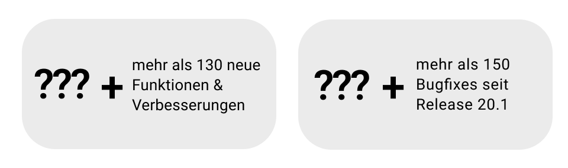
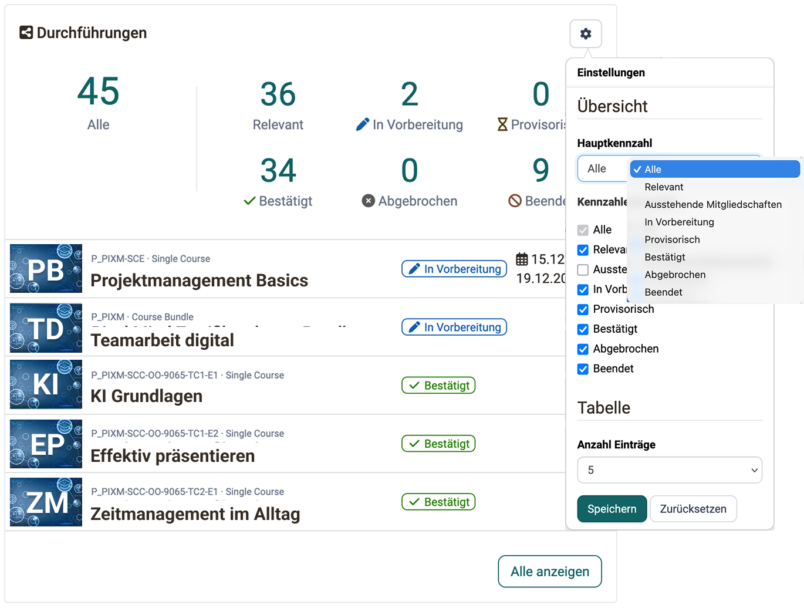
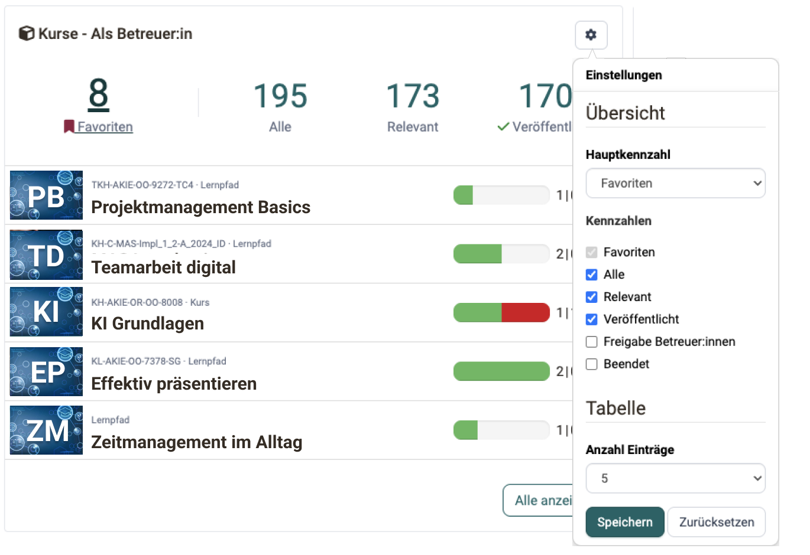
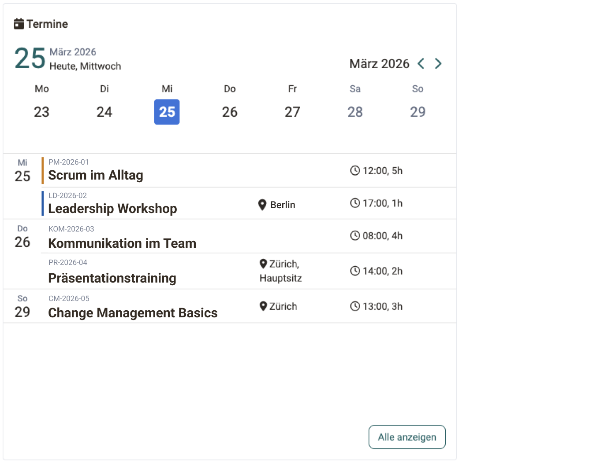
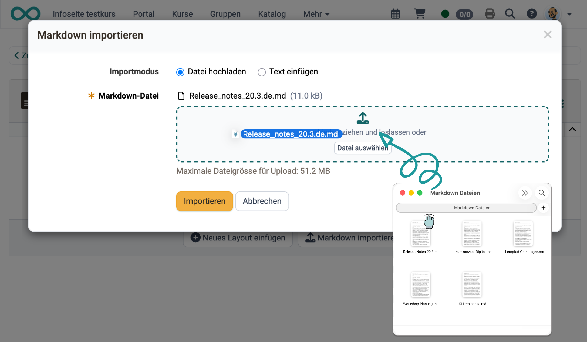
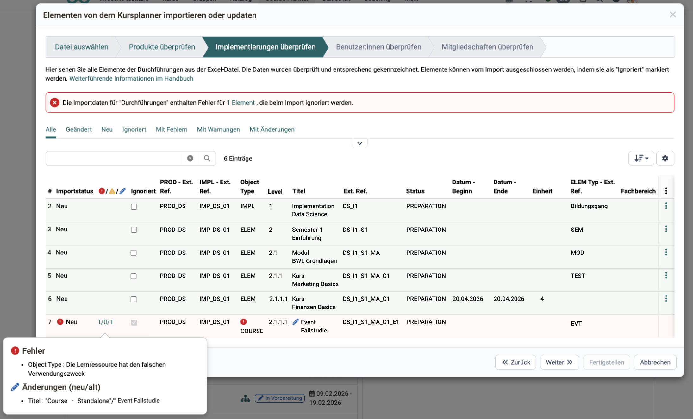

# Release Notes OpenOlat 20.3

* * *

:material-calendar-month-outline: **Releasedatum: 25.03.2026 • Letztes Update: 30.09.2026**

* * *

Mit **OpenOlat 20.3** wurden zentrale Bereiche weiterentwickelt. Der Fokus lag auf der flexiblen Gestaltung der **Widgets**, dem neuen **Master-Import/Export** im Course Planner und zahlreichen Verbesserungen für eine effizientere Nutzung im Alltag.

## Highlights

**Widgets** – Übersichtsseiten im Course Planner und Coaching Tool wurden um neue und erweiterte Widgets ergänzt. Das persönliche Dashboard kann individuell gestaltet werden, der Course Planner bietet eine kompakte Übersicht über laufende Durchführungen und das Coaching Tool zeigt relevante Termine direkt an.

**Seiten-Baustein – Markdown-Import** – In einer ersten Version können Seiten direkt aus Markdown-Dateien importiert werden. Inhalte aus externen Quellen lassen sich so schnell übernehmen und strukturiert darstellen – eine effiziente Grundlage für die Erstellung und Weiterentwicklung von Kursinhalten.

**KI-Funktionen** – Das KI Modul unterstützt neu verschiedene KI-Anbieter (OpenAI, Anthropic, allgemeine OpenAI-kompatible Dienste). Beim Hochladen von Bildern werden Metadaten wie Alt-Text, Titel und Schlagwörter automatisch generiert. Die Erstellung von Multiple-Choice-Fragen wurde qualitativ verbessert und unterstützt beliebige Sprachen.

**Course Planner – Master Import/Export** – Produktstrukturen, Durchführungen und Mitgliedschaften können vollständig exportiert und in andere OpenOlat-Instanzen übertragen werden. Ein integrierter Assistent prüft die Daten vor dem Import und unterstützt mit klaren Rückmeldungen.

Seit Release 20.2 wurden über 105 neue Funktionen und Verbesserungen zu OpenOlat hinzugefügt. Hier finden Sie die wichtigsten Neuerungen zusammengefasst. Zusätzlich wurden zahlreiche Bugs behoben. Die komplette Liste der Änderungen in 20.2.x finden Sie [hier](Release_notes_20.2.de.md){:target="_blank"}.

* * *

## Ankündigung für Release 21.0

!!! warning "Separater Einstieg für Lernen und Coaching"

    Ab **Release 21.0** sind die Bereiche für Lernen und Coaching separiert: Teilnehmer:innen bewegen sich wie gewohnt unter "Kurse", um auf ihre Lerninhalte zuzugreifen.
    Betreuer:innen, Kursbesitzer:innen und weitere Rollen mit Betreuungsfunktion (z.B. Linienvorgesetzte, Ausbildungsverantwortliche) finden ab sofort ihre Kurse und Lernressourcen im Bereich "Coaching".

* * *

## Widgets

Widgets wurden funktional erweitert und vereinheitlicht: Sie lassen sich frei anordnen sowie ein- oder ausblenden. Gleichzeitig bieten Widgets wie das Tabellen- und Mitglieder-Widget erweiterte Konfigurationsmöglichkeiten bei einheitlicher Bedienung.

### Übersichts-Widget (Course Planner)

Im Course Planner zeigt das neue **Übersichts-Widget** laufende Durchführungen direkt auf der Startseite. Kennzahlen, Status und die Anzahl der angezeigten Einträge sind flexibel konfigurierbar.

{ class="shadow lightbox" title="Dashboard: Individuelle Widget-Konfiguration" }

### Ereignis-Widget (Coaching Tool)

Das neue **Ereignis-Widget** zeigt bevorstehende Termine übersichtlich an – mit direkten Links zu den jeweiligen Veranstaltungen. Kennzahlen und Standardeinstellungen im Kurs-Widget wurden überarbeitet.

{ class="shadow lightbox" title="Coaching Tool: Ereignis-Widget" }

### Kalender-Widget

Das **Kalender-Widget** im Coaching Tool (neu) und Course Planner bietet eine übersichtliche Darstellung aller anstehenden Termine und erleichtert die zeitliche Orientierung im Arbeitsalltag. Relevante Veranstaltungen werden direkt im Kontext des Kalenders angezeigt, inklusive Datum, Uhrzeit und – falls vorhanden – Ort.

Die Farbcodierung unterstützt die schnelle Einordnung: Orange markiert aktuell laufende Termine, während Blau den nächsten anstehenden Termin hervorhebt. So lassen sich Prioritäten auf einen Blick erkennen und Termine effizient planen.

{ class="shadow lightbox" title="Coaching Tool: Kalender-Widget" }

* * *

## Content Editor

### Markdown-Import

Markdown-Dateien können nun in einer ersten Version direkt im Content Editor importiert werden, wodurch sich Inhalte aus externen Werkzeugen oder einfachen Textdateien ohne manuelles Nachformatieren übernehmen lassen. Der Inhalt wird automatisch in das strukturierte Seitenformat überführt und bildet so eine effiziente Grundlage, um Kursseiten schneller und einfacher mit Inhalten zu befüllen. Die Inhalte werden dabei automatisch in die Funktionsblöcke wie Titel, Tabelle, Info-Box etc. des Content Editors überführt.

Bilder werden direkt ins Media Center eingebunden, wobei eine Duplikats-Prüfung verhindert, dass das selbe Bild mehrfach im Media Center abgelegt wird. So wird Platz gespart und automatisch aufgeräumt, ohne dass man sich als Autor:in darum kümmern muss.

!!! note "Info Markdown"

	Markdown ist ein weit verbreitetes Textformat, das in vielen Tools und KI-Anwendungen ausgegeben wird, und ermöglicht die nahtlose Übernahme und Weiterverwendung bestehender Inhalte ohne zusätzlichen Formatierungsaufwand. Gleichzeitig unterstützt es eine klare Struktur und erleichtert die kontinuierliche Weiterentwicklung von Lerninhalten.

{ class="shadow lightbox" title="Content Editor: Markdown-Import" }

### Unterstützung für SVG-Grafiken

Neu werden SVG-Grafiken im Media Center sowie Content Editor nicht mehr als Dateien behandelt, sondern als Bildformat unterstützt. SVG wird insbesondere bei KI-gestützter Inhaltserstellung oft als Format für Diagramme und Grafiken verwendet.

* * *

## KI-Funktionen

### KI Modul: Multi-Provider-Unterstützung

Das **KI Modul** wurde grundlegend überarbeitet und unterstützt neu verschiedene KI-Anbieter und Modelle. Neben OpenAI können nun auch **Anthropic** sowie beliebige **OpenAI-API-kompatible Dienste** (z.B. Ollama, vLLM) eingebunden werden. Die Konfiguration erfolgt pro Funktion: Für jede KI-gestützte Funktion kann individuell ein Anbieter und ein Modell ausgewählt werden. Verfügbare Modelle werden direkt vom Anbieter geladen, und eine integrierte Validierung prüft die API-Verbindung beim Einrichten.

### Automatische Bild-Metadaten

Beim **Hochladen von Bildern** im Media Center werden Metadaten wie Titel, Beschreibung, Alt-Text und Schlagwörter nun **automatisch per KI generiert**. Dies verbessert die Barrierefreiheit und erleichtert das Wiederfinden von Medien. Die Metadaten-Generierung funktioniert auch beim **Markdown-Import**: Enthaltene Bilder erhalten ihre Metadaten automatisch im Hintergrund. Sind die generierten Metadaten ungenügend oder nicht geeignet, können diese wie gewohnt angepasst und jederzeit verändert werden.

### Verbesserte Multiple-Choice-Generierung

Die automatische Erstellung von **Multiple-Choice-Fragen** wurde qualitativ verbessert, die Validierung der Antwortoptionen und Distraktoren optimiert. Zudem werden neu **beliebige Sprachen** unterstützt, nicht nur Deutsch und Englisch.

### Ausblick

Mit der neuen Multi-Provider-Architektur und der funktionsspezifischen Konfiguration ist die Grundlage geschaffen, um in den kommenden Releases zahlreiche weitere KI-unterstützte Funktionen in OpenOlat zu integrieren. Von der Unterstützung weiterer Fragetypen bis hin zu KI-unterstützten Lernsystemen sind viele Projekte in der Planung und Umsetzung.

* * *

## Course Planner: Master Import

Der Course Planner erhält mit dem **Master Import** eine zentrale Funktion für die effiziente Verwaltung von Durchführungen: Über strukturierte Excel-Dateien lassen sich Durchführungen, Termine und Mitgliedschaften in einem Schritt anlegen. Ebenso können bestehende Strukturen nachträglich ergänzt werden – etwa um weitere Termine oder zusätzliche Teilnehmende hinzuzufügen.

**Was lässt sich importieren?** Produkte, Durchführungen, Kurse und Termine – sowie Teilnehmer:innen und Benutzer:innen. Neue Personen können direkt beim Import angelegt werden. Ein Assistent führt durch den Prozess und zeigt vor dem Import klar an, was neu angelegt, aktualisiert oder übersprungen wird.

**Typische Anwendungsfälle:** Neue Durchführungen mit Terminen und Teilnehmenden effizient anlegen, nachträglich weitere Termine zu bestehenden Durchführungen hinzufügen oder zusätzliche Mitgliedschaften ergänzen.

Ab :octicons-tag-24: Release 20.3.1 können Administrator:innen im [Master Import](https://docs.openolat.org/de/manual_user/area_modules/Course_Planner_Import_Export/#import_wizard){:target="_blank"} auch Kurse mit dem Verwendungszweck «Eigenständig» übernehmen. OpenOlat zeigt dabei eine Warnung statt eines Fehlers. Ab :octicons-tag-24: Release 20.3.2 enthalten Export und Import der Benutzer:innen zudem den **Kontoablauf**.

{ class="shadow lightbox" title="Course Planner: Master Import" }

* * *

## Course Planner: Weitere Verbesserungen

### Mitgliedschaften & Zugriffssteuerung

Neue Funktionen ermöglichen es, dass Teilnehmende Mitgliedschaften selbstständig bestätigen oder ablehnen. Angebote können zeitlich über Durchführungszeiträume gesteuert werden. Erweiterte Zugriffsberechtigungen sorgen für mehr Transparenz und Kontrolle beim Zugriff auf Produktdaten und öffnen den Berichtszugriff für zusätzliche Rollen.

### Aktivitäts-Log im Zertifikatsprogramm

Mit dem neuen **Aktivitäts-Log** werden alle relevanten Vorgänge im Zertifikatsprogramm zentral erfasst – darunter Mitgliedschaften, Benachrichtigungen, Zertifikate und Einstellungen. Die Einträge sind vollständig einsehbar und lassen sich gezielt filtern.

!!! note "Info Aktivitäts-Log"

	Das Aktivitäts-Log schafft Nachvollziehbarkeit: Änderungen und Vorgänge im Course Planner sind lückenlos dokumentiert und auf einen Blick auffindbar – das erleichtert die Fehlersuche, erhöht die Transparenz und stärkt die Qualitätssicherung.

### Report und Tabellenansicht

Ab :octicons-tag-24: Release 20.3.2 enthält der Report «Buchungsaufträge» **[alle Buchungsarten](https://docs.openolat.org/de/manual_user/area_modules/Course_Planner_Reports/#inhalt_buchungsbericht){:target="_blank"}**, mit dem Blatt «Alle» und einem Blatt pro Angebotstyp. Ab :octicons-tag-24: Release 20.3.1 lassen sich in Produkten und Durchführungen die **[Fachbereiche](https://docs.openolat.org/de/manual_user/area_modules/Course_Planner_Implementations/#listing){:target="_blank"}** als Spalten einblenden.

* * *

## Tests, E-Assessment & Safe Exam Browser

Die **Statusanzeige in Tests** wurde vereinfacht und die Anzahl der Versuche ist direkt bei der Frage sichtbar.

Für den Safe Exam Browser können eigene **Konfigurationsvorlagen** erstellt und für eine Prüfung ausgewählt werden.

Ab :octicons-tag-24: Release 20.3.7 können Administrator:innen bestehende **[SEB-Dateien als Vorlage importieren](https://docs.openolat.org/de/manual_admin/administration/e-Assessment_AssessmentMgmt/#tab_seb){:target="_blank"}**, und das **Beenden/Entsperren-Kennwort** lässt sich pro Prüfung festlegen. Ab :octicons-tag-24: Release 20.3.10 laden Autor:innen in den Einstellungen des Prüfungsmodus auch eine **[eigene SEB-Datei](https://docs.openolat.org/de/manual_user/learningresources/Assessment_mode/#tab-safe-exam-browser){:target="_blank"}** hoch, ohne dafür eine Vorlage der Administration zu benötigen.

Ab :octicons-tag-24: Release 20.3.2 prüft OpenOlat beim **[Import von QTI-Tests](https://docs.openolat.org/de/manual_user/learningresources/Test/#create_questions_in_tests){:target="_blank"}**, ob das Paket dem QTI-Standard entspricht, und lehnt nicht konforme Pakete ab. Die **[Copy/Paste-Sperre](https://docs.openolat.org/de/manual_user/learningresources/Test_question_types/#essay){:target="_blank"}** in Freitext-Fragen gilt zudem auch für Text, der per Drag & Drop in das Eingabefeld gezogen wird.

Für stets aktuelle Bewertungsdaten der Teilnehmenden (inklusive Leistungsnachweis) erfolgt ab :octicons-tag-24: Release 20.3.7 eine **automatische Neuberechnung der Bewertungsdaten** auf Ebene Struktur-Baustein sowie am obersten Kursknoten, sobald Bewertungsregeln geändert und publiziert werden.

Ausserdem wurde in :octicons-tag-24: Release 20.3.4 und :octicons-tag-24: Release 20.3.7 die **Teilpunkteberechnung** für **Matrix- und Drag-und-Drop-Fragen** korrigiert.

!!! warning "Keine automatische Migration"

    Bestehende Fragen werden durch das Update nicht automatisch korrigiert.
    
    Umgang mit bestehenden Fragen:

    - Vorhandene Fragen im Fragenpool werden nicht automatisch korrigiert – sie müssen im Editor geöffnet und manuell gespeichert werden.
    - Vorhandene Fragen in Testressourcen werden nicht automatisch korrigiert – sie müssen im Editor geöffnet und manuell gespeichert werden.
    - Vorhandene Fragen in bereits verwendeten Tests werden nicht automatisch korrigiert. Eine Korrektur ist nicht möglich; der Test muss kopiert werden, und die Frage kann im kopierten Test korrigiert werden.

* * *

## SEO & Seitenvorschau

Mit OpenOlat 20.3 wird die Auffindbarkeit öffentlicher Kursseiten und Info-Pages gezielt verbessert. Beim Teilen von Links in sozialen Netzwerken und Messenger-Diensten werden automatisch ansprechende Vorschauen mit Titel, Beschreibung und Bild angezeigt. Gleichzeitig wurde die Darstellung für Suchmaschinen optimiert, und Keywords können individuell pro Seite oder Lernangebot definiert werden.

{ class="shadow lightbox" title="SEO: Open Graph und Metadaten-Konfiguration" }

* * *

## Layout Refresh

Das OpenOlat Layout wurde an diversen Stellen mit kleinen Anpassungen optimiert. Leichte Animationen bei der Interaktion mit der Maus lassen die Applikation frischer und attraktiver erscheinen.

Das Überblenden der Hintergrundbilder auf der Login Seite wurde vollständig überarbeitet und ist nun flüssiger und ruhiger. Ein optionaler neuer Zoom Effekt erlaubt eine weitere Individualisierung und Erhöhung des Nutzererlebnisses.

* * *

## Weiteres, kurz notiert

- **Kurs:**
    - Ein neuer Filter «Relevant» zeigt Kursmitgliedern direkt ihre aktiven Kurse an.
    - Kurse können nach Zeitraum sortiert werden und der Dialog zum Verlassen eines Kurses wurde vereinheitlicht.
    - Der [Excel-Export der Mitgliederverwaltung](https://docs.openolat.org/de/manual_user/learningresources/Members_management/#excel-export-der-herkunft){:target="_blank"} zeigt alle Herkünfte eines Mitglieds mit Namen (:octicons-tag-24: Release 20.3.1)
    - Kurse mit dem Verwendungszweck «Verwendung im Course Planner» bieten die vordefinierten Filter für Betreuende und Teilnehmende (:octicons-tag-24: Release 20.3.7)

- **Blog/Podcast:** Die Tabellenansicht wurde für den Read-Only-Modus verbessert.

- **Video:** Die Videotranskodierung erfolgt neu standardmässig in 1080p.

- **Benutzerverwaltung:** Einladungslinks können deaktiviert werden. Der Prozess zum Zurücksetzen des Passworts wurde datenschutzrechtlich optimiert.

- **Filter & Suche:** Der Autor:innen- bzw. Besitzer:innen-Filter unterstützt neu die Suche über E-Mail-Adressen.

- **Projekt-Tool:** Neu können persönliche Filter gespeichert werden und Dateien lassen sich über einen externen Link direkt referenzieren.

- **Framework & Usability:** Der Login-Screen wurde visuell modernisiert und sorgt für einen zeitgemässen ersten Eindruck. Zudem wurde veralteter Code entfernt, um Stabilität und Wartbarkeit zu verbessern. Die Oberfläche wurde durchgehend für ein konsistenteres Nutzungserlebnis verfeinert.

- **Barrierefreiheit:** Die Navigation per Tab in Dialogen mit Datumsauswahl sowie die Anzeige der Datumsauswahl wurden verbessert.

- **Internes Sicherheitsaudit:** Im Rahmen der Qualitätssicherung für Release 20.3 wurde ein internes Sicherheitsaudit durchgeführt und gezielte Verbesserungen im Bereich Sicherheit umgesetzt.

- **Termine:**
    - Eingabefeld für URL zur Meeting-Aufzeichnung (:octicons-tag-24: Release 20.3.2)
    - Die Konfiguration der [Termin- und Absenzenverwaltung](https://docs.openolat.org/de/manual_user/learningresources/Course_Settings_Execution/#config_event_and_absence_management){:target="_blank"} in Administration und Kurseinstellungen ist neu gegliedert. Die Administration legt fest, ob Kurse die Standardkonfiguration überschreiben dürfen (:octicons-tag-24: Release 20.3.8)

- **[Themenvergabe](https://docs.openolat.org/de/manual_user/learningresources/Course_Element_Topic_Assignment/){:target="_blank"}:** Die Bezeichnungen wurden vereinheitlicht, der Tab heisst neu «Verwaltung Benutzer:innen» (:octicons-tag-24: Release 20.3.1)

- **[Coaching Tool](https://docs.openolat.org/de/manual_user/area_modules/Coaching_Courses/#courses_search){:target="_blank"}:** Die Suche nach Kursen und Personen unterstützt den Platzhalter `*`, wie im Bereich «Kurse» (:octicons-tag-24: Release 20.3.7)

- **[Aufgabe und Gruppenaufgabe](https://docs.openolat.org/de/manual_user/learningresources/Assessing_tasks_and_group_tasks/#results_export){:target="_blank"}:** «Resultate exportieren» liefert den aktuellen Schritt, das Abschlussdatum jedes Schritts und die zugewiesenen Betreuer:innen (:octicons-tag-24: Release 20.3.8)

- **[ePortfolio](https://docs.openolat.org/de/manual_user/learningresources/Portfolio_assignment_Grading/#comment_save){:target="_blank"}:** Kommentare bleiben erhalten, wenn die verfassende Person gelöscht wird. Statt Name und Bild erscheint «Unbekannte:r Benutzer:in» (:octicons-tag-24: Release 20.3.10)

* * *

## Administratives / Technisches

- Modernisierung theme.js und OpenOlat Theme Login-Seite
- Video-Transkodierung:
    - Standardauflösung 1080p für Videotranskodierung
    - Unterstützung für externen Transcodingdienst mit verschiedenen Service-Queues zur Verarbeitung von Videos unterschiedlicher Grösse
    - Automatische Erstellung von Video-Untertiteln (*Teil des frentix Cloud Services. Nicht-Kunden melden sich bei Interesse beim Frentix Vertrieb.*)
- Allgemeine Bibliotheks-Updates
    - Hibernate 7.2.6, Jakarta persistence 3.2, Jakarta EE 11
    - Infinispan 16.0.5
    - Hibernate validator 9.1.0
    - Spring framework 7.0.2
    - Apache CXF 4.2.0
    - Java HTML sanitizer 20260102.1
    - Jackson und Jackson annotations 2.21.0
    - Apache Artemis 2.52.0
    - Undertow core 2.3.23
    - PDFBox 3.0.7
    - Webauthn4j 0.30.2
    - PostgreSQL JDBC 42.7.9
    - Nimbus Jose JWT 10.8
    - iCal4j 4.2.3
    - ical4j zone infos für Outlook 2.2.0
    - Azure Identity 1.18.2
    - Microsoft Graph API 6.59.0
    - JSON, SwaggerUI, Selenium, AssertJ
    - Fabric.js von 4.4.0 auf 6.4.0+
    - Prototype.js 1.7 entfernt
-  OpenOlat wird mit einer Projektkonfiguration für Anthropic Claude Code zur KI-gestützten Entwicklung inkl. Architekturwissen und Entwickler-Skill ausgeliefert
- REST API Erweiterungen:
    - Kreditpunktesystem (Transaktionen, Systeme, Guthaben) (:octicons-tag-24: Release 20.3.2)
    - URL zur Aufzeichnung bei Terminen (:octicons-tag-24: Release 20.3.2)
    - Absenzmeldungen eines Kurses abrufen (:octicons-tag-24: Release 20.3.5)
- Wartungstool zum Auffinden und Wiederherstellen beschädigter Zertifikat-PDFs (:octicons-tag-24: Release 20.3.7)
- Lernressourcen mit dem Verwendungszweck «Template» sind vom automatischen Lebenszyklus ausgenommen und werden nicht mehr automatisch beendet oder gelöscht (:octicons-tag-24: Release 20.3.2)
- fxSyncher: Konfiguration in der Administration lesend einsehbar (:octicons-tag-24: Release 20.3.2 - nur frentix-Release)
- [KI Modul](https://docs.openolat.org/de/manual_admin/administration/External_Tools_AI/#ai_properties){:target="_blank"}: Anbieter und Funktionen lassen sich über `olat.properties` vorbelegen (`ai.*`) (:octicons-tag-24: Release 20.3.4)
- Paella player: mp4-Streams werden im CORS-Modus geladen, der Stream-Server muss `Access-Control-Allow-Origin` senden (:octicons-tag-24: Release 20.3.10)
- Aktualisierung der Bibliotheken von Drittanbietern (:octicons-tag-24: Release 20.3.10)

* * *

## Systemadministratoren: Neue Funktionen aktivieren / konfigurieren

!!! note "Checkliste nach Update auf 20.3"

    Folgende Funktionen müssen nach einem Update auf Release 20.3 in der `Administration` aktiviert bzw. konfiguriert werden:

    * [x] Standardeinstellung für Video-Auflösung festlegen: `Module > Video > Videokonfiguration`
    * [x] SEO Metadaten (Organisation, Stichwörter) konfigurieren: `Module > SEO / OAI-PMH Metadaten > Suchmaschinenoptimierung`
    * [x] Stream-Server auf CORS prüfen oder CORS im Player abschalten (`"crossOrigin": false`): `Module > Livestream > Paella player` (:octicons-tag-24: Release 20.3.10)
    * [x] [Konfiguration auf Kursebene prüfen](https://docs.openolat.org/de/manual_admin/administration/Modules_Events_and_Absences/){:target="_blank"}: `Module > Termine / Absenzen` (:octicons-tag-24: Release 20.3.8)
    * [x] SEB-Konfigurationsvorlagen erstellen und freigeben: `e-Assessment > Prüfungsverwaltung > Safe Exam Browser Konfiguration`
    * [x] Content Security Policy nach Update auf Kompatibilität prüfen: `Login > Sicherheit > Konfiguration`
    * [x] Wartung Zertifikate: `e-Assessment > Zertifikate > Wartung` (:octicons-tag-24: Release 20.3.7)

* * *

## Weitere Informationen

- [YouTrack Release Notes 20.3.10](https://track.frentix.com/releaseNotes/OO?q=fix%20version:%2020.3.10&title=Release%20Notes%2020.3.10){:target="_blank"}
- [YouTrack Release Notes 20.3.9](https://track.frentix.com/releaseNotes/OO?q=fix%20version:%2020.3.9&title=Release%20Notes%2020.3.9){:target="_blank"}
- [YouTrack Release Notes 20.3.8](https://track.frentix.com/releaseNotes/OO?q=fix%20version:%2020.3.8&title=Release%20Notes%2020.3.8){:target="_blank"}
- [YouTrack Release Notes 20.3.7](https://track.frentix.com/releaseNotes/OO?q=fix%20version:%2020.3.7&title=Release%20Notes%2020.3.7){:target="_blank"}
- [YouTrack Release Notes 20.3.6](https://track.frentix.com/releaseNotes/OO?q=fix%20version:%2020.3.6&title=Release%20Notes%2020.3.6){:target="_blank"}
- [YouTrack Release Notes 20.3.5](https://track.frentix.com/releaseNotes/OO?q=fix%20version:%2020.3.5&title=Release%20Notes%2020.3.5){:target="_blank"}
- [YouTrack Release Notes 20.3.4](https://track.frentix.com/releaseNotes/OO?q=fix%20version:%2020.3.4&title=Release%20Notes%2020.3.4){:target="_blank"}
- [YouTrack Release Notes 20.3.3](https://track.frentix.com/releaseNotes/OO?q=fix%20version:%2020.3.3&title=Release%20Notes%2020.3.3){:target="_blank"}
- [YouTrack Release Notes 20.3.2](https://track.frentix.com/releaseNotes/OO?q=fix%20version:%2020.3.2&title=Release%20Notes%2020.3.2){:target="_blank"}
- [YouTrack Release Notes 20.3.1](https://track.frentix.com/releaseNotes/OO?q=fix%20version:%2020.3.1&title=Release%20Notes%2020.3.1){:target="_blank"}
- [YouTrack Release Notes 20.3.0](https://track.frentix.com/releaseNotes/OO?q=fix%20version:%2020.3.0&title=Release%20Notes%2020.3.0){:target="_blank"}
