# Release Notes OpenOlat 21.1

* * *

:material-calendar-month-outline: **Releasedatum: 30.09.2026**

* * *

Im Mittelpunkt von OpenOlat 21.1 stehen die **Buchungsformulare im Course Planner**: Beim Buchen eines Angebots holen Formulare zusätzliche Angaben der Teilnehmenden ein, Schritt für Schritt in einem Wizard.

Die **Infoseite** von Kursen und Durchführungen ist neu gestaltet und lässt sich als PDF-Flyer mit QR-Code herunterladen. Online-Termine mit **Microsoft Teams** können aufgezeichnet und direkt in OpenOlat bereitgestellt werden. Mit den **KI-Einstellungen** entscheidet jede Person selbst, ob automatische KI-Funktionen mit ihren Inhalten arbeiten.

Im Course Planner erleichtern die **Debitorennummer** und gebündelte To-do-Mails die Verwaltung. Bewertbare Kursbausteine schützen laufende Bewertungen mit einem **Bearbeitungsmodus**, und der Kursbaustein **Mitteilungen** erreicht gezielt einzelne Empfängergruppen. Im **e-Assessment** werden angepasste Punkte in Tests sichtbar, und der Export der Testresultate liefert sprechende Dateinamen.

Zahlreiche Optimierungen bei Usability, Barrierefreiheit, Wording und Konsistenz runden das Release ab, von einheitlichen Suchfeldern und Begriffen bis zu besser bedienbaren Menüs.

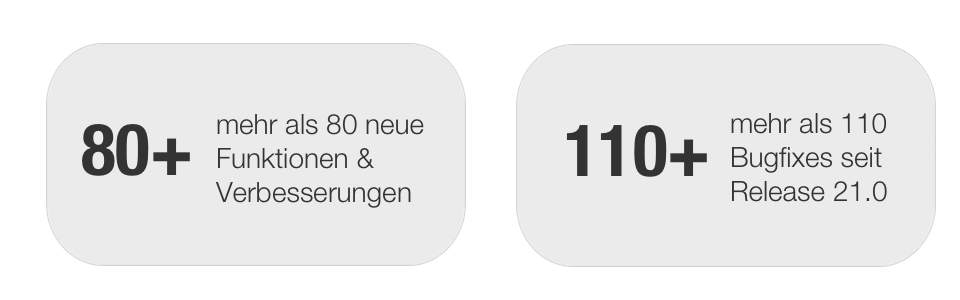

Seit Release 21.0 wurden rund 80 neue Funktionen und Verbesserungen zu OpenOlat hinzugefügt, die wichtigsten sind hier zusammengefasst. Zusätzlich wurden über 110 Bugs behoben. Die komplette Liste der Änderungen in 21.0.x steht [hier](Release_notes_21.0.de.md){:target="_blank"}.

* * *

## Buchungsformulare im Course Planner

Bisher fragte der Buchungsprozess nur die Angaben ab, die für die Buchung nötig sind, etwa die Rechnungsadresse. Neu lassen sich beim Buchen eines Angebots zusätzliche Informationen einholen, zum Beispiel persönliche Angaben oder Essenswünsche für einen Kurstag mit Verpflegung.

Dazu werden einem Angebot einer Durchführung ein oder mehrere **[Formulare für Buchungsaufträge](https://docs.openolat.org/de/manual_user/area_modules/Course_Planner_Implementations/#booking_order_forms){:target="_blank"}** zugeordnet.

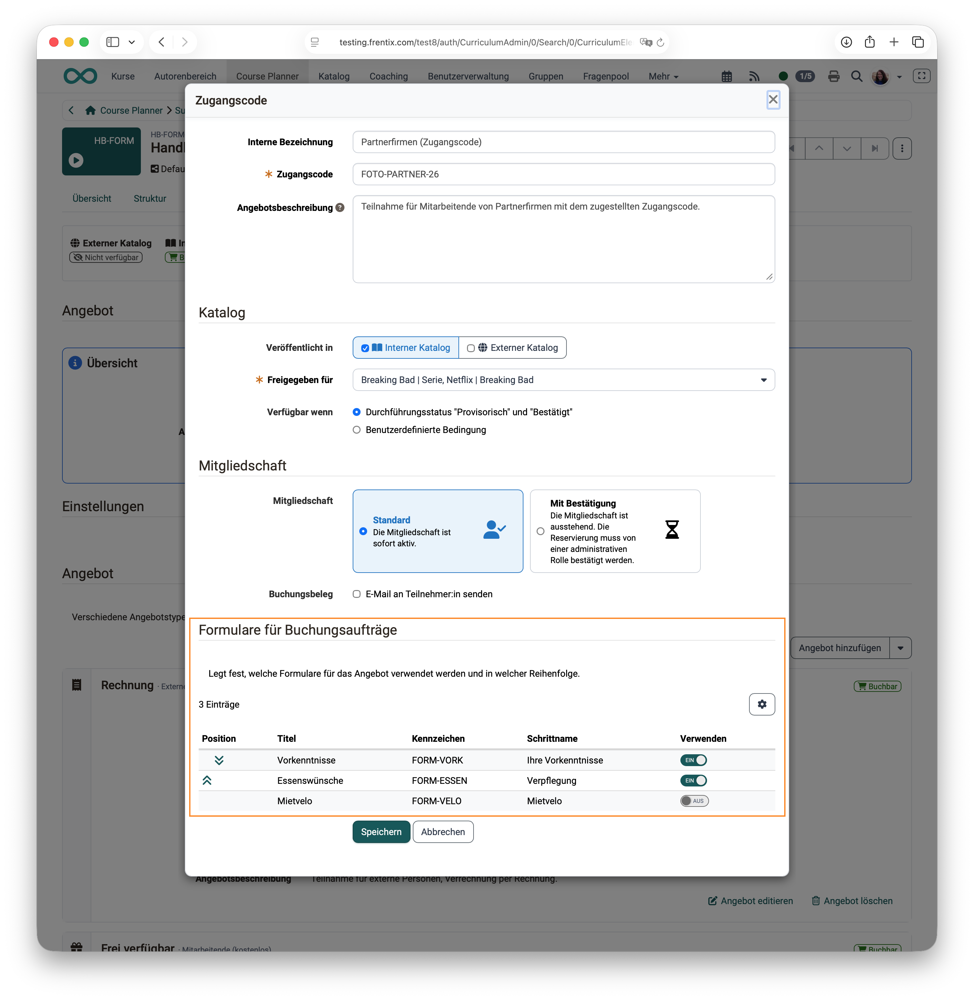{ class="shadow lightbox" title="Formulare für Buchungsaufträge in einem Angebot" }

Ein [Wizard](https://docs.openolat.org/de/manual_user/area_modules/catalog2.0_angebote/#offer_booking_wizard){:target="_blank"} führt Schritt für Schritt durch die Formulare, und die Buchung ist erst abgeschlossen, wenn alle ausgefüllt sind. Das gilt auch, wenn Kursplaner:innen Teilnehmende hinzufügen oder Linienvorgesetzte im Auftrag buchen.

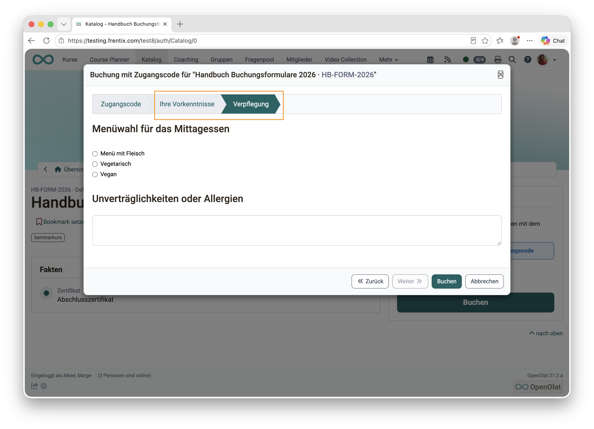{ class="shadow lightbox" title="Buchungswizard mit Formularschritt" }

Die Antworten sind beim Buchungsauftrag einsehbar und lassen sich als Excel-Datei exportieren.

Neu ist ausserdem die Einstellung **[Buchung](https://docs.openolat.org/de/manual_user/area_modules/Course_Planner_Implementations/#tab_catalog_settings){:target="_blank"}** am Angebot: Mit «Buchungsauftrag erforderlich» lassen sich Teilnehmende im Course Planner nur noch über ein Angebot hinzufügen, mit «Ohne Buchungsauftrag zulässig» bleibt auch das direkte Hinzufügen möglich.

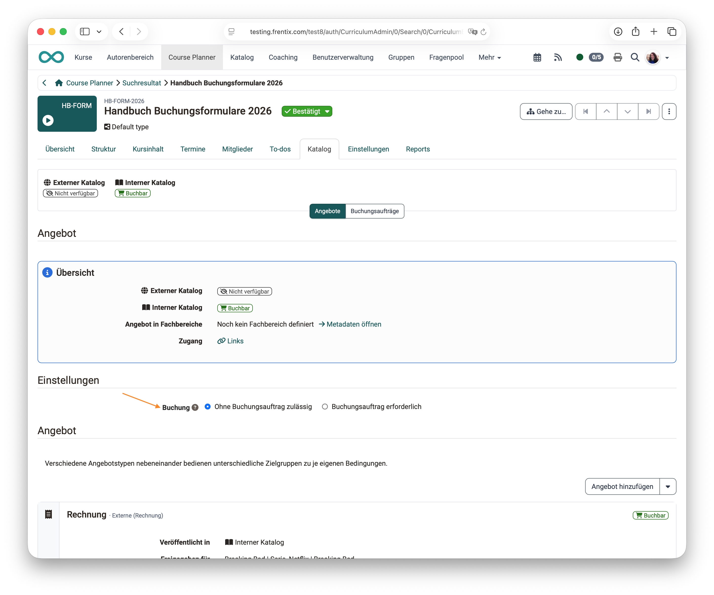{ class="shadow lightbox" title="Einstellungen zur Buchung" }

* * *

## Neue Infoseite

Die **Infoseite** von Kursen und Durchführungen wurde neu gestaltet. Bisher wirkte sie in Aufbau und Darstellung veraltet, besonders beim Drucken. Neu ordnet ein zweispaltiges Layout die Inhalte in übersichtliche Boxen. Die Box **«Fakten»** zeigt die wichtigsten Eckdaten auf einen Blick, etwa Zeitraum, Ort, Sprache und Aufwand. **«Los geht's»** enthält die Buchungsinformationen, und Mitglieder sehen unter **«Mein Kurs»** ihren Lernfortschritt, ihre Bewertung und ihre Gruppen. Auf kleinen Bildschirmen stehen alle Inhalte in einer Spalte.

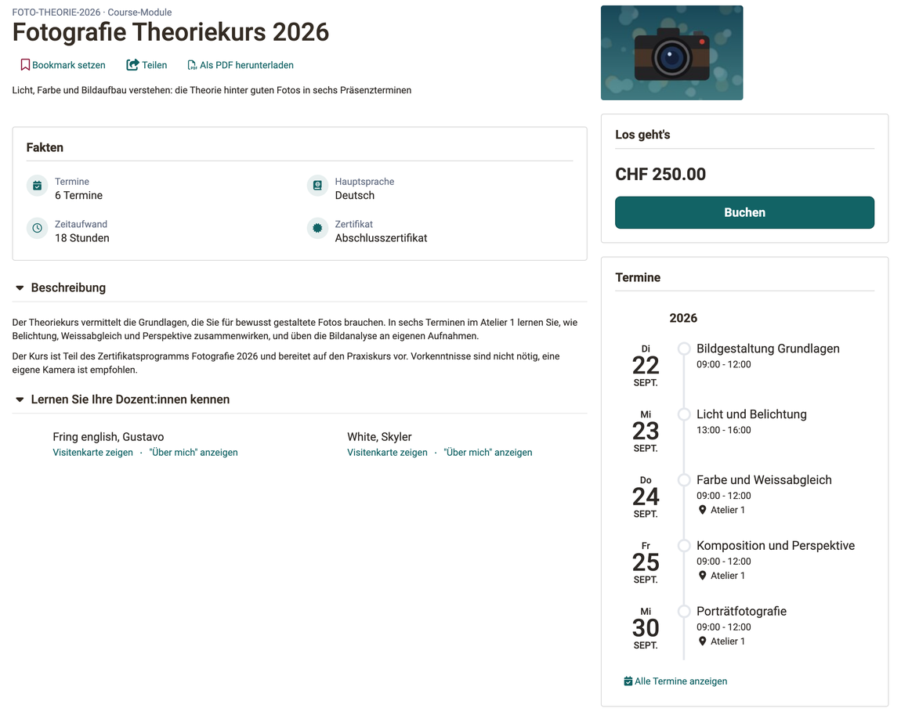{ class="shadow lightbox" title="Infoseite einer Durchführung" }

Über die Aktion **[«Als PDF herunterladen»](https://docs.openolat.org/de/manual_user/learningresources/General_Functions_Infopage/#print){:target="_blank"}** wird die Infoseite zum Flyer mit Logo, Terminübersicht und QR-Code, der direkt zum Angebot führt. Das unterstützt zum Beispiel Mitarbeitende, die für eine Kursbuchung die Zustimmung ihrer vorgesetzten Person brauchen und dafür eine Ausschreibung auf Papier vorlegen. Lesezeichen und Teilen stehen als weitere Aktionen im Kopf der Seite.

{ class="shadow lightbox" title="PDF-Flyer einer Infoseite" }

Welche Informationen erscheinen, wird für Kurse und Durchführungen einheitlich unter **[«Auf Infoseite anzeigen»](https://docs.openolat.org/de/manual_user/learningresources/Course_Settings_Info/#display_settings){:target="_blank"}** festgelegt, mit Standardwerten aus der Administration und einer Sammelaktion für bestehende Kurse.

Der Name «Infoseite» gilt jetzt überall im System. Die technischen Informationen eines Kurses sind von der Infoseite in den neuen Menüpunkt **[«Über diesen Kurs»](https://docs.openolat.org/de/manual_user/learningresources/Technical_Information_on_Resources_and_Usage/#open){:target="_blank"}** im Administrationsmenü gewandert und bleiben so den Personen mit verwaltender Rolle vorbehalten.

* * *

## Aufzeichnung von Teams-Terminen

Online-Termine mit Microsoft Teams liessen sich bisher aus OpenOlat heraus nicht aufzeichnen. Aufzeichnungen blieben im OneDrive der organisierenden Person, waren in OpenOlat nicht sichtbar und liefen dort nach kurzer Zeit ab. Mit der neuen **[Terminaufzeichnung](https://docs.openolat.org/de/manual_user/learningresources/Course_Element_Microsoft_Teams/#meeting_recording){:target="_blank"}** wird die Aufzeichnung direkt am Online-Termin eingeschaltet, wahlweise mit automatischem Start zu Beginn des Termins.

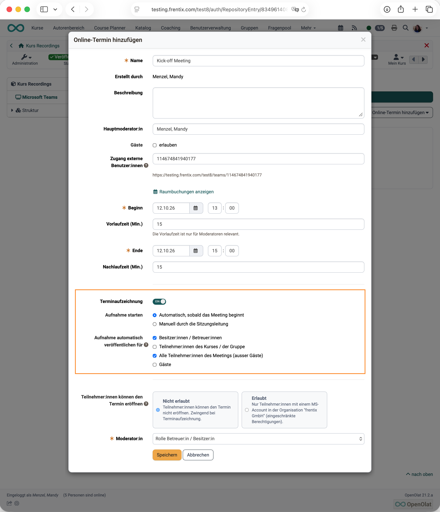{ class="shadow lightbox" title="Einstellung der Teams-Aufzeichnung am Termin" }

Nach dem Termin holt OpenOlat die fertige Aufzeichnung automatisch ab und stellt sie am Online-Termin zur Wiedergabe bereit. Pro Aufzeichnung wird festgelegt, für wen sie veröffentlicht ist, mit denselben Zielgruppen wie bei BigBlueButton: Besitzer:innen und Betreuer:innen, Teilnehmende des Kurses oder der Gruppe, alle Teilnehmenden des Termins oder Gäste. Eine **automatische Löschung** nach einer festgelegten Anzahl Tagen hält den Speicher schlank; wertvolle Aufzeichnungen, etwa von Vorlesungen, lassen sich davon ausnehmen.

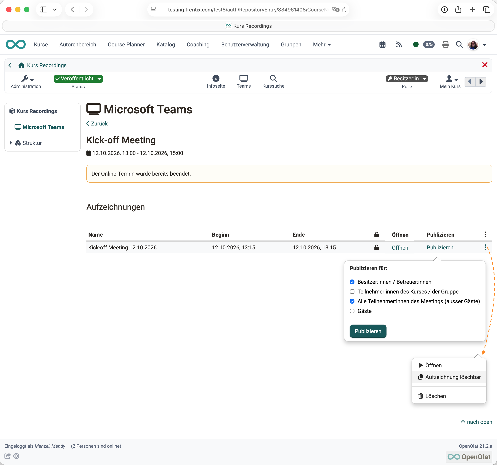{ class="shadow lightbox" title="Aufzeichnung mit Veröffentlichungsoptionen" }

Die Standardwerte für Aufzeichnung, Start und Veröffentlichung legt die Administration im Modul Microsoft Teams fest. Ebenfalls neu ist dort die Option, **[Online-Termine ohne Datum (permanente Reservierungen)](https://docs.openolat.org/de/manual_admin/administration/Teams_module/#permanent_meetings){:target="_blank"}** für die ganze Instanz **auszuschalten**. Dann braucht jeder neue Online-Termin ein Datum.

* * *

## KI-Einstellungen: Kontrolle über automatische KI-Funktionen

Zwei KI-Funktionen arbeiteten bisher ohne Rückfrage mit Inhalten von Personen: Beim Hochladen eines Bildes erzeugt die KI Metadaten wie Titel und Alternativtext, und Freitextantworten in einem Quiz des Content Editors erhalten eine **KI-Korrektur**. Im Sinne der Transparenz, die der EU AI Act verlangt, lässt sich das jetzt steuern. <!-- OO-9784 -->

Die Administration legt pro KI-Funktion eine **Vorgabe für Personen** fest. Jede Person kann sie in den persönlichen Einstellungen unter **«KI-Einstellungen»** übernehmen oder für sich ändern. Vor der ersten KI-Korrektur in einem Quiz fragt ein Dialog nach der Zustimmung. Beim Import in den Content Editor zeigt ein Schalter, ob Bild-Metadaten mit KI erzeugt werden, und lässt sich für den einzelnen Import ändern. Bestehende Installationen verhalten sich wie bisher, bis jemand eine Einstellung ändert.

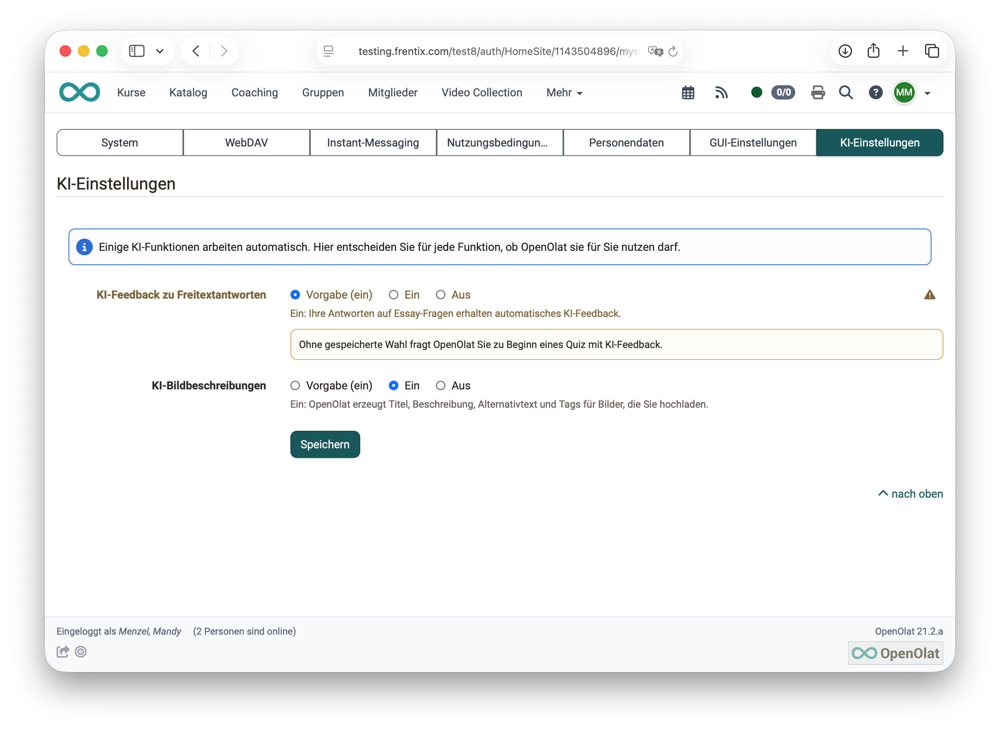{ class="shadow lightbox" title="Persönliche KI-Einstellungen" }

* * *

## Course Planner

### Debitorennummer

Organisationen, die Kurse in Rechnung stellen, brauchen für die Buchhaltung die Debitorennummer der zahlenden Stelle. Bisher gab es dafür in OpenOlat keinen Platz, und die Nummer musste für jede Buchung von Hand im Buchhaltungssystem nachgeschlagen werden. Neu lässt sich eine **[Debitorennummer](https://docs.openolat.org/de/manual_admin/administration/Modules_Organisations/#customer_number){:target="_blank"}** an Benutzerkonten, Organisationen und Rechnungsadressen von Organisationen hinterlegen. Der Course Planner zeigt sie bei Personen und bei Buchungen mit Rechnungsadresse, der Buchungsreport führt sie als eigene Spalten. So lassen sich Buchungen direkt dem richtigen Debitorenkonto zuordnen. Das Feld ist optional und wird in der Administration eingeschaltet.

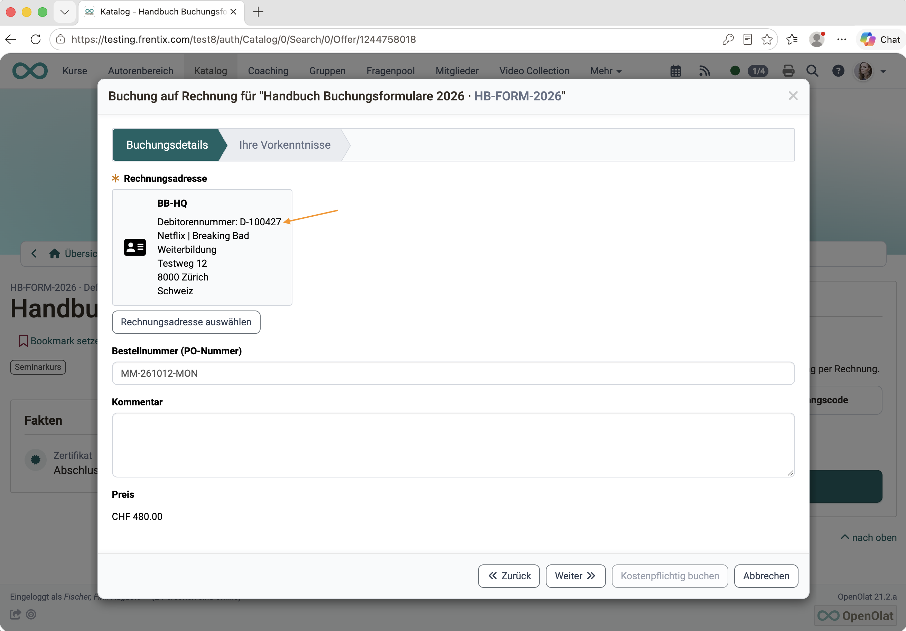{ class="shadow lightbox" title="Buchung mit Rechnungsadresse und Debitorennummer" }

### Sammelmail für To-dos

Beim Kopieren einer Durchführung verschickte OpenOlat bisher für jedes kopierte To-do eine eigene Mail, bei 20 To-dos also 20 Mails. Neu erhält jede Person eine einzige **[Sammelmail](https://docs.openolat.org/de/manual_user/basic_concepts/To_Dos_Basics/#notifications){:target="_blank"}** mit allen ihr zugewiesenen To-dos und den passenden Links. Das gilt auch, wenn To-dos für mehrere Elemente auf einmal angelegt werden.

### Weitere Verbesserungen

* **[Teilnehmer:inkommentar](https://docs.openolat.org/de/manual_user/area_modules/Course_Planner_Implementations/#tab_members){:target="_blank"}:** Kommentare aus der Buchung zeigt die Mitgliedertabelle direkt mit einem Notizsymbol, ohne dass jede Person einzeln geöffnet werden muss.
* **Termine kopieren:** Kopien übernehmen alle Angaben wie Ort, Online-Termin, Raum, Dozierende und Themen. Einzel- und Sammelaktion verhalten sich gleich.
* **[Termine und Absenzen](https://docs.openolat.org/de/manual_user/learningresources/Course_Settings_Execution/#lecture_enabled){:target="_blank"}:** Wird im Course Planner ein Termin für einen Kurs erstellt oder zugewiesen, schaltet OpenOlat die Funktion im Kurs automatisch ein.

* * *

## Kurse und Lernressourcen

### Bearbeitungsmodus für bewertbare Kursbausteine

Ändern sich die Bewertungsregeln eines Kursbausteins, berechnet OpenOlat beim Publizieren die Bewertungen aller Teilnehmenden neu. Bisher war das nicht in jedem Kursbaustein erkennbar. Neu sind die betroffenen Einstellungen **schreibgeschützt**, sobald Bewertungen vorliegen. Erst die Aktion **«Bearbeitungsmodus aktivieren»** gibt sie frei, und ein Hinweis macht deutlich, dass die Neuberechnung nicht rückgängig zu machen ist. So werden versehentliche Änderungen an laufenden Bewertungen vermieden.

Der Schutz gilt für die Kursbausteine Test, Bewertung, Aufgabe, Gruppenaufgabe, Videoaufgabe, Portfolioaufgabe, Checkliste, Struktur und SCORM. Die Bewertungseinstellungen dieser Kursbausteine sind dabei einheitlich unter «Konfiguration Bewertung» gegliedert.

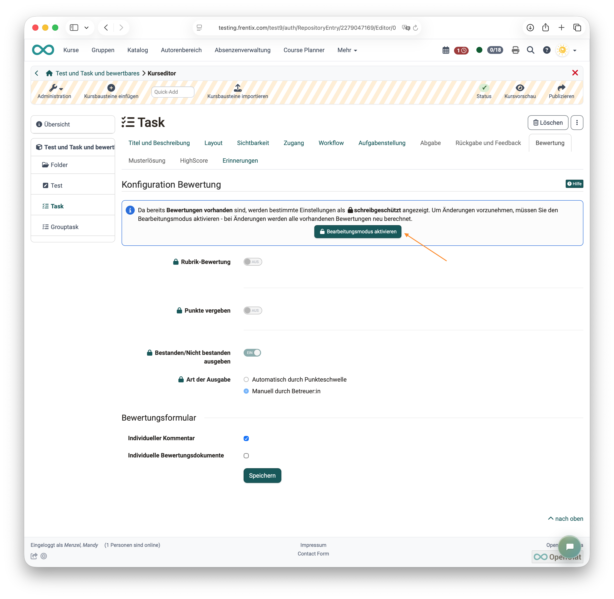{ class="shadow lightbox" title="Schreibgeschützte Bewertungseinstellungen am Aufgabenbaustein" }

### Mitteilungen: Empfängergruppen

Im Kursbaustein **[Mitteilungen](https://docs.openolat.org/de/manual_user/learningresources/Course_Element_Notifications/#create_notification){:target="_blank"}** liessen sich die Empfänger:innen bisher nicht nach Kurs und Gruppen unterscheiden. Neu werden Besitzer:innen, Betreuer:innen und Teilnehmende getrennt ausgewählt, in Kursen mit Gruppen oder Course-Planner-Elementen auch gezielt nur die Personen im Kurs oder die Mitglieder einer bestimmten Gruppe oder eines bestimmten Elements. So erreicht eine Ankündigung genau die Personen, für die sie gedacht ist.

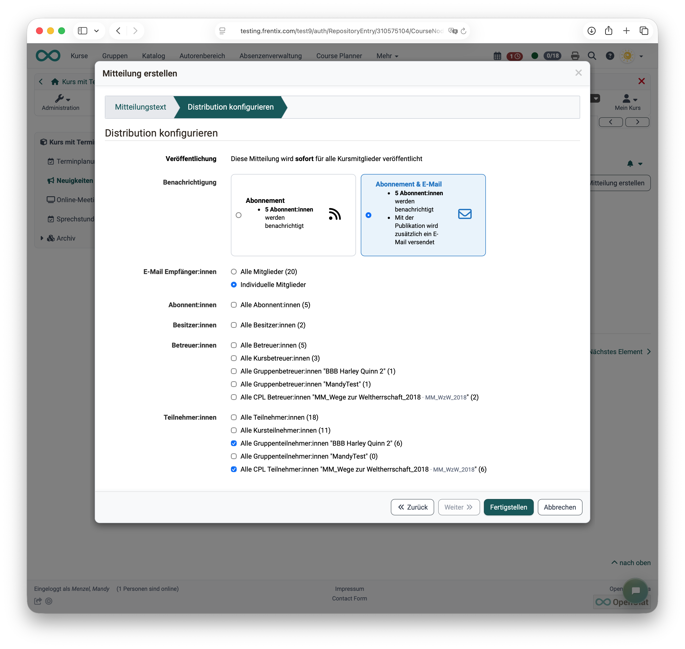{ class="shadow lightbox" title="Mitteilung mit Empfänger:innen-Auswahl aus Kurs, Guppen und Durchführung" }

### Weitere Verbesserungen

* **Durchführungszeitraum «Eintägig»:** Eintägige Kurse und Durchführungen brauchen nur noch ein Datum und funktionieren trotzdem mit Automatisierungen. «Jederzeit» ersetzt die bisherige Option «Keine».
* **[Einstellungen der Lernressource](https://docs.openolat.org/de/manual_user/learningresources/Course_Settings/#metadata){:target="_blank"}:** Der Tab «Metadaten» steht neu an erster Stelle und öffnet sich nach dem Erstellen oder Importieren direkt.
* **[Autorenbereich](https://docs.openolat.org/de/manual_user/area_modules/Authoring/#action_columns){:target="_blank"}:** Aktionen heissen einheitlich, der passende Editor ist direkt erreichbar, und weitere Kurzaktionen lassen sich in der Tabelle einblenden.
* **Verwendungszweck «Einbindung»:** ersetzt «Einbindung in Kurs», weil Formulare auch im Qualitätsmanagement und im Course Planner eingebunden werden.
* **Mitteilungen und Blog:** Der Kursbaustein Mitteilungen trägt überall denselben Namen und ein eigenes Symbol, ebenso der Blog.
* **Quiz im Video:** Klarere Optionen und Schaltflächen. Nach einer falschen Antwort führen «Nochmal ansehen», «Nochmal versuchen» oder «Überspringen» weiter.
* **Freigabe für OER-Kataloge:** erfolgt nur noch in den Kurseinstellungen. Die separate Aktion im Autorenbereich entfällt.

* * *

## e-Assessment und Testing

### Angepasste Punkte im Test sichtbar

Eine fehlerhafte Frage lässt sich nach der Durchführung eines Tests nicht mehr entfernen. Nachträglich können aber zusätzliche Punkte oder die volle Punktzahl an alle Teilnehmenden vergeben werden. Diese Punkteänderung war bisher im Ergebnisexport und in der Teststatistik nicht erkennbar, sodass gegebene Antwort und erreichte Punkte scheinbar nicht zusammenpassten.

Neu kennzeichnet OpenOlat solche Fragen mit dem Status **[«Angepasst»](https://docs.openolat.org/de/manual_user/learningresources/Assessing_tests/#adjust_score){:target="_blank"}** und weist automatische, angepasste und manuelle Punkte getrennt aus. Vordefinierte Filter in der Detailansicht eines Testlaufs und im Korrekturwerkzeug führen direkt zu den Fragen, die zu korrigieren, zu überprüfen oder angepasst sind. Die Teststatistik zeigt die Anzahl der Anpassungen und die durchschnittliche Anpassung, der Ergebnisexport enthält eigene Spalten dafür.

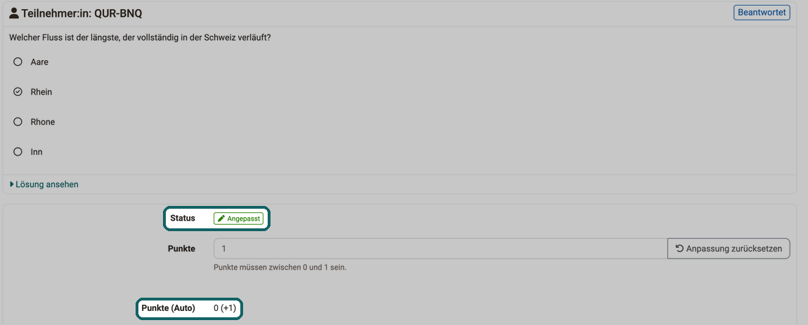{ class="shadow lightbox" title="Korrektur einer Frage mit Punkte-Anpassung" }

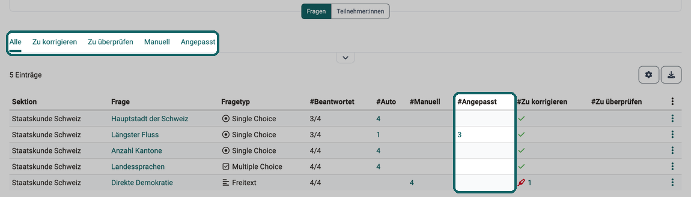{ class="shadow lightbox" title="Test-Übersicht im Korrekturwerkzeug mit automatisch und manuell vergebenen sowie angepassten Punkten" }

### Export der Testresultate

Beim Export aller Testresultate trugen die PDF-Dateien bisher nur eine Nummer als Namen. Neu enthält der Dateiname Nachname, Vorname, Kursbaustein, Test und Testlauf. Standardmässig liegen die PDFs weiterhin in Unterordnern pro Person; die zusätzliche Option **[«Alle PDF-Dateien in einem Ordner»](https://docs.openolat.org/de/manual_user/learningresources/Test_export/#pdf_files){:target="_blank"}** legt sie zusammen ab. Das erspart das Umbenennen und das Zusammensuchen, wenn die Resultate schnell weitergegeben werden müssen.

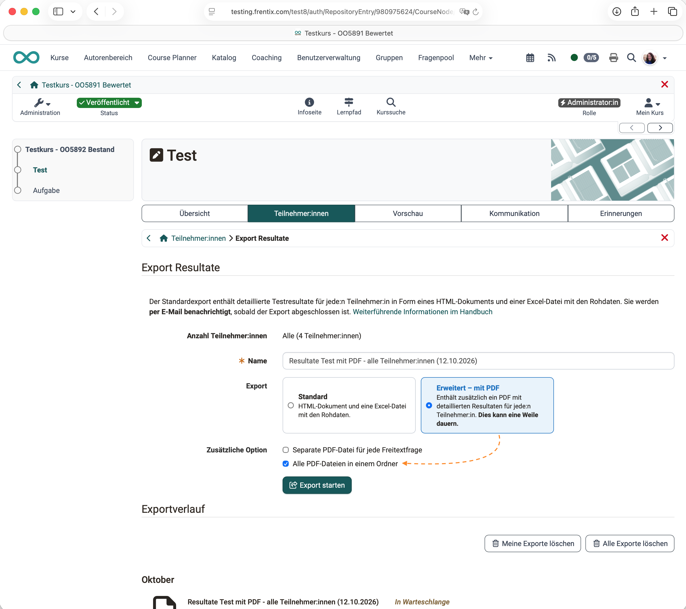{ class="shadow lightbox" title="Exportoption - Alle PDF-Dateien in einem Ordner" }

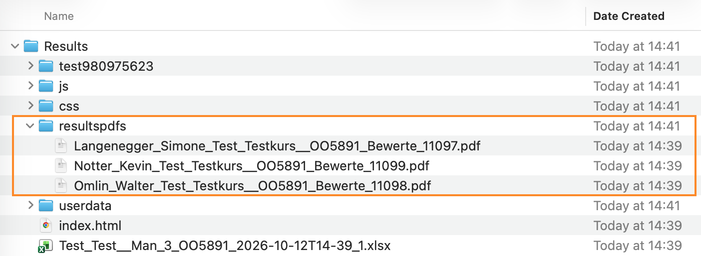{ class="shadow lightbox" title="Exportierte PDF-Resultate in einem Ordner mit sprechenden Dateinamen" }

### Weitere Verbesserungen

* **Lückentext:** Beim Kopieren einer Lücke übernimmt OpenOlat alle Einstellungen, auch Varianten, Länge und Gross-/Kleinschreibung.
* **Standard-Bewertungssystem:** lässt sich in der Administration von Einstufung/Noten festlegen und ist beim ersten Bearbeiten der Bewertungsskala vorausgewählt.
* **Einstufung/Noten:** Einheitliche Begriffe wie «Bewertungssystem», «Bewertungsskala», «Höchste Bewertung» und «Mit Erfolgsstatus».

* * *

## UX, Usability

* **Barrierefreie Menüs:** Popup-Menüs an rund 240 Stellen kündigen sich beim Screenreader an, öffnen mit der Leertaste und geben den Fokus nach dem Schliessen zurück.
* **Suche:** Suchfelder sind einheitlich gestaltet und lassen sich mit «Suche zurücksetzen» leeren.
* **Teilen:** Eine Aktion vereint «Link kopieren», «QR-Code anzeigen» und den Versand per E-Mail.
* **Course Planner:** Der Kopfbereich der Elemente passt sich kleinen Bildschirmen an.
* **Fragetyp Reihenfolge:** Neutrale Anleitungstexte passen zu jeder Anordnung und Verwendung der Frage.
* **Formulareditor:** Wie die anderen Editoren zeigt er eine gelbe Schraffur als Kennzeichen der Bearbeitung.

* * *

## Weiteres, kurz notiert

* **Kreditpunkte im Coaching:** Linienvorgesetzte, Ausbildungsverantwortliche und Beziehungsrollen sehen die Kreditpunkte betreuter Personen in einem eigenen Tab, nur lesend.
* **[Kontoablauf und Kontolebenszyklus](https://docs.openolat.org/de/manual_admin/administration/Life_cycles_-_Administration/#lifecycle_accounts_variants){:target="_blank"}:** Administration und Benutzerverwaltung trennen beide Abläufe klar. Die neue Spalte «Tage bis Ablauf» zeigt, wann ein Konto abläuft.
* **[Zertifikate](https://docs.openolat.org/de/manual_user/area_modules/Course_Planner_Certification_Programs/#certificate_status){:target="_blank"}:** OpenOlat erstellt Zertifikate zuverlässig im Hintergrund, auch nach einem Neustart, und wiederholt fehlgeschlagene Versuche automatisch. Bis dahin zeigt das Zertifikat den Status «Hängig».
* **Sprachen:** Polnisch und Spanisch sind vollständig übersetzt, alle weiteren ausgelieferten Sprachen auf dem Stand von 21.1.
* **Sprachanpassungswerkzeug:** Die Sprache lässt sich direkt beim Bearbeiten eines Textes wechseln, ohne zum Start zurückzukehren.

* * *

## Administratives / Technisches

* **Startseite:** Neuinstallationen und Installationen ohne eigene Regeln erhalten rollenbasierte Standardregeln für Kursplaner:innen, Autor:innen, Betreuer:innen und alle übrigen Personen. Bestehende Regeln bleiben unverändert.
* **[LTI 1.3](https://docs.openolat.org/de/manual_user/learningresources/LTI_Share_courses/#deployment_id_several_courses){:target="_blank"}:** OpenOlat als Tool akzeptiert dieselbe Deployment-ID einer Plattform für mehrere Kurse und Gruppen. Ein zusätzliches Tool als Umweg entfällt.
* **REST API, Audit-Log:** Protokoll über jeden schreibenden und abgelehnten Aufruf, inklusive der übermittelten Daten mit maskierten Passwörtern, auch als Excel-Export verfügbar.
* **REST API, Limite für Anfragen (Rate Limiting):** Begrenzt die Anfragen pro Benutzer:in und Minute sowie die parallelen Anfragen. Abgewiesene Anfragen erhalten den HTTP-Status 429 und erscheinen im Audit-Log.
* **REST API, Räume von Terminen (Breaking Change):** `.../lectureblocks/{key}/room` liefert und erwartet alle Raumbuchungen eines Termins als Array statt als Objekt; ohne Buchung antwortet `GET` mit `200` und leerem Array statt `204`. Der neue Endpunkt `GET /rm/bookings?lectureBlockKeys=` liefert die Buchungen für bis zu 500 Termine in einer Anfrage.
* **SSRF Mitigation:** Erfasste URLs, etwa von Kalendern oder Feeds, dürfen nicht mehr auf lokale oder interne Adressen zeigen. Neuinstallationen aktiv, bestehende per Opt-in.
* Aktualisierung der Bibliotheken von Drittanbietern

* * *

## Systemadministratoren: Neue Funktionen aktivieren / konfigurieren

!!! note "Checkliste nach Update auf 21.1"

    Folgende Funktionen werden nach einem Update auf Release 21.1 in der `Administration` aktiviert oder konfiguriert:

    * [x] Regeln der Startseite prüfen: `Core-Konfiguration > Startseite`
    * [x] Audit-Log und Limite für Anfragen der REST API konfigurieren, die Limite gilt pro Cluster-Knoten: `Core-Konfiguration > REST API` (`restapi.auditlog.*`, `restapi.ratelimit.*`)
    * [x] SSRF Mitigation einschalten: `Login > Sicherheit` (`http.ssrf.protection.enabled`, erlaubte Ziele: `http.ssrf.allowed.addresses`, `http.ssrf.allowed.hosts`)
    * [x] [Debitorennummer aktivieren](https://docs.openolat.org/de/manual_admin/administration/Modules_Organisations/#customer_number){:target="_blank"}: `Module > Organisationen`
    * [x] Recht «Kreditpunkte anzeigen» vergeben, für Linienvorgesetzte und Ausbildungsverantwortliche: `Module > Organisationen`, für Rollen Person zu Person: `Module > Rolle Person zu Person`
    * [x] [Standardwerte der Anzeigeeinstellungen für die Infoseite setzen](https://docs.openolat.org/de/manual_admin/administration/Modules_Course_Planner/#default_settings){:target="_blank"}: `Module > Course Planner > Einstellungen` und `Module > Kurs`
    * [x] Standardwert für den Durchführungszeitraum neuer Kurse prüfen: `Module > Kurs`
    * [x] Standard-Bewertungssystem markieren: `e-Assessment > Einstufung/Noten`
    * [x] Vorgabe für Personen je KI-Funktion festlegen: `Externe Werkzeuge > KI-Modul > KI-Funktionen`. In der fxCloud konfiguriert frentix das KI-Modul, frentix-Kund:innen wenden sich an den frentix Support.
    * [x] [Terminaufzeichnung für Microsoft Teams einschalten und Standardwerte setzen](https://docs.openolat.org/de/manual_admin/administration/Teams_module/#meeting_recording){:target="_blank"}: `Externe Werkzeuge > Microsoft Teams`
    * [x] [Online-Termine ohne Datum (permanente Reservierungen) bei Bedarf ausschalten](https://docs.openolat.org/de/manual_admin/administration/Teams_module/#permanent_meetings){:target="_blank"}: `Externe Werkzeuge > Microsoft Teams`
    * [x] [Einstellungen zu Kontoablauf und automatischem Kontolebenszyklus prüfen](https://docs.openolat.org/de/manual_admin/administration/Life_cycles_-_Administration/#lifecycle_accounts_variants){:target="_blank"}: `Lebenszyklen > Konto`
    * [x] [Erstellung der Zertifikate im Hintergrund bei Bedarf anpassen](https://docs.openolat.org/de/manual_admin/administration/e-Assessment_Certificates/#tab_config){:target="_blank"}: `olat.properties` (`certificate.generation.*`)

* * *

## Weitere Informationen

* [YouTrack Release Notes 21.1.0](https://track.frentix.com/releaseNotes/OO?q=fix%20version:%2021.1.0&title=Release%20Notes%2021.1.0){:target="_blank"}
