# Release Notes OpenOlat 21.1

* * *

:material-calendar-month-outline: **Release date: 09/30/2026 • Last update: 10/21/2026**

* * *

OpenOlat 21.1 focuses on **booking forms in the Course Planner**: when an offer is booked, forms collect additional information from participants, step by step in a wizard.

The **Info page** of courses and implementations has been redesigned and can be downloaded as a PDF flyer with a QR code. Online meetings with **Microsoft Teams** can be recorded and provided directly in OpenOlat. With the **AI settings**, each person decides whether automatic AI features work with their content.

In the Course Planner, the **customer number** and bundled to-do mails make administration easier. Assessable course elements protect ongoing assessments with an **edit mode**, and the course element **Info messages** reaches individual recipient groups in a targeted way. In **e-Assessment**, adjusted points in tests become visible, and the export of test results delivers descriptive file names.

Numerous optimizations in usability, accessibility, wording and consistency round off the release, from uniform search fields and terms to menus that are easier to operate.

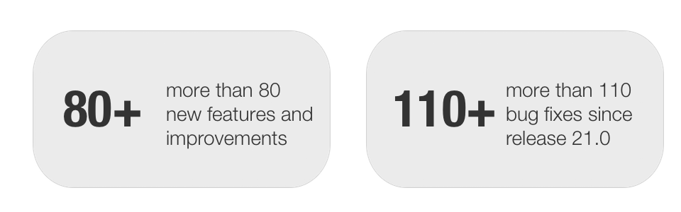

Since release 21.0, around 80 new features and improvements have been added to OpenOlat; the most important ones are summarized here. In addition, more than 110 bugs have been fixed. You can find the complete list of changes in 21.0.x [here](Release_notes_21.0.md){:target="_blank"}.

* * *

## Booking forms in the Course Planner
<!-- karte: Collect additional information when booking. -->

Until now, the booking process only asked for the information required for the booking, such as the billing address. Now additional information can be collected when an offer is booked, for example personal details or meal preferences for a course day with catering.

For this purpose, one or more **[Booking order forms](https://docs.openolat.org/en/manual_user/area_modules/Course_Planner_Implementations/#booking_order_forms){:target="_blank"}** are assigned to an offer of an implementation.

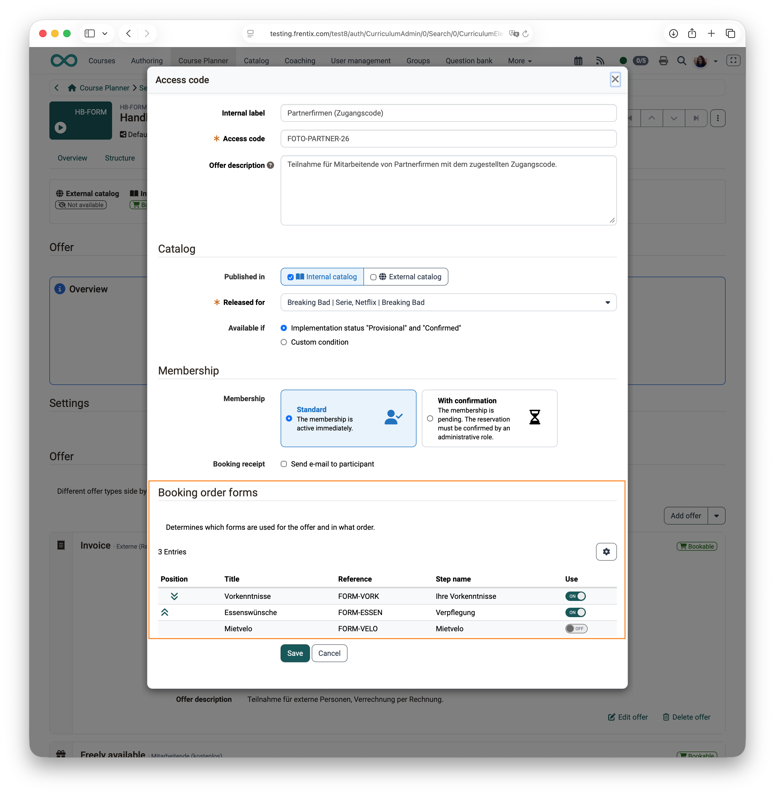{ class="shadow lightbox" title="Booking order forms in an offer" }

A [wizard](https://docs.openolat.org/en/manual_user/area_modules/catalog2.0_angebote/#offer_booking_wizard){:target="_blank"} guides step by step through the forms, and the booking is only completed when all of them are filled in. This also applies when course planners add participants or line managers book on someone else's behalf.

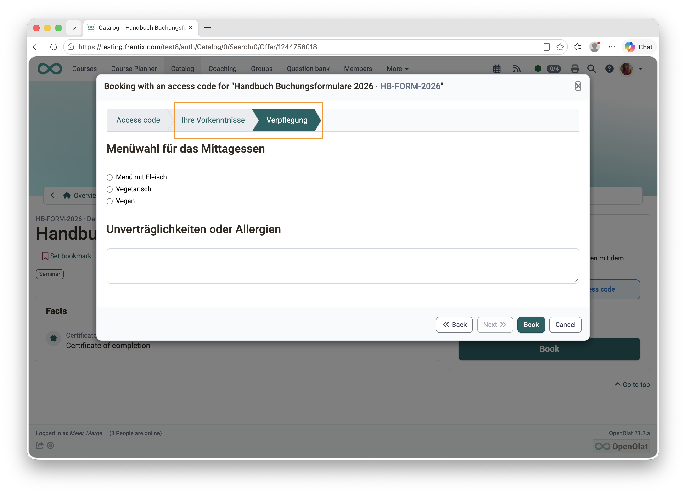{ class="shadow lightbox" title="Booking wizard with form step" }

The answers can be viewed in the booking order and exported as an Excel file.

Also new is the setting **[Booking](https://docs.openolat.org/en/manual_user/area_modules/Course_Planner_Implementations/#tab_catalog_settings){:target="_blank"}** on the offer: with «Requires booking order», participants can only be added in the Course Planner via an offer; with «Allowed without booking order», adding them directly remains possible as well.

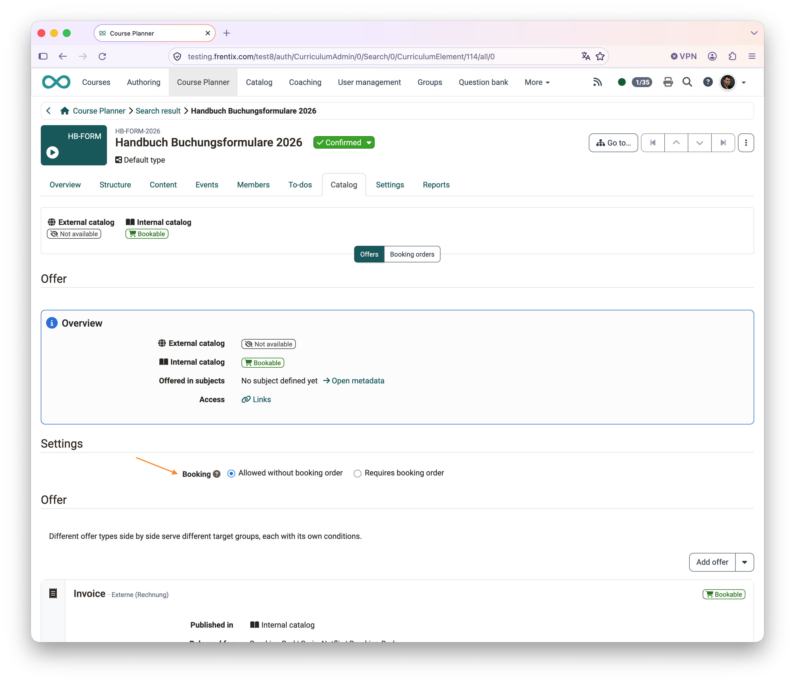{ class="shadow lightbox" title="Booking settings" }

* * *

## New Info page
<!-- karte: Redesigned, as a flyer with QR code. -->

The **Info page** of courses and implementations has been redesigned. Previously, its structure and presentation looked outdated, especially when printed. Now a two-column layout arranges the content in clear boxes. The **«Facts»** box shows the most important key data at a glance, such as period, location, language and workload. **«Get started»** contains the booking information, and members see their learning progress, their assessment and their groups under **«My course»**. On small screens, all content is shown in one column.

{ class="shadow lightbox" title="Info page of an implementation" }

With the action **[«Download as PDF»](https://docs.openolat.org/en/manual_user/learningresources/General_Functions_Infopage/#print){:target="_blank"}**, the Info page becomes a flyer with logo, event overview and a QR code that leads directly to the offer. This helps, for example, employees who need the approval of their supervisor for a course booking and present a printed course announcement for this purpose. Bookmark and Share are available as further actions in the page header.

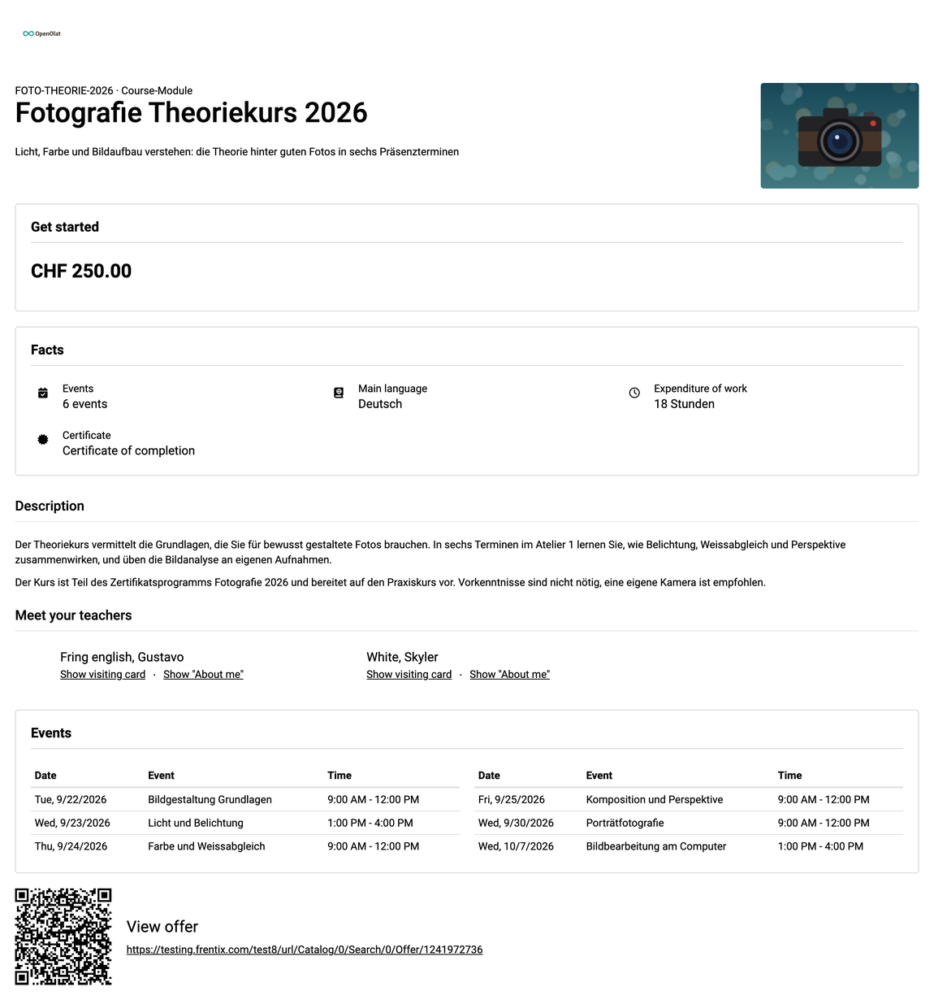{ class="shadow lightbox" title="PDF flyer of an Info page" }

Which information appears is defined uniformly for courses and implementations under **[«Display on info page»](https://docs.openolat.org/en/manual_user/learningresources/Course_Settings_Info/#display_settings){:target="_blank"}**, with default values from the Administration and a bulk action for existing courses.

The name «Info page» now applies everywhere in the system. The technical information of a course has moved from the Info page to the new menu item **[«About this course»](https://docs.openolat.org/en/manual_user/learningresources/Technical_Information_on_Resources_and_Usage/#open){:target="_blank"}** in the administration menu and thus remains reserved for persons with an administrative role.

* * *

## Recording of Teams online meetings
<!-- karte: Record and provide Teams meetings. -->

Until now, online meetings with Microsoft Teams could not be recorded from within OpenOlat. Recordings remained in the OneDrive of the organizer, were not visible in OpenOlat and expired there after a short time. With the new **[Meeting recording](https://docs.openolat.org/en/manual_user/learningresources/Course_Element_Microsoft_Teams/#meeting_recording){:target="_blank"}**, recording is switched on directly in the online meeting, optionally with an automatic start at the beginning of the online meeting.

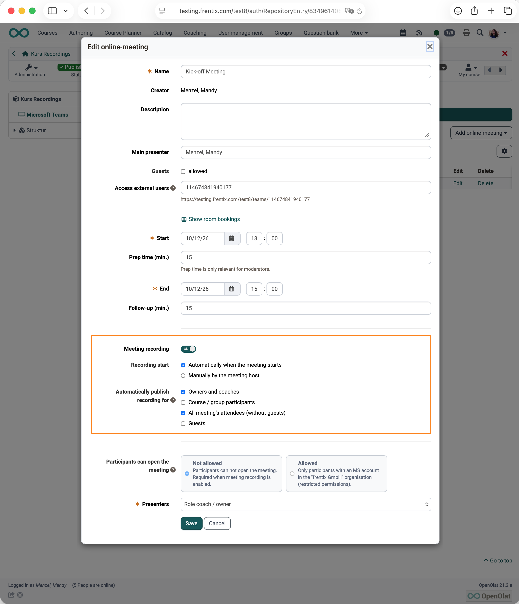{ class="shadow lightbox" title="Setting of the Teams recording in the online meeting" }

After the online meeting, OpenOlat automatically fetches the finished recording and provides it for playback in the online meeting. For each recording, you define who it is published for, with the same target groups as in BigBlueButton: owners and coaches, participants of the course or group, all participants of the online meeting, or guests. An **automatic deletion** after a defined number of days keeps the storage lean; valuable recordings, for example of lectures, can be exempted from it.

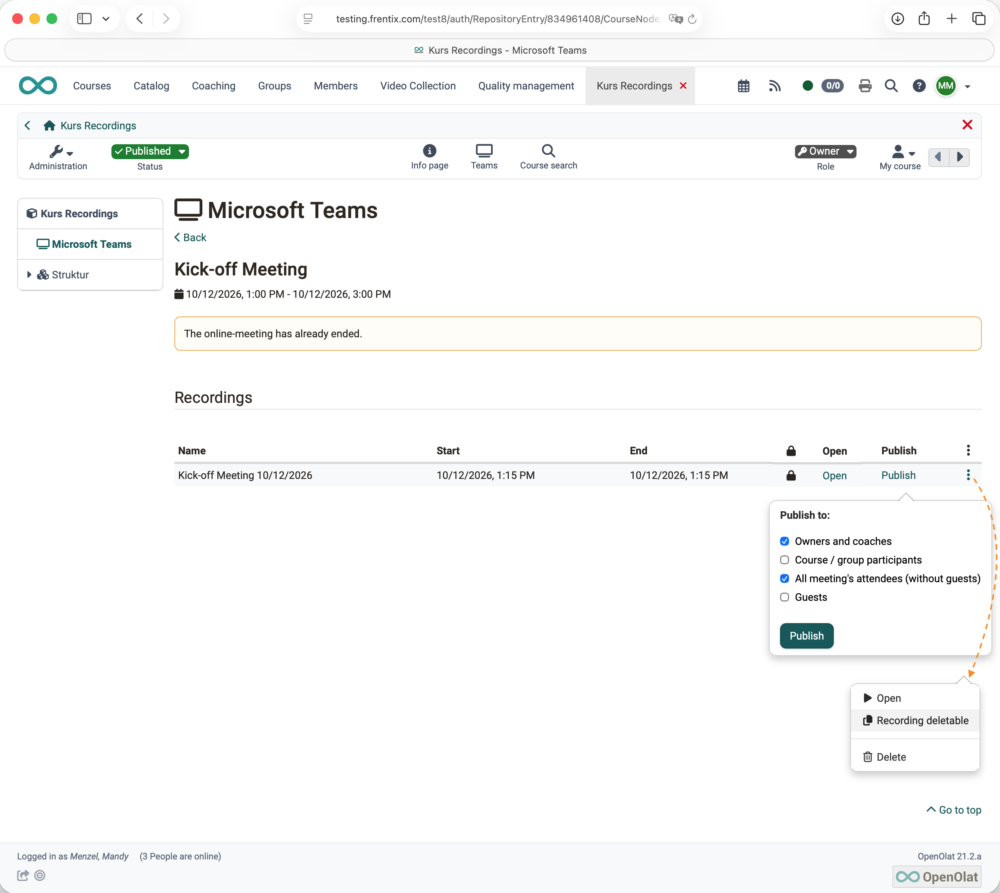{ class="shadow lightbox" title="Recording with publishing options" }

The default values for recording, start and publishing are defined in the Administration in the Microsoft Teams module. Also new there is the option to **switch off** **[online meetings without date (permanent reservations)](https://docs.openolat.org/en/manual_admin/administration/Teams_module/#permanent_meetings){:target="_blank"}** for the whole instance. Then every new online meeting needs a date.

* * *

## AI settings: Control over automatic AI features
<!-- karte: Decide on automatic AI yourself. -->

Until now, two AI features worked with the content of persons without asking: when an image is uploaded, the AI generates metadata such as title and alternative text, and free-text answers to essay questions in a quiz of the Content Editor receive an **AI correction**. In line with the transparency required by the EU AI Act, this can now be controlled.

The Administration defines a **Default for users** for each AI feature. Each person can adopt it in the personal settings under **«AI settings»** or change it for themselves. Before the first AI correction in a quiz, a dialog asks for consent. When importing into the Content Editor, a switch shows whether image metadata is generated with AI, and it can be changed for the individual import. Existing installations behave as before until someone changes a setting.

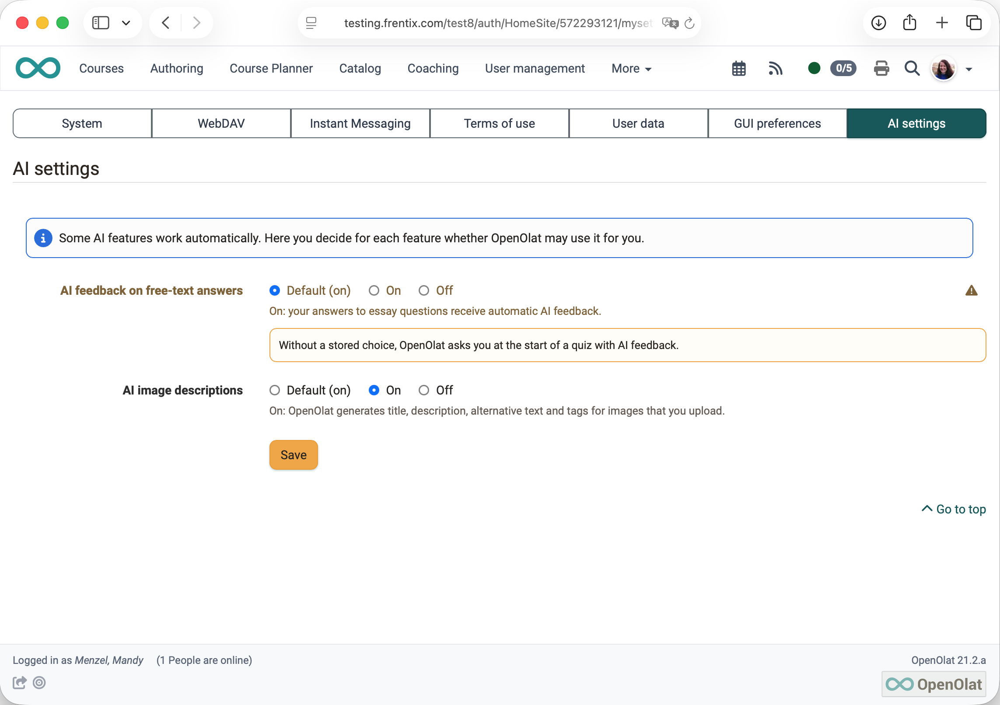{ class="shadow lightbox" title="Personal AI settings" }

* * *

## Course Planner

### Customer number
<!-- karte: Assign bookings directly to the customer account. -->

Organisations that invoice courses need the customer number of the paying party for their accounting. Until now, there was no place for it in OpenOlat, and the number had to be looked up manually in the accounting system for every booking. Now a **[customer number](https://docs.openolat.org/en/manual_admin/administration/Modules_Organisations/#customer_number){:target="_blank"}** can be stored on user accounts, organisations and billing addresses of organisations. The Course Planner shows it for users and for bookings with a billing address, and the booking report lists it in separate columns. This way, bookings can be assigned directly to the correct customer number. The field is optional and is switched on in the Administration.

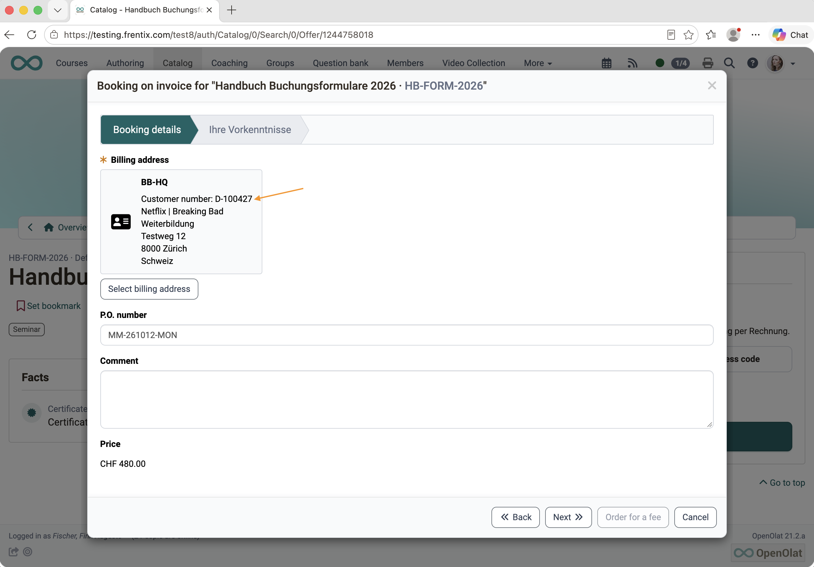{ class="shadow lightbox" title="Booking with billing address and customer number" }

### Summary mail for to-dos

Until now, when an implementation was copied, OpenOlat sent a separate mail for every copied to-do, so 20 mails for 20 to-dos. Now each person receives a single **[summary mail](https://docs.openolat.org/en/manual_user/basic_concepts/To_Dos_Basics/#notifications){:target="_blank"}** with all to-dos assigned to them and the matching links. This also applies when to-dos are created for several elements at once.

### Further improvements

* **[Participant comment](https://docs.openolat.org/en/manual_user/area_modules/Course_Planner_Implementations/#tab_members){:target="_blank"}:** The members table shows comments from the booking directly with a note icon, without each person having to be opened individually.
* **Copy events:** Copies take over all details such as location, online meeting, room, teachers and topics. Single and bulk actions behave the same.
* **[Events and absences](https://docs.openolat.org/en/manual_user/learningresources/Course_Settings_Execution/#lecture_enabled){:target="_blank"}:** If an event for a course is created or assigned in the Course Planner, OpenOlat automatically switches the function on in the course.

* * *

## Courses and learning resources

### Edit mode for assessable course elements

If the assessment rules of a course element change, OpenOlat recalculates the assessments of all participants on publishing. Until now, this was not apparent in every course element. Now the affected settings are **read-only** as soon as assessments exist. Only the action **«Enable edit mode»** unlocks them, and a notice makes clear that the recalculation cannot be undone. This prevents accidental changes to ongoing assessments.

The protection applies to the course elements Test, Assessment, Task, Group task, Video task, Portfolio task, Check list, Structure and SCORM. The assessment settings of these course elements are uniformly structured under «Assessment configuration».

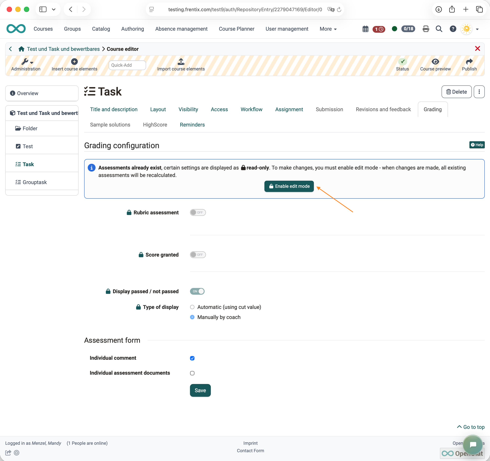{ class="shadow lightbox" title="Read-only assessment settings in the Task course element" }

### Info messages: recipient groups

In the course element **[Info messages](https://docs.openolat.org/en/manual_user/learningresources/Course_Element_Notifications/#create_notification){:target="_blank"}**, the recipients could not previously be distinguished by course and groups. Now owners, coaches and participants are selected separately; in courses with groups or Course Planner elements, it is also possible to select only the persons in the course or the members of a specific group or a specific element. This way, an announcement reaches exactly the persons it is intended for.

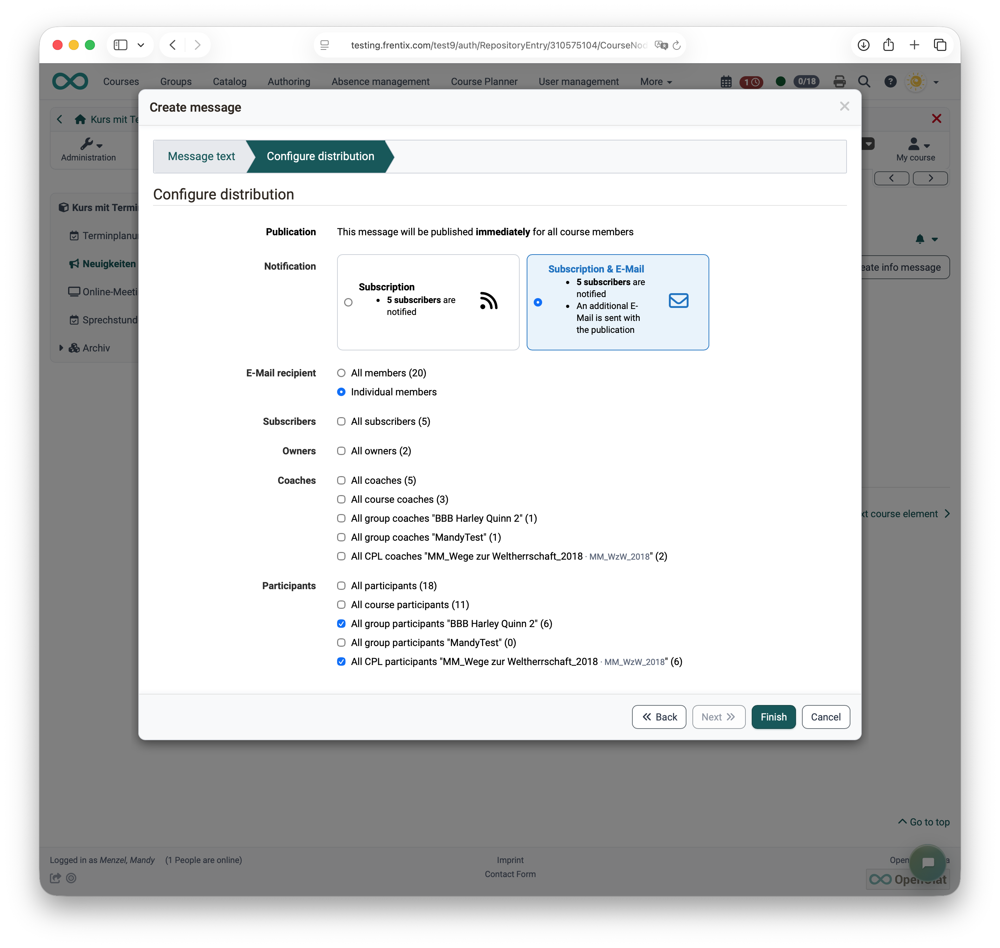{ class="shadow lightbox" title="Info message with selection of recipients from course, groups and implementation" }

### Further improvements

* **Execution period «One-day»:** One-day courses and implementations only need one date and still work with automations. «Anytime» replaces the previous option «None».
* **[Learning resource settings](https://docs.openolat.org/en/manual_user/learningresources/Course_Settings/#metadata){:target="_blank"}:** The «Metadata» tab is now in first position and opens directly after creating or importing.
* **[Authoring](https://docs.openolat.org/en/manual_user/area_modules/Authoring/#action_columns){:target="_blank"}:** Actions are named uniformly, the matching editor can be reached directly, and further quick actions can be shown in the table.
* **Usage «Embedding»:** replaces «Embedding in course», because forms are also embedded in quality management and in the Course Planner.
* **Info messages and Blog:** The course element Info messages has the same name everywhere and its own icon, as does the Blog.
* **Video quiz:** Clearer options and buttons. After a wrong answer, «Watch again», «Try again» or «Skip» lead onward.
* **Release for OER catalogs:** now only takes place in the course settings. The separate action in Authoring is no longer available.
* **[Course archive](https://docs.openolat.org/en/manual_user/learningresources/Course_Archiving/#memberships){:target="_blank"}:** The new Excel export «Memberships» shows for each role in which groups and Course Planner elements persons hold that role (:octicons-tag-24: Release 21.1.1)
* **[Export information](https://docs.openolat.org/en/manual_user/learningresources/Test_export/#export_information){:target="_blank"}:** The export of results from Task, Group task and Test contains an additional sheet with course, course element, time and exporting person (:octicons-tag-24: Release 21.1.1)

* * *

## e-Assessment and testing

### Adjusted points visible in the test

A faulty question can no longer be removed after a test has been taken. However, additional points or the full score can be awarded to all participants afterwards. Until now, this change of points was not apparent in the results export and in the test statistics, so that the given answer and the points achieved seemingly did not match.

Now OpenOlat marks such questions with the status **[«Adjusted»](https://docs.openolat.org/en/manual_user/learningresources/Assessing_tests/#adjust_score){:target="_blank"}** and shows automatic, adjusted and manual points separately. Predefined filters in the detail view of a test run and in the correction tool lead directly to the questions that are to be corrected, to be reviewed or adjusted. The test statistics show the number of adjustments and the average adjustment, and the results export contains separate columns for them.

From :octicons-tag-24: Release 21.1.1 onward, a **[comment](https://docs.openolat.org/en/manual_user/learningresources/Assessing_tests/#score_all_participants){:target="_blank"}** for participants can be entered directly when adjusting points, also in the bulk actions «Set score for all participants» and «Add points to participants score». OpenOlat appends it to the existing comment. Clear statuses such as «Adjusted manually» or «No answer» show in the detail view how a question was assessed.

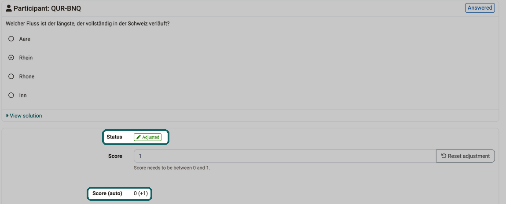{ class="shadow lightbox" title="Correction of a question with score adjustment" }

{ class="shadow lightbox" title="Test overview in the correction tool with automatically and manually awarded as well as adjusted points" }

### Export of test results

Until now, when all test results were exported, the PDF files only had a number as their name. Now the file name contains last name, first name, course element, test and test run. By default, the PDFs are still stored in subfolders per person; the additional option **[«All PDF files in one folder»](https://docs.openolat.org/en/manual_user/learningresources/Test_export/#pdf_files){:target="_blank"}** stores them together. This saves renaming and gathering files when the results have to be passed on quickly.

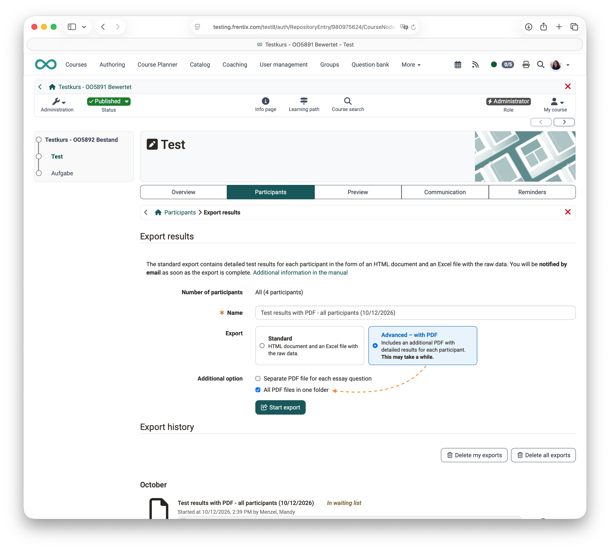{ class="shadow lightbox" title="Export option - All PDF files in one folder" }

{ class="shadow lightbox" title="Exported PDF results in one folder with descriptive file names" }

### Further improvements

* **Gap FIB text:**
    * When a gap is copied, OpenOlat takes over all settings, including variants, length and case sensitivity.
    * Help text for the «Wildcard (*)» option, a default value for numerical gaps and a stable order of answers with the same score (:octicons-tag-24: Release 21.1.1)
* **Default rating system:** can be defined in the Administration of Levels/Grading and is preselected the first time the rating scale is edited.
* **Levels/Grading:** Uniform terms such as «Rating system», «Rating scale», «Highest rating» and «With success status».

* * *

## UX, Usability

* **Accessible menus:** Pop-up menus in around 240 places announce themselves to screen readers, open with the space bar and return the focus after closing.
* **Search:** Search fields have a uniform design and can be cleared with «Reset search».
* **Share:** One action combines «Copy link», «Show QR code» and sending by email.
* **Course Planner:** The header area of the elements adapts to small screens.
* **Question type Order:** Neutral instruction texts fit every arrangement and use of the question.
* **Form editor:** Like the other editors, it shows yellow hatching as an indicator of editing.

* * *

## Other, in brief

* **Coaching:**
    * Line managers, education managers and relation roles see the credit points of the persons they coach in a separate tab, read-only.
    * The course list offers the «Implementation format» filter and an optional column of the same name (:octicons-tag-24: Release 21.1.1)
* **[Account expiration and user lifecycle](https://docs.openolat.org/en/manual_admin/administration/Life_cycles_-_Administration/#lifecycle_accounts_variants){:target="_blank"}:** Administration and user management clearly separate the two processes. The new column «Days until expiry» shows when an account expires.
* **[Certificates](https://docs.openolat.org/en/manual_user/area_modules/Course_Planner_Certification_Programs/#certificate_status){:target="_blank"}:** OpenOlat creates certificates reliably in the background, even after a restart, and automatically repeats failed attempts. Until then, the certificate shows the status «Pending».
* **Languages:** Polish and Spanish are fully translated, all other shipped languages are at the level of 21.1.
* **Language adaptation tool:** The language can be switched directly while editing a text, without returning to the start.
* **Web catalog:** Search engines and social media previews now show the teaser image of implementations as well as the price, dates and taxonomy of offers (:octicons-tag-24: Release 21.1.1)

* * *

## Administrative / Technical

* **Landing page:** New installations and installations without their own rules receive role-based default rules for course planners, authors, coaches and all other users. Existing rules remain unchanged.
* **[LTI 1.3](https://docs.openolat.org/en/manual_user/learningresources/LTI_Share_courses/#deployment_id_several_courses){:target="_blank"}:** OpenOlat as a tool accepts the same deployment ID of a platform for several courses and groups. An additional tool as a workaround is no longer needed.
* **REST API, audit log:** Log of every writing and rejected call, including the transmitted data with masked passwords, also available as an Excel export.
* **REST API, rate limits:** Limits the requests per user and minute as well as the parallel requests. Rejected requests receive the HTTP status 429 and appear in the audit log.
* **REST API, rooms of events (Breaking Change):** `.../lectureblocks/{key}/room` returns and expects all room bookings of an event as an array instead of an object; without a booking, `GET` responds with `200` and an empty array instead of `204`. The new endpoint `GET /rm/bookings?lectureBlockKeys=` returns the bookings for up to 500 events in one request.
* **SSRF Mitigation:** Entered URLs, for example of calendars or feeds, may no longer point to local or internal addresses. Active for new installations, opt-in for existing ones.
* **[User properties](https://docs.openolat.org/en/manual_admin/administration/Customizing/#user_properties){:target="_blank"}:**
    * «Reset» only offers «Default» and «Minimal», calculated from the system configuration. New installations and «Default» switch off Skype, XING, LinkedIn and ICQ (:octicons-tag-24: Release 21.1.1)
    * Deactivated properties keep their contexts. The «Contexts» column shows their number, and a filter and «Add context» make assignment easier (:octicons-tag-24: Release 21.1.1)
* **Login:** «Resume last session» is now set to «No» for persons without their own choice, and the landing page opens after login without a prompt (:octicons-tag-24: Release 21.1.1)
* **Public pages without session:** Sitemaps and error pages no longer create a session, and the imprint has a fixed URL for search engines (:octicons-tag-24: Release 21.1.1)
* **Reply-to address of system mails:** The new property `adminemailname` defines a display name for the reply-to address (:octicons-tag-24: Release 21.1.1)
* Update of third-party libraries

* * *

## System administrators: Activate / configure new features

!!! note "Checklist after updating to 21.1"

    The following features have to be activated or configured in the `Administration` after an update to Release 21.1:

    * [x] Check the rules of the landing page: `Core functions > Landing page`
    * [x] Configure the audit log and the rate limits of the REST API, the limit applies per cluster node: `Core functions > REST API` (`restapi.auditlog.*`, `restapi.ratelimit.*`)
    * [x] Switch on SSRF Mitigation: `Login > Security` (`http.ssrf.protection.enabled`, allowed targets: `http.ssrf.allowed.addresses`, `http.ssrf.allowed.hosts`)
    * [x] [Check the user properties; Skype, XING, LinkedIn and ICQ are switched off by default](https://docs.openolat.org/en/manual_admin/administration/Customizing/#user_properties_social_media){:target="_blank"}: `Customizing > User Properties` (`user.properties.deactivated.default`) (:octicons-tag-24: Release 21.1.1)
    * [x] [Activate the customer number](https://docs.openolat.org/en/manual_admin/administration/Modules_Organisations/#customer_number){:target="_blank"}: `Modules > Organisations`
    * [x] Grant the right «View credit points», for line managers and education managers: `Modules > Organisations`, for roles user to user: `Modules > Role user to user`
    * [x] [Set the default values of the display settings for the Info page](https://docs.openolat.org/en/manual_admin/administration/Modules_Course_Planner/#default_settings){:target="_blank"}: `Modules > Course Planner > Settings` and `Modules > Course`
    * [x] Check the default value for the execution period of new courses: `Modules > Course`
    * [x] Mark the default rating system: `e-Assessment > Levels/Grading`
    * [x] Define the Default for users per AI feature: `External tools > AI module > AI features`. In the fxCloud, frentix configures the AI module; frentix customers contact frentix support.
    * [x] [Switch on meeting recording for Microsoft Teams and set default values](https://docs.openolat.org/en/manual_admin/administration/Teams_module/#meeting_recording){:target="_blank"}: `External tools > Microsoft Teams`
    * [x] [Switch off online meetings without date (permanent reservations) if needed](https://docs.openolat.org/en/manual_admin/administration/Teams_module/#permanent_meetings){:target="_blank"}: `External tools > Microsoft Teams`
    * [x] [Check the settings for account expiration and automatic user lifecycle](https://docs.openolat.org/en/manual_admin/administration/Life_cycles_-_Administration/#lifecycle_accounts_variants){:target="_blank"}: `Life cycles > Account`
    * [x] [Adjust the creation of certificates in the background if needed](https://docs.openolat.org/en/manual_admin/administration/e-Assessment_Certificates/#tab_config){:target="_blank"}: `olat.properties` (`certificate.generation.*`)
    * [x] Adjust the default value for «Resume last session» if needed, previously «Yes, on request»: `olat.properties` (`history.resume.enabled.default=ondemand`) (:octicons-tag-24: Release 21.1.1)
    * [x] Define the display name of the reply-to address if needed: `olat.properties` (`adminemailname`) (:octicons-tag-24: Release 21.1.1)

* * *

## Further information

* [YouTrack Release notes 21.1.1](https://track.frentix.com/releaseNotes/OO?q=fix%20version:%2021.1.1&title=Release%20Notes%2021.1.1){:target="_blank"}
* [YouTrack Release notes 21.1.0](https://track.frentix.com/releaseNotes/OO?q=fix%20version:%2021.1.0&title=Release%20Notes%2021.1.0){:target="_blank"}
